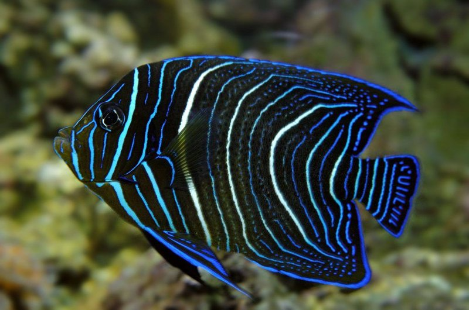

# Pez ángel emperador — *Pomacanthus imperator* (Bloch, 1787)

> Archivo generado desde `especies/datos/catalogo_inicial.json` con `especies/herramientas/generar_fichas.py`. No editar a mano.

*Imagen ilustrativa generada con IA por Brayan (2026-11-18). No es una fotografía de un ejemplar real; puede contener errores anatómicos.*

**Grupo:** pez  
**Otros nombres:** Emperor angelfish, Imperator angelfish  
**Fecha de consulta:** 2026-11-18  
**Confianza global:** media  
**Estado:** verificada; pendiente de revisión del equipo

## Ficha AIRI

| Campo | Valor |
|---|---|
| Nombre común | Pez ángel emperador |
| Nombre científico | *Pomacanthus imperator* |
| Temperamento | Semiagresivo |
| Comportamiento | . Semiagresivo. El juvenil tiene anillos azules y blancos; el adulto, rayas amarillas. Pica corales y almejas. |
| Adecuado para arrecife | Con precaución. LiveAquaria advierte que pica corales duros y blandos y almejas, aunque puede convivir con corales SPS y algunos corales blandos nocivos. |
| Tipo de alimentación | Omnívoro: esponjas y organismos incrustantes, algas, preparados para peces ángel, mysis. |
| Temperatura | 22.2–25.6 °C |
| Litraje recomendado | 832.7 L (220 gal EE. UU.). *Es el mínimo recomendado por una sola fuente comercial; ninguna fuente científica consultada establece un litraje.* |
| Tamaño adulto | 40 cm (longitud estándar). Madura desde 25 cm. *Diferencia menor entre fuentes: FishBase 40 cm (longitud estándar); LiveAquaria 15 in (≈ 38.1 cm).* |

## Detalle verificado

| Campo | Dato | Confianza | Fuentes |
|---|---|---|---|
| Clasificación taxonómica | Clase Teleostei; orden Chaetodontiformes; familia Pomacanthidae. WoRMS AphiaID 220001 (aceptado). Sinónimos: Chaetodon imperator Bloch, 1787 (combinación original), Acanthochaetodon imperator (Bloch, 1787). La foto muestra un juvenil, que es negro con anillos blancos y azules; el adulto es azul con rayas amarillas (LiveAquaria). | alta | [worms_pomacanthus_imperator](https://www.marinespecies.org/aphia.php?p=taxdetails&id=220001), [fishbase_pomacanthus_imperator](https://www.fishbase.se/summary/Pomacanthus-imperator.html) |
| Hábitat natural | Los juveniles viven bajo cornisas o en agujeros de arrecifes de laguna; los adultos, en cornisas y cuevas con abundante coral (FishBase). Profundidad: 1–100 m. Distribución: Indo-Pacífico: del mar Rojo y África oriental a las islas de la Línea y Tuamotu; al norte hasta el sur de Japón y Ogasawara; al sur hasta la Gran Barrera, Nueva Caledonia y las Australes. | alta | [fishbase_pomacanthus_imperator](https://www.fishbase.se/summary/Pomacanthus-imperator.html) |
| Tamaño adulto | Máx. 40 cm (longitud estándar). Diferencia menor entre fuentes: FishBase 40 cm (longitud estándar); LiveAquaria 15 in (≈ 38.1 cm). | media | [fishbase_pomacanthus_imperator](https://www.fishbase.se/summary/Pomacanthus-imperator.html), [liveaquaria_pomacanthus_imperator](https://www.liveaquaria.com/products/emperor-angelfish) |
| Alimentación | Come esponjas y otros organismos incrustantes, y también tunicados (FishBase). En acuario: espirulina, algas, preparados para peces ángel, mysis y otros alimentos cárneos (LiveAquaria). | alta | [fishbase_pomacanthus_imperator](https://www.fishbase.se/summary/Pomacanthus-imperator.html), [liveaquaria_pomacanthus_imperator](https://www.liveaquaria.com/products/emperor-angelfish) |
| Temperatura del agua | Acuario: 22.2–25.6 °C (72–78 °F). FishBase no indica rango de temperatura para esta especie. | baja | [liveaquaria_pomacanthus_imperator](https://www.liveaquaria.com/products/emperor-angelfish) |
| Rango de pH | Fuente de acuario: 8.1–8.4. Rango prudente AIRI: 8.1–8.3. Criterio: Intersección con la tabla MSD para agua salada (7.8–8.3). | media | [liveaquaria_pomacanthus_imperator](https://www.liveaquaria.com/products/emperor-angelfish), [msd_tabla_referencia](https://www.msdvetmanual.com/multimedia/table/normal-reference-ranges-for-routine-water-quality-analysis), [msd_capitulo](https://www.msdvetmanual.com/exotic-and-laboratory-animals/aquatic-systems/environmental-diseases-of-aquatic-animals-in-aquatic-systems) |
| Salinidad | 1.020–1.025 de gravedad específica (adimensional). Agua de mar media: 35 ppt (UF/IFAS). No se convierte a ppt porque la equivalencia depende de la temperatura. | media | [liveaquaria_pomacanthus_imperator](https://www.liveaquaria.com/products/emperor-angelfish), [ufifas_ph_sal_temp](https://waterwatch.ifas.ufl.edu/media/waterwatchifasufledu/FactSheet_pH_Sal_Temp.pdf) |
| Volumen mínimo | 832.7 L (220 gal EE. UU.). Justificación: Cifra de LiveAquaria (220 gal), con roca abundante y cuevas profundas. | baja | [liveaquaria_pomacanthus_imperator](https://www.liveaquaria.com/products/emperor-angelfish) |
| Comportamiento | Forma parejas; jóvenes y adultos pueden limpiar a peces mucho mayores (FishBase). Necesita mucha roca y cuevas profundas para sentirse seguro (LiveAquaria). | media | [fishbase_pomacanthus_imperator](https://www.fishbase.se/summary/Pomacanthus-imperator.html), [liveaquaria_pomacanthus_imperator](https://www.liveaquaria.com/products/emperor-angelfish) |
| Territorialidad y refugio | Necesita roca abundante y cuevas profundas (LiveAquaria). | media | [liveaquaria_pomacanthus_imperator](https://www.liveaquaria.com/products/emperor-angelfish) |
| Compatibilidad con arrecife | con precaución (según la fuente; sin verificación independiente) | baja | [liveaquaria_pomacanthus_imperator](https://www.liveaquaria.com/products/emperor-angelfish) |
| Convivencia: condiciones | Acuario de 220 gal o más. · Roca abundante y cuevas profundas. | baja | [liveaquaria_pomacanthus_imperator](https://www.liveaquaria.com/products/emperor-angelfish) |
| Convivencia: riesgos | Pica corales y almejas. | baja | [liveaquaria_pomacanthus_imperator](https://www.liveaquaria.com/products/emperor-angelfish) |
| Conservación | Preocupación menor (LC), evaluada el 08/10/2009, según FishBase. | media | [fishbase_pomacanthus_imperator](https://www.fishbase.se/summary/Pomacanthus-imperator.html) |

**Regla AIRI:** compartir rangos de agua no implica compatibilidad entre especies. Los rangos de acuario provienen de una fuente comercial y no son límites veterinarios.

## Fuentes

- **worms_pomacanthus_imperator** (taxonomía): WoRMS — Pomacanthus imperator (Bloch, 1787) (AphiaID 220001). <https://www.marinespecies.org/aphia.php?p=taxdetails&id=220001>. Consultada el 2026-11-18.
- **fishbase_pomacanthus_imperator** (biología): FishBase — Pomacanthus imperator. <https://www.fishbase.se/summary/Pomacanthus-imperator.html>. Consultada el 2026-11-18.
- **liveaquaria_pomacanthus_imperator** (comercial): LiveAquaria — Emperor Angelfish (Pomacanthus imperator). <https://www.liveaquaria.com/products/emperor-angelfish>. Consultada el 2026-11-18.
- **msd_tabla_referencia** (veterinaria): MSD Veterinary Manual — “Normal” Reference Ranges for Routine Water Quality Analysis. <https://www.msdvetmanual.com/multimedia/table/normal-reference-ranges-for-routine-water-quality-analysis>. Consultada el 2026-11-12. Reutilizada del registro del motor (motor/airi_motor/datos/fuentes.json); no se volvió a consultar para estas fichas.
- **ufifas_ph_sal_temp** (institucional): UF/IFAS — pH, Salinity and Temperature (hoja informativa). <https://waterwatch.ifas.ufl.edu/media/waterwatchifasufledu/FactSheet_pH_Sal_Temp.pdf>. Consultada el 2026-11-12. Reutilizada del registro del motor (motor/airi_motor/datos/fuentes.json); no se volvió a consultar para estas fichas.
- **msd_capitulo** (veterinaria): MSD Veterinary Manual — Environmental Diseases of Aquatic Animals in Aquatic Systems. <https://www.msdvetmanual.com/exotic-and-laboratory-animals/aquatic-systems/environmental-diseases-of-aquatic-animals-in-aquatic-systems>. Consultada el 2026-11-12. Reutilizada del registro del motor (motor/airi_motor/datos/fuentes.json); no se volvió a consultar para estas fichas.
