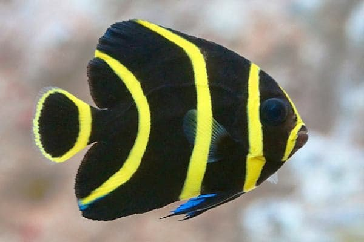

# Pez ángel francés — *Pomacanthus paru* (Bloch, 1787)

> Archivo generado desde `especies/datos/catalogo_inicial.json` con `especies/herramientas/generar_fichas.py`. No editar a mano.

*Imagen ilustrativa generada con IA por Brayan (2026-11-18). No es una fotografía de un ejemplar real; puede contener errores anatómicos.*

**Grupo:** pez  
**Otros nombres:** French angelfish, Gallineta negra  
**Fecha de consulta:** 2026-11-18  
**Confianza global:** media  
**Estado:** verificada; pendiente de revisión del equipo

## Ficha AIRI

| Campo | Valor |
|---|---|
| Nombre común | Pez ángel francés |
| Nombre científico | *Pomacanthus paru* |
| Temperamento | Semiagresivo |
| Comportamiento | Territorial. Semiagresivo y dominante; necesita un acuario muy grande. Pica corales y almejas. Los juveniles limpian a otros peces. |
| Adecuado para arrecife | No. LiveAquaria lo desaconseja: pica corales blandos y duros y el manto de las almejas. |
| Tipo de alimentación | Omnívoro: esponjas, algas, gorgonias y tunicados, preparados para peces ángel con esponja, mysis o camarón congelado. |
| Temperatura | 22.2–25.6 °C |
| Litraje recomendado | 946.2 L (250 gal EE. UU.). *Es el mínimo recomendado por una sola fuente comercial; ninguna fuente científica consultada establece un litraje.* |
| Tamaño adulto | 41.1 cm (longitud total). Al venderse mide 1.9–24.1 cm (juvenil o subadulto). Madura desde 23.3 cm. *Diferencia menor entre fuentes: FishBase 41.1 cm; LiveAquaria 15 in (≈ 38.1 cm).* |

## Detalle verificado

| Campo | Dato | Confianza | Fuentes |
|---|---|---|---|
| Clasificación taxonómica | Clase Teleostei; orden Chaetodontiformes; familia Pomacanthidae. WoRMS AphiaID 276025 (aceptado). Sinónimos: Chaetodon paru Bloch, 1787 (combinación original), Chaetodon aureus Bloch, 1787, Pomacanthus aureus. | alta | [worms_pomacanthus_paru](https://www.marinespecies.org/aphia.php?p=taxdetails&id=276025), [fishbase_pomacanthus_paru](https://www.fishbase.se/summary/Pomacanthus-paru.html) |
| Hábitat natural | Arrecifes someros; los adultos suelen ir en pareja, a menudo cerca de gorgonias (FishBase). Profundidad: 3–100 m. Distribución: Atlántico occidental: de Florida y las Bahamas a Brasil, incluidos el golfo de México y el Caribe; Atlántico oriental: isla Ascensión y peñascos de San Pedro y San Pablo. | alta | [fishbase_pomacanthus_paru](https://www.fishbase.se/summary/Pomacanthus-paru.html) |
| Tamaño adulto | Máx. 41.1 cm (longitud total). Diferencia menor entre fuentes: FishBase 41.1 cm; LiveAquaria 15 in (≈ 38.1 cm). | media | [fishbase_pomacanthus_paru](https://www.fishbase.se/summary/Pomacanthus-paru.html), [liveaquaria_pomacanthus_paru](https://www.liveaquaria.com/products/french-angelfish-1) |
| Alimentación | Omnívoro: come esponjas, algas, briozoos, zoantarios, gorgonias y tunicados (FishBase). En acuario: espirulina, algas marinas, preparados para peces ángel con esponja y mysis o camarón congelado, al menos tres veces al día (LiveAquaria). | alta | [fishbase_pomacanthus_paru](https://www.fishbase.se/summary/Pomacanthus-paru.html), [liveaquaria_pomacanthus_paru](https://www.liveaquaria.com/products/french-angelfish-1) |
| Temperatura del agua | Acuario: 22.2–25.6 °C (72–78 °F). FishBase no indica rango de temperatura para esta especie. | baja | [liveaquaria_pomacanthus_paru](https://www.liveaquaria.com/products/french-angelfish-1) |
| Rango de pH | Fuente de acuario: 8.1–8.4. Rango prudente AIRI: 8.1–8.3. Criterio: Intersección con la tabla MSD para agua salada (7.8–8.3). | media | [liveaquaria_pomacanthus_paru](https://www.liveaquaria.com/products/french-angelfish-1), [msd_tabla_referencia](https://www.msdvetmanual.com/multimedia/table/normal-reference-ranges-for-routine-water-quality-analysis), [msd_capitulo](https://www.msdvetmanual.com/exotic-and-laboratory-animals/aquatic-systems/environmental-diseases-of-aquatic-animals-in-aquatic-systems) |
| Salinidad | 1.020–1.025 de gravedad específica (adimensional). Agua de mar media: 35 ppt (UF/IFAS). No se convierte a ppt porque la equivalencia depende de la temperatura. | media | [liveaquaria_pomacanthus_paru](https://www.liveaquaria.com/products/french-angelfish-1), [ufifas_ph_sal_temp](https://waterwatch.ifas.ufl.edu/media/waterwatchifasufledu/FactSheet_pH_Sal_Temp.pdf) |
| Volumen mínimo | 946.2 L (250 gal EE. UU.). Justificación: Cifra de LiveAquaria (250 gal), con abundante roca viva para esconderse y pastar. | baja | [liveaquaria_pomacanthus_paru](https://www.liveaquaria.com/products/french-angelfish-1) |
| Comportamiento | Los adultos suelen ir en pareja; son monógamos y las parejas reproductoras defienden con fuerza su territorio. Los juveniles atienden estaciones de limpieza para otros peces (FishBase). En acuario tiende a dominar a sus compañeros (LiveAquaria). | media | [fishbase_pomacanthus_paru](https://www.fishbase.se/summary/Pomacanthus-paru.html), [liveaquaria_pomacanthus_paru](https://www.liveaquaria.com/products/french-angelfish-1) |
| Territorialidad y refugio | Las parejas son muy territoriales (FishBase); necesita roca viva abundante para esconderse y pastar (LiveAquaria). | media | [fishbase_pomacanthus_paru](https://www.fishbase.se/summary/Pomacanthus-paru.html), [liveaquaria_pomacanthus_paru](https://www.liveaquaria.com/products/french-angelfish-1) |
| Compatibilidad con arrecife | no (según la fuente; sin verificación independiente) | baja | [liveaquaria_pomacanthus_paru](https://www.liveaquaria.com/products/french-angelfish-1) |
| Convivencia: condiciones | Acuario de 250 gal o más con abundante roca viva. · Alimentarlo al menos tres veces al día. | baja | [liveaquaria_pomacanthus_paru](https://www.liveaquaria.com/products/french-angelfish-1) |
| Convivencia: riesgos | Pica corales y almejas. · Tiende a dominar el acuario. | baja | [liveaquaria_pomacanthus_paru](https://www.liveaquaria.com/products/french-angelfish-1) |
| Conservación | Preocupación menor (LC), evaluada el 08/10/2009, según FishBase. | media | [fishbase_pomacanthus_paru](https://www.fishbase.se/summary/Pomacanthus-paru.html) |

**Regla AIRI:** compartir rangos de agua no implica compatibilidad entre especies. Los rangos de acuario provienen de una fuente comercial y no son límites veterinarios.

## Fuentes

- **worms_pomacanthus_paru** (taxonomía): WoRMS — Pomacanthus paru (Bloch, 1787) (AphiaID 276025). <https://www.marinespecies.org/aphia.php?p=taxdetails&id=276025>. Consultada el 2026-11-18.
- **fishbase_pomacanthus_paru** (biología): FishBase — Pomacanthus paru. <https://www.fishbase.se/summary/Pomacanthus-paru.html>. Consultada el 2026-11-18.
- **liveaquaria_pomacanthus_paru** (comercial): LiveAquaria — French Angelfish (Pomacanthus paru). <https://www.liveaquaria.com/products/french-angelfish-1>. Consultada el 2026-11-18.
- **msd_tabla_referencia** (veterinaria): MSD Veterinary Manual — “Normal” Reference Ranges for Routine Water Quality Analysis. <https://www.msdvetmanual.com/multimedia/table/normal-reference-ranges-for-routine-water-quality-analysis>. Consultada el 2026-11-12. Reutilizada del registro del motor (motor/airi_motor/datos/fuentes.json); no se volvió a consultar para estas fichas.
- **ufifas_ph_sal_temp** (institucional): UF/IFAS — pH, Salinity and Temperature (hoja informativa). <https://waterwatch.ifas.ufl.edu/media/waterwatchifasufledu/FactSheet_pH_Sal_Temp.pdf>. Consultada el 2026-11-12. Reutilizada del registro del motor (motor/airi_motor/datos/fuentes.json); no se volvió a consultar para estas fichas.
- **msd_capitulo** (veterinaria): MSD Veterinary Manual — Environmental Diseases of Aquatic Animals in Aquatic Systems. <https://www.msdvetmanual.com/exotic-and-laboratory-animals/aquatic-systems/environmental-diseases-of-aquatic-animals-in-aquatic-systems>. Consultada el 2026-11-12. Reutilizada del registro del motor (motor/airi_motor/datos/fuentes.json); no se volvió a consultar para estas fichas.
