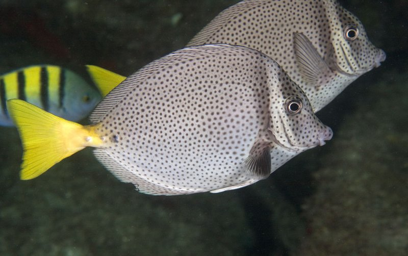

# Cirujano pimienta — *Prionurus punctatus* Gill, 1862

> Archivo generado desde `especies/datos/catalogo_inicial.json` con `especies/herramientas/generar_fichas.py`. No editar a mano.

*Imagen ilustrativa generada con IA por Brayan (2026-11-18). No es una fotografía de un ejemplar real; puede contener errores anatómicos.*

**Grupo:** pez  
**Otros nombres:** Yellowtail surgeonfish, Yellowtail tang, Cochinito punteado  
**Fecha de consulta:** 2026-11-18  
**Confianza global:** media  
**Estado:** verificada; pendiente de revisión del equipo

## Ficha AIRI

| Campo | Valor |
|---|---|
| Nombre común | Cirujano pimienta |
| Nombre científico | *Prionurus punctatus* |
| Temperamento | Semiagresivo *Quality Marine lo clasifica como «Social», pero advierte que puede ser agresivo con cirujanos de forma parecida.* |
| Comportamiento | Sociable. Sociable: en el medio natural vive en grupos. Crece mucho y necesita un acuario enorme. Espina caudal muy afilada. |
| Adecuado para arrecife | Sí. Quality Marine lo considera apto para arrecife, aunque puede picar pequeños invertebrados si no está bien alimentado. |
| Tipo de alimentación | Herbívoro: algas, láminas de alga, alimentos cárneos marinos. |
| Temperatura | 22.2–25.6 °C *Rango de Quality Marine.* |
| Litraje recomendado | 946.2 L (250 gal EE. UU.). *Es el mínimo de una sola fuente comercial. LiveAquaria no vende esta especie.* |
| Tamaño adulto | 60 cm (longitud total). *FishBase 60 cm y Quality Marine «casi 24 in» (≈ 61 cm) coinciden.* |

## Detalle verificado

| Campo | Dato | Confianza | Fuentes |
|---|---|---|---|
| Clasificación taxonómica | Clase Teleostei; orden Acanthuriformes; familia Acanthuridae. WoRMS AphiaID 282349 (aceptado). Sinónimos: Xesurus punctatus (Gill, 1862). | alta | [worms_prionurus_punctatus](https://www.marinespecies.org/aphia.php?p=taxdetails&id=282349), [fishbase_prionurus_punctatus](https://www.fishbase.se/summary/Prionurus-punctatus.html) |
| Hábitat natural | Arrecifes someros, en cardúmenes; come algas en zonas rocosas (FishBase). Profundidad: 5–35 m (habitual 6–12 m). Distribución: Pacífico centro-oriental: del golfo de California a El Salvador, incluidas las islas Revillagigedo. | alta | [fishbase_prionurus_punctatus](https://www.fishbase.se/summary/Prionurus-punctatus.html) |
| Tamaño adulto | Máx. 60 cm (longitud total). FishBase 60 cm y Quality Marine «casi 24 in» (≈ 61 cm) coinciden. | alta | [fishbase_prionurus_punctatus](https://www.fishbase.se/summary/Prionurus-punctatus.html), [qualitymarine_prionurus_punctatus](https://www.qualitymarine.com/quality-marine/fish/tangs/prionurus/sawtail-yellowtail-31542/) |
| Alimentación | Come algas en zonas rocosas (FishBase). En acuario: dieta variada de alimentos cárneos y de algas varias veces al día; si faltan algas, láminas de alga (Quality Marine). | alta | [fishbase_prionurus_punctatus](https://www.fishbase.se/summary/Prionurus-punctatus.html), [qualitymarine_prionurus_punctatus](https://www.qualitymarine.com/quality-marine/fish/tangs/prionurus/sawtail-yellowtail-31542/) |
| Temperatura del agua | Acuario: 22.2–25.6 °C (72–78 °F). FishBase no indica rango de temperatura para esta especie. | baja | [qualitymarine_prionurus_punctatus](https://www.qualitymarine.com/quality-marine/fish/tangs/prionurus/sawtail-yellowtail-31542/) |
| Rango de pH | Fuente de acuario: 8.1–8.4. Rango prudente AIRI: 8.1–8.3. Criterio: Intersección con la tabla MSD para agua salada (7.8–8.3). | media | [qualitymarine_prionurus_punctatus](https://www.qualitymarine.com/quality-marine/fish/tangs/prionurus/sawtail-yellowtail-31542/), [msd_tabla_referencia](https://www.msdvetmanual.com/multimedia/table/normal-reference-ranges-for-routine-water-quality-analysis), [msd_capitulo](https://www.msdvetmanual.com/exotic-and-laboratory-animals/aquatic-systems/environmental-diseases-of-aquatic-animals-in-aquatic-systems) |
| Salinidad | 1.020–1.025 de gravedad específica (adimensional). Agua de mar media: 35 ppt (UF/IFAS). No se convierte a ppt porque la equivalencia depende de la temperatura. | media | [qualitymarine_prionurus_punctatus](https://www.qualitymarine.com/quality-marine/fish/tangs/prionurus/sawtail-yellowtail-31542/), [ufifas_ph_sal_temp](https://waterwatch.ifas.ufl.edu/media/waterwatchifasufledu/FactSheet_pH_Sal_Temp.pdf) |
| Volumen mínimo | 946.2 L (250 gal EE. UU.). Justificación: Cifra de Quality Marine (250 gal), porque el adulto crece mucho. | baja | [qualitymarine_prionurus_punctatus](https://www.qualitymarine.com/quality-marine/fish/tangs/prionurus/sawtail-yellowtail-31542/) |
| Comportamiento | Vive en cardúmenes (FishBase). Puede ser agresivo con cirujanos de forma parecida; su espina caudal es muy afilada (Quality Marine). | media | [fishbase_prionurus_punctatus](https://www.fishbase.se/summary/Prionurus-punctatus.html), [qualitymarine_prionurus_punctatus](https://www.qualitymarine.com/quality-marine/fish/tangs/prionurus/sawtail-yellowtail-31542/) |
| Territorialidad y refugio | Necesita mucho espacio para nadar y roca para pastar y esconderse (Quality Marine). | media | [qualitymarine_prionurus_punctatus](https://www.qualitymarine.com/quality-marine/fish/tangs/prionurus/sawtail-yellowtail-31542/) |
| Compatibilidad con arrecife | sí (según la fuente; sin verificación independiente) | baja | [qualitymarine_prionurus_punctatus](https://www.qualitymarine.com/quality-marine/fish/tangs/prionurus/sawtail-yellowtail-31542/) |
| Convivencia: condiciones | Acuario de 250 gal o más. · Algas abundantes. | baja | [qualitymarine_prionurus_punctatus](https://www.qualitymarine.com/quality-marine/fish/tangs/prionurus/sawtail-yellowtail-31542/) |
| Convivencia: riesgos | Puede picar invertebrados si pasa hambre. · Agresivo con cirujanos de forma parecida. · Espina caudal muy afilada. | baja | [qualitymarine_prionurus_punctatus](https://www.qualitymarine.com/quality-marine/fish/tangs/prionurus/sawtail-yellowtail-31542/) |
| Conservación | Preocupación menor (LC), evaluada el 06/05/2010, según FishBase. | media | [fishbase_prionurus_punctatus](https://www.fishbase.se/summary/Prionurus-punctatus.html) |

**Regla AIRI:** compartir rangos de agua no implica compatibilidad entre especies. Los rangos de acuario provienen de una fuente comercial y no son límites veterinarios.

## Fuentes

- **worms_prionurus_punctatus** (taxonomía): WoRMS — Prionurus punctatus Gill, 1862 (AphiaID 282349). <https://www.marinespecies.org/aphia.php?p=taxdetails&id=282349>. Consultada el 2026-11-18.
- **fishbase_prionurus_punctatus** (biología): FishBase — Prionurus punctatus. <https://www.fishbase.se/summary/Prionurus-punctatus.html>. Consultada el 2026-11-18.
- **qualitymarine_prionurus_punctatus** (comercial): Quality Marine — Yellowtail Tang (Prionurus punctatus). <https://www.qualitymarine.com/quality-marine/fish/tangs/prionurus/sawtail-yellowtail-31542/>. Consultada el 2026-11-18.
- **msd_tabla_referencia** (veterinaria): MSD Veterinary Manual — “Normal” Reference Ranges for Routine Water Quality Analysis. <https://www.msdvetmanual.com/multimedia/table/normal-reference-ranges-for-routine-water-quality-analysis>. Consultada el 2026-11-12. Reutilizada del registro del motor (motor/airi_motor/datos/fuentes.json); no se volvió a consultar para estas fichas.
- **ufifas_ph_sal_temp** (institucional): UF/IFAS — pH, Salinity and Temperature (hoja informativa). <https://waterwatch.ifas.ufl.edu/media/waterwatchifasufledu/FactSheet_pH_Sal_Temp.pdf>. Consultada el 2026-11-12. Reutilizada del registro del motor (motor/airi_motor/datos/fuentes.json); no se volvió a consultar para estas fichas.
- **msd_capitulo** (veterinaria): MSD Veterinary Manual — Environmental Diseases of Aquatic Animals in Aquatic Systems. <https://www.msdvetmanual.com/exotic-and-laboratory-animals/aquatic-systems/environmental-diseases-of-aquatic-animals-in-aquatic-systems>. Consultada el 2026-11-12. Reutilizada del registro del motor (motor/airi_motor/datos/fuentes.json); no se volvió a consultar para estas fichas.
