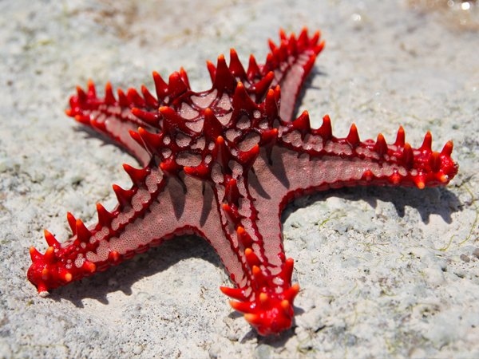

# Estrella de mar cornuda — *Protoreaster lincki* (Blainville, 1830)

> Archivo generado desde `especies/datos/catalogo_inicial.json` con `especies/herramientas/generar_fichas.py`. No editar a mano.

*Imagen ilustrativa generada con IA por Brayan (2026-11-18). No es una fotografía de un ejemplar real; puede contener errores anatómicos.*

**Grupo:** estrella de mar  
**Otros nombres:** Red knob sea star, African red knob starfish, Red spine star  
**Fecha de consulta:** 2026-11-18  
**Confianza global:** baja  
**Estado:** verificada; pendiente de revisión del equipo

## Ficha AIRI

| Campo | Valor |
|---|---|
| Nombre común | Estrella de mar cornuda |
| Nombre científico | *Protoreaster lincki* |
| Temperamento | Pacífico *LiveAquaria la clasifica como pacífica; Saltwaterfish, como semiagresiva.* |
| Comportamiento | . Al crecer se come corales e invertebrados: no es apta para arrecife. Muy sensible a los cambios del agua. |
| Adecuado para arrecife | No. LiveAquaria y Saltwaterfish la consideran no apta: al crecer come corales blandos, esponjas, almejas y otros invertebrados. |
| Tipo de alimentación | Carnívoro: almeja, camarón, pescado y calamar troceados, invertebrados (al crecer), algas (de pequeña). *Saltwaterfish la clasifica como omnívora.* |
| Temperatura | 22.2–25.6 °C |
| Litraje recomendado | 75.7 L (20 gal EE. UU.). *Es el mínimo recomendado por una sola fuente comercial; ninguna fuente científica consultada establece un litraje.* |
| Tamaño adulto | 30.5 cm (diámetro). Al venderse mide 5.1–20.3 cm (juvenil o subadulto). *LiveAquaria y Saltwaterfish coinciden en 12 in (≈ 30.5 cm). SeaLifeBase no indica tamaño.* |

## Detalle verificado

| Campo | Dato | Confianza | Fuentes |
|---|---|---|---|
| Clasificación taxonómica | Clase Asteroidea; orden Valvatida; familia Oreasteridae. WoRMS AphiaID 213286 (aceptado). Sinónimos: Asterias lincki de Blainville, 1830 (combinación original), Pentaceros lincki (de Blainville, 1830), Oreaster lincki (de Blainville, 1830). WoRMS escribe «lincki»; LiveAquaria usa la grafía «linckii». | alta | [worms_protoreaster_lincki](https://www.marinespecies.org/aphia.php?p=taxdetails&id=213286), [sealifebase_protoreaster_lincki](https://www.sealifebase.se/summary/Protoreaster-lincki.html) |
| Hábitat natural | Charcas de marea someras y arrecifes de hasta 100 ft (≈ 30 m) de profundidad (LiveAquaria). SeaLifeBase solo indica que es bentónica y tropical. Profundidad: 0–30 m. Distribución: Océano Índico (LiveAquaria); SeaLifeBase la registra en Omán. | baja | [liveaquaria_protoreaster_lincki](https://www.liveaquaria.com/products/red-knob-sea-star), [sealifebase_protoreaster_lincki](https://www.sealifebase.se/summary/Protoreaster-lincki.html) |
| Tamaño adulto | Máx. 30.5 cm (diámetro). LiveAquaria y Saltwaterfish coinciden en 12 in (≈ 30.5 cm). SeaLifeBase no indica tamaño. | media | [liveaquaria_protoreaster_lincki](https://www.liveaquaria.com/products/red-knob-sea-star), [saltwaterfish_protoreaster_lincki](https://www.saltwaterfish.com/product-african-red-knob-star) |
| Alimentación | En acuario: almeja, camarón, pescado y calamar troceados una vez por semana. De pequeña come algas, pero al crecer come corales blandos, esponjas, gusanos tubícolas, almejas, estrellas y otros invertebrados (LiveAquaria). | baja | [liveaquaria_protoreaster_lincki](https://www.liveaquaria.com/products/red-knob-sea-star) |
| Temperatura del agua | Acuario: 22.2–25.6 °C (72–78 °F). SeaLifeBase no indica rango de temperatura para esta especie. | baja | [liveaquaria_protoreaster_lincki](https://www.liveaquaria.com/products/red-knob-sea-star) |
| Rango de pH | Fuente de acuario: 8.1–8.4. Rango prudente AIRI: 8.1–8.3. Criterio: Intersección con la tabla MSD para agua salada (7.8–8.3). | media | [liveaquaria_protoreaster_lincki](https://www.liveaquaria.com/products/red-knob-sea-star), [msd_tabla_referencia](https://www.msdvetmanual.com/multimedia/table/normal-reference-ranges-for-routine-water-quality-analysis), [msd_capitulo](https://www.msdvetmanual.com/exotic-and-laboratory-animals/aquatic-systems/environmental-diseases-of-aquatic-animals-in-aquatic-systems) |
| Salinidad | 1.023–1.025 de gravedad específica (adimensional). Agua de mar media: 35 ppt (UF/IFAS). No se convierte a ppt porque la equivalencia depende de la temperatura. | media | [liveaquaria_protoreaster_lincki](https://www.liveaquaria.com/products/red-knob-sea-star), [ufifas_ph_sal_temp](https://waterwatch.ifas.ufl.edu/media/waterwatchifasufledu/FactSheet_pH_Sal_Temp.pdf) |
| Volumen mínimo | 75.7 L (20 gal EE. UU.). Justificación: Cifra de Saltwaterfish («Minimum Tank Size: 20 Gallons»). LiveAquaria pide un acuario grande, sin dar una cifra. | baja | [saltwaterfish_protoreaster_lincki](https://www.saltwaterfish.com/product-african-red-knob-star) |
| Comportamiento | Muy sensible a los cambios bruscos de oxígeno, salinidad y pH; requiere aclimatación por goteo y nunca debe exponerse al aire (LiveAquaria). | media | [liveaquaria_protoreaster_lincki](https://www.liveaquaria.com/products/red-knob-sea-star) |
| Territorialidad y refugio | Necesita un acuario grande con roca viva abundante (LiveAquaria). | media | [liveaquaria_protoreaster_lincki](https://www.liveaquaria.com/products/red-knob-sea-star) |
| Compatibilidad con arrecife | no (según la fuente; sin verificación independiente) | baja | [liveaquaria_protoreaster_lincki](https://www.liveaquaria.com/products/red-knob-sea-star), [saltwaterfish_protoreaster_lincki](https://www.saltwaterfish.com/product-african-red-knob-star) |
| Convivencia: condiciones | Acuario grande con roca viva abundante. · Aclimatación por goteo, sin exponerla al aire. · Sin peces globo. | baja | [liveaquaria_protoreaster_lincki](https://www.liveaquaria.com/products/red-knob-sea-star) |
| Convivencia: riesgos | Se come corales e invertebrados. · No tolera cambios bruscos del agua, medicamentos con cobre ni nitratos altos. | baja | [liveaquaria_protoreaster_lincki](https://www.liveaquaria.com/products/red-knob-sea-star) |
| Conservación | No evaluada por la UICN, según SeaLifeBase. | media | [sealifebase_protoreaster_lincki](https://www.sealifebase.se/summary/Protoreaster-lincki.html) |

**Regla AIRI:** compartir rangos de agua no implica compatibilidad entre especies. Los rangos de acuario provienen de una fuente comercial y no son límites veterinarios.

## Fuentes

- **worms_protoreaster_lincki** (taxonomía): WoRMS — Protoreaster lincki (Blainville, 1830) (AphiaID 213286). <https://www.marinespecies.org/aphia.php?p=taxdetails&id=213286>. Consultada el 2026-11-18.
- **sealifebase_protoreaster_lincki** (biología): SeaLifeBase — Protoreaster lincki. <https://www.sealifebase.se/summary/Protoreaster-lincki.html>. Consultada el 2026-11-18.
- **liveaquaria_protoreaster_lincki** (comercial): LiveAquaria — Red Knob Sea Star (Protoreaster linckii). <https://www.liveaquaria.com/products/red-knob-sea-star>. Consultada el 2026-11-18.
- **saltwaterfish_protoreaster_lincki** (comercial): Saltwaterfish — African Red Knob (Red Tip) Starfish. <https://www.saltwaterfish.com/product-african-red-knob-star>. Consultada el 2026-11-18.
- **msd_tabla_referencia** (veterinaria): MSD Veterinary Manual — “Normal” Reference Ranges for Routine Water Quality Analysis. <https://www.msdvetmanual.com/multimedia/table/normal-reference-ranges-for-routine-water-quality-analysis>. Consultada el 2026-11-12. Reutilizada del registro del motor (motor/airi_motor/datos/fuentes.json); no se volvió a consultar para estas fichas.
- **ufifas_ph_sal_temp** (institucional): UF/IFAS — pH, Salinity and Temperature (hoja informativa). <https://waterwatch.ifas.ufl.edu/media/waterwatchifasufledu/FactSheet_pH_Sal_Temp.pdf>. Consultada el 2026-11-12. Reutilizada del registro del motor (motor/airi_motor/datos/fuentes.json); no se volvió a consultar para estas fichas.
- **msd_capitulo** (veterinaria): MSD Veterinary Manual — Environmental Diseases of Aquatic Animals in Aquatic Systems. <https://www.msdvetmanual.com/exotic-and-laboratory-animals/aquatic-systems/environmental-diseases-of-aquatic-animals-in-aquatic-systems>. Consultada el 2026-11-12. Reutilizada del registro del motor (motor/airi_motor/datos/fuentes.json); no se volvió a consultar para estas fichas.
