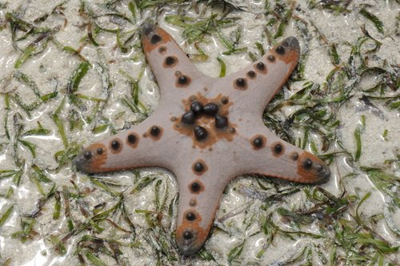

# Estrella chocochip — *Protoreaster nodosus* (Linnaeus, 1758)

> Archivo generado desde `especies/datos/catalogo_inicial.json` con `especies/herramientas/generar_fichas.py`. No editar a mano.

*Imagen ilustrativa generada con IA por Brayan (2026-11-16). No es una fotografía de un ejemplar real; puede contener errores anatómicos.*

**Grupo:** estrella de mar  
**Otros nombres:** Chocolate chip sea star, Horned sea star, Nodular sea star  
**Fecha de consulta:** 2026-11-16  
**Confianza global:** media  
**Estado:** verificada; pendiente de revisión del equipo

## Ficha AIRI

| Campo | Valor |
|---|---|
| Nombre común | Estrella chocochip |
| Nombre científico | *Protoreaster nodosus* |
| Temperamento | Pacífico |
| Comportamiento | Pacífico. Pacífica con los peces, pero se come corales blandos, esponjas, almejas y otras estrellas. Exige agua de muy buena calidad. |
| Adecuado para arrecife | No. LiveAquaria no la considera apta para arrecife: los adultos comen corales blandos, esponjas, gusanos tubícolas, almejas y otras estrellas. |
| Tipo de alimentación | Omnívoro: películas de microbios y microalgas, pastos marinos y algas, invertebrados sésiles (corales blandos, esponjas, almejas). *Diferencia entre fuentes: SeaLifeBase describe una dieta de microalgas y pastos marinos; LiveAquaria la clasifica como carnívora en acuario.* |
| Temperatura | 22.2–25.6 °C |
| Litraje recomendado | 75.7 L (20 gal EE. UU.). *Es el mínimo de una sola fuente comercial.* |
| Tamaño adulto | 30 cm (diámetro). *Diferencia entre fuentes: SeaLifeBase 30 cm de diámetro; LiveAquaria hasta 15 in (≈ 38.1 cm).* |

## Detalle verificado

| Campo | Dato | Confianza | Fuentes |
|---|---|---|---|
| Clasificación taxonómica | Clase Asteroidea; orden Valvatida; familia Oreasteridae. WoRMS AphiaID 213285 (aceptado). Sinónimos: Asterias nodosa Linnaeus, 1758 (combinación original), Pentaceros nodosus, Oreaster turritus. | alta | [worms_protoreaster_nodosus](https://www.marinespecies.org/aphia.php?p=taxdetails&id=213285), [sealifebase_protoreaster_nodosus](https://www.sealifebase.se/summary/Protoreaster-nodosus.html) |
| Hábitat natural | Praderas marinas y zonas de algas, sobre todo planicies arrecifales. SeaLifeBase la considera una buena especie bioindicadora de la salud del arrecife. Profundidad: 0–37 m (habitual 0–30 m (WoRMS)). Distribución: Indo-Pacífico occidental, de Seychelles a Australia y Japón. | media | [sealifebase_protoreaster_nodosus](https://www.sealifebase.se/summary/Protoreaster-nodosus.html) |
| Tamaño adulto | Máx. 30 cm (diámetro). Diferencia entre fuentes: SeaLifeBase 30 cm de diámetro; LiveAquaria hasta 15 in (≈ 38.1 cm). | media | [sealifebase_protoreaster_nodosus](https://www.sealifebase.se/summary/Protoreaster-nodosus.html), [liveaquaria_protoreaster_nodosus](https://www.liveaquaria.com/products/chocolate-chip-sea-star) |
| Alimentación | En la naturaleza se alimenta de películas de microbios y microalgas, hojas de pastos marinos vivas y en descomposición, y algas verdes filamentosas (SeaLifeBase). En acuario, LiveAquaria la clasifica como carnívora: los adultos comen corales blandos, esponjas, gusanos tubícolas, almejas y otras estrellas. | media | [sealifebase_protoreaster_nodosus](https://www.sealifebase.se/summary/Protoreaster-nodosus.html), [liveaquaria_protoreaster_nodosus](https://www.liveaquaria.com/products/chocolate-chip-sea-star) |
| Temperatura del agua | Acuario: 22.2–25.6 °C (72–78 °F). SeaLifeBase no indica rango de temperatura para esta especie. | baja | [liveaquaria_protoreaster_nodosus](https://www.liveaquaria.com/products/chocolate-chip-sea-star) |
| Rango de pH | Fuente de acuario: 8.1–8.4. Rango prudente AIRI: 8.1–8.3. Criterio: Intersección con la tabla MSD para agua salada (7.8–8.3). | media | [liveaquaria_protoreaster_nodosus](https://www.liveaquaria.com/products/chocolate-chip-sea-star), [msd_tabla_referencia](https://www.msdvetmanual.com/multimedia/table/normal-reference-ranges-for-routine-water-quality-analysis), [msd_capitulo](https://www.msdvetmanual.com/exotic-and-laboratory-animals/aquatic-systems/environmental-diseases-of-aquatic-animals-in-aquatic-systems) |
| Salinidad | 1.023–1.025 de gravedad específica (adimensional). Agua de mar media: 35 ppt (UF/IFAS). No se convierte a ppt porque la equivalencia depende de la temperatura. | media | [liveaquaria_protoreaster_nodosus](https://www.liveaquaria.com/products/chocolate-chip-sea-star), [ufifas_ph_sal_temp](https://waterwatch.ifas.ufl.edu/media/waterwatchifasufledu/FactSheet_pH_Sal_Temp.pdf) |
| Volumen mínimo | 75.7 L (20 gal EE. UU.). Justificación: Cifra de Saltwaterfish («Minimum Tank Size: 20 Gallons»). LiveAquaria y las fuentes científicas consultadas no publican un litraje para esta especie. | baja | [saltwaterfish_protoreaster_nodosus](https://www.saltwaterfish.com/product-chocolate-chip-starfish) |
| Comportamiento | Pacífica con los peces, pero se come corales blandos, esponjas, gusanos tubícolas, almejas y otras estrellas. Exige muy buena calidad del agua y no tolera nitratos altos (LiveAquaria). Se recolecta mucho como adorno (SeaLifeBase). | media | [sealifebase_protoreaster_nodosus](https://www.sealifebase.se/summary/Protoreaster-nodosus.html), [liveaquaria_protoreaster_nodosus](https://www.liveaquaria.com/products/chocolate-chip-sea-star) |
| Territorialidad y refugio | No territorial. Necesita un acuario grande con un lecho de arena maduro de varias pulgadas. | media | [liveaquaria_protoreaster_nodosus](https://www.liveaquaria.com/products/chocolate-chip-sea-star), [sealifebase_protoreaster_nodosus](https://www.sealifebase.se/summary/Protoreaster-nodosus.html) |
| Compatibilidad con arrecife | no (según la fuente; sin verificación independiente) | baja | [liveaquaria_protoreaster_nodosus](https://www.liveaquaria.com/products/chocolate-chip-sea-star) |
| Convivencia: condiciones | Acuario muy grande, sin corales ni invertebrados sésiles (solo peces y roca viva). · Peces tranquilos; sin peces ballesta ni peces globo. | baja | [liveaquaria_protoreaster_nodosus](https://www.liveaquaria.com/products/chocolate-chip-sea-star), [sealifebase_protoreaster_nodosus](https://www.sealifebase.se/summary/Protoreaster-nodosus.html) |
| Convivencia: riesgos | Come corales blandos, esponjas, gusanos tubícolas, almejas y otras estrellas. · No tolera nitratos altos. · No tolera medicamentos con cobre ni cambios bruscos de salinidad, pH u oxígeno; requiere aclimatación por goteo. | baja | [liveaquaria_protoreaster_nodosus](https://www.liveaquaria.com/products/chocolate-chip-sea-star), [sealifebase_protoreaster_nodosus](https://www.sealifebase.se/summary/Protoreaster-nodosus.html) |
| Conservación | No evaluada por la UICN, según SeaLifeBase. | media | [sealifebase_protoreaster_nodosus](https://www.sealifebase.se/summary/Protoreaster-nodosus.html) |

**Regla AIRI:** compartir rangos de agua no implica compatibilidad entre especies. Los rangos de acuario provienen de una fuente comercial y no son límites veterinarios.

## Fuentes

- **worms_protoreaster_nodosus** (taxonomía): WoRMS — Protoreaster nodosus (Linnaeus, 1758) (AphiaID 213285). <https://www.marinespecies.org/aphia.php?p=taxdetails&id=213285>. Consultada el 2026-11-16.
- **sealifebase_protoreaster_nodosus** (biología): SeaLifeBase — Protoreaster nodosus. <https://www.sealifebase.se/summary/Protoreaster-nodosus.html>. Consultada el 2026-11-16.
- **liveaquaria_protoreaster_nodosus** (comercial): LiveAquaria — Chocolate Chip Sea Star. <https://www.liveaquaria.com/products/chocolate-chip-sea-star>. Consultada el 2026-11-16.
- **msd_tabla_referencia** (veterinaria): MSD Veterinary Manual — “Normal” Reference Ranges for Routine Water Quality Analysis. <https://www.msdvetmanual.com/multimedia/table/normal-reference-ranges-for-routine-water-quality-analysis>. Consultada el 2026-11-12. Reutilizada del registro del motor (motor/airi_motor/datos/fuentes.json); no se volvió a consultar para estas fichas.
- **ufifas_ph_sal_temp** (institucional): UF/IFAS — pH, Salinity and Temperature (hoja informativa). <https://waterwatch.ifas.ufl.edu/media/waterwatchifasufledu/FactSheet_pH_Sal_Temp.pdf>. Consultada el 2026-11-12. Reutilizada del registro del motor (motor/airi_motor/datos/fuentes.json); no se volvió a consultar para estas fichas.
- **saltwaterfish_protoreaster_nodosus** (comercial): Saltwaterfish — Chocolate Chip Starfish. <https://www.saltwaterfish.com/product-chocolate-chip-starfish>. Consultada el 2026-11-16.
- **msd_capitulo** (veterinaria): MSD Veterinary Manual — Environmental Diseases of Aquatic Animals in Aquatic Systems. <https://www.msdvetmanual.com/exotic-and-laboratory-animals/aquatic-systems/environmental-diseases-of-aquatic-animals-in-aquatic-systems>. Consultada el 2026-11-12. Reutilizada del registro del motor (motor/airi_motor/datos/fuentes.json); no se volvió a consultar para estas fichas.
