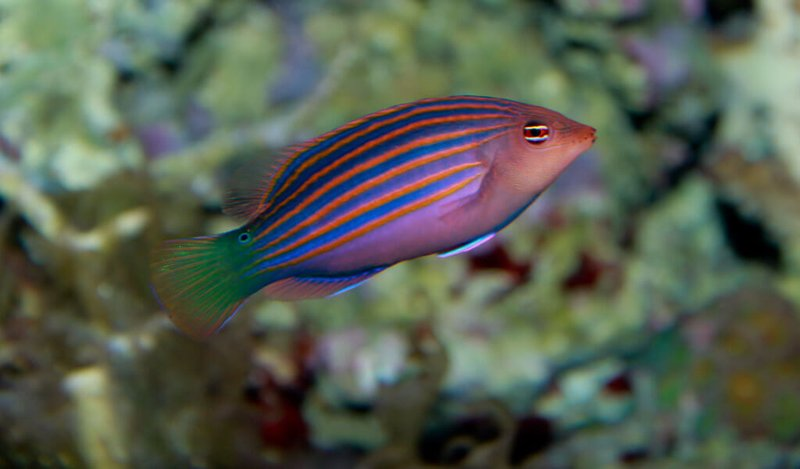

# Lábrido de seis líneas — *Pseudocheilinus hexataenia* (Bleeker, 1857)

> Archivo generado desde `especies/datos/catalogo_inicial.json` con `especies/herramientas/generar_fichas.py`. No editar a mano.

*Imagen ilustrativa generada con IA por Brayan (2026-11-16). No es una fotografía de un ejemplar real; puede contener errores anatómicos.*

**Grupo:** pez  
**Otros nombres:** Sixline wrasse, Sixstripe wrasse  
**Fecha de consulta:** 2026-11-16  
**Confianza global:** media  
**Estado:** verificada; pendiente de revisión del equipo

## Ficha AIRI

| Campo | Valor |
|---|---|
| Nombre común | Lábrido de seis líneas |
| Nombre científico | *Pseudocheilinus hexataenia* |
| Temperamento | Semiagresivo |
| Comportamiento | Territorial. Tímido en la naturaleza, pero puede ser agresivo con lábridos pacíficos y peces que se intimidan fácilmente. Necesita muchos escondites. |
| Adecuado para arrecife | Sí. LiveAquaria lo considera compatible con arrecife y útil contra plagas de la roca viva; no hay verificación independiente. |
| Tipo de alimentación | Carnívoro: pequeños crustáceos, caracoles piramidélidos, gusanos planos y de cerdas, carne picada. |
| Temperatura | 22.2–25.6 °C *Discrepancia: el límite inferior de acuario (22.2 °C) está por debajo del mínimo natural indicado por FishBase (24 °C).* |
| Litraje recomendado | 227.1 L (60 gal EE. UU.). *Diferencia dentro de LiveAquaria: sus datos rápidos indican 60 gal y su descripción, 30 gal o más. Se adopta la cifra mayor. Ninguna fuente científica consultada establece un litraje.* |
| Tamaño adulto | 10 cm (longitud total). Al venderse mide hasta 5.1 cm (juvenil o subadulto). *Diferencia entre fuentes: FishBase 10 cm; LiveAquaria 3 in (≈ 7.6 cm).* |

## Detalle verificado

| Campo | Dato | Confianza | Fuentes |
|---|---|---|---|
| Clasificación taxonómica | Clase Teleostei; orden Labriformes (WoRMS); familia Labridae; subfamilia Cirrhilabrinae. WoRMS AphiaID 208915 (aceptado). Sinónimos: Cheilinus hexataenia Bleeker, 1857 (combinación original). El orden varía según la fuente: Labriformes (WoRMS) y Eupercaria/misc (FishBase). Se toma WoRMS como referencia. | alta | [worms_pseudocheilinus_hexataenia](https://www.marinespecies.org/aphia.php?p=taxdetails&id=208915), [fishbase_pseudocheilinus_hexataenia](https://www.fishbase.se/summary/Pseudocheilinus-hexataenia.html) |
| Hábitat natural | Arrecifes externos, entre las ramas del coral, y aguas costeras claras con coral denso en crestas o pendientes someras hasta unos 20 m. Suele ir en grupos pequeños y sueltos; es tímido y reservado. Profundidad: 1–35 m (habitual 4–35 m). Distribución: Indo-Pacífico: del Mar Rojo a Natal (Sudáfrica) y al este hasta las Tuamotu; al norte hasta las Ryukyu; al sur hasta Lord Howe y las Australes. | media | [fishbase_pseudocheilinus_hexataenia](https://www.fishbase.se/summary/Pseudocheilinus-hexataenia.html) |
| Tamaño adulto | Máx. 10 cm (longitud total). Diferencia entre fuentes: FishBase 10 cm; LiveAquaria 3 in (≈ 7.6 cm). | media | [fishbase_pseudocheilinus_hexataenia](https://www.fishbase.se/summary/Pseudocheilinus-hexataenia.html), [liveaquaria_pseudocheilinus_hexataenia](https://www.liveaquaria.com/products/six-line-wrasse) |
| Alimentación | Carnívoro: come sobre todo pequeños crustáceos (FishBase). En acuario busca caracoles piramidélidos (parásitos de almejas), gusanos planos y gusanos de cerdas; se le da carne picada y preparados congelados (LiveAquaria). | alta | [fishbase_pseudocheilinus_hexataenia](https://www.fishbase.se/summary/Pseudocheilinus-hexataenia.html), [liveaquaria_pseudocheilinus_hexataenia](https://www.liveaquaria.com/products/six-line-wrasse) |
| Temperatura del agua | Acuario: 22.2–25.6 °C (72–78 °F). Medio natural: 24–28 °C. Discrepancia: el límite inferior de acuario (22.2 °C) está por debajo del mínimo natural indicado por FishBase (24 °C). | baja | [liveaquaria_pseudocheilinus_hexataenia](https://www.liveaquaria.com/products/six-line-wrasse), [fishbase_pseudocheilinus_hexataenia](https://www.fishbase.se/summary/Pseudocheilinus-hexataenia.html) |
| Rango de pH | Fuente de acuario: 8.1–8.4. Rango prudente AIRI: 8.1–8.3. Criterio: Intersección con la tabla MSD para agua salada (7.8–8.3). | media | [liveaquaria_pseudocheilinus_hexataenia](https://www.liveaquaria.com/products/six-line-wrasse), [msd_tabla_referencia](https://www.msdvetmanual.com/multimedia/table/normal-reference-ranges-for-routine-water-quality-analysis), [msd_capitulo](https://www.msdvetmanual.com/exotic-and-laboratory-animals/aquatic-systems/environmental-diseases-of-aquatic-animals-in-aquatic-systems) |
| Salinidad | 1.020–1.025 de gravedad específica (adimensional). Agua de mar media: 35 ppt (UF/IFAS). No se convierte a ppt porque la equivalencia depende de la temperatura. | media | [liveaquaria_pseudocheilinus_hexataenia](https://www.liveaquaria.com/products/six-line-wrasse), [ufifas_ph_sal_temp](https://waterwatch.ifas.ufl.edu/media/waterwatchifasufledu/FactSheet_pH_Sal_Temp.pdf) |
| Volumen mínimo | 227.1 L (60 gal EE. UU.). Justificación: Cifra de los datos rápidos de LiveAquaria (60 gal). Aunque es pequeño, necesita muchos escondites y roca viva donde buscar alimento. | baja | [liveaquaria_pseudocheilinus_hexataenia](https://www.liveaquaria.com/products/six-line-wrasse), [fishbase_pseudocheilinus_hexataenia](https://www.fishbase.se/summary/Pseudocheilinus-hexataenia.html) |
| Comportamiento | Tímido y reservado en la naturaleza (FishBase), pero puede ser agresivo en acuario con lábridos pacíficos y con peces que se intimidan fácilmente (LiveAquaria). El macho intensifica sus colores durante el cortejo. | media | [fishbase_pseudocheilinus_hexataenia](https://www.fishbase.se/summary/Pseudocheilinus-hexataenia.html), [liveaquaria_pseudocheilinus_hexataenia](https://www.liveaquaria.com/products/six-line-wrasse) |
| Territorialidad y refugio | Necesita muchos escondites y roca viva. Puede acosar a peces pequeños y tímidos. | media | [liveaquaria_pseudocheilinus_hexataenia](https://www.liveaquaria.com/products/six-line-wrasse), [fishbase_pseudocheilinus_hexataenia](https://www.fishbase.se/summary/Pseudocheilinus-hexataenia.html) |
| Compatibilidad con arrecife | sí (según la fuente; sin verificación independiente) | baja | [liveaquaria_pseudocheilinus_hexataenia](https://www.liveaquaria.com/products/six-line-wrasse) |
| Convivencia: condiciones | Muchos escondites y roca viva. · Evitar lábridos pacíficos y peces tímidos. | baja | [liveaquaria_pseudocheilinus_hexataenia](https://www.liveaquaria.com/products/six-line-wrasse), [fishbase_pseudocheilinus_hexataenia](https://www.fishbase.se/summary/Pseudocheilinus-hexataenia.html) |
| Convivencia: riesgos | Agresión hacia lábridos pacíficos y peces que se intimidan fácilmente. | baja | [liveaquaria_pseudocheilinus_hexataenia](https://www.liveaquaria.com/products/six-line-wrasse), [fishbase_pseudocheilinus_hexataenia](https://www.fishbase.se/summary/Pseudocheilinus-hexataenia.html) |
| Conservación | Preocupación menor (LC), evaluada el 03/03/2009, según FishBase. | media | [fishbase_pseudocheilinus_hexataenia](https://www.fishbase.se/summary/Pseudocheilinus-hexataenia.html) |

**Regla AIRI:** compartir rangos de agua no implica compatibilidad entre especies. Los rangos de acuario provienen de una fuente comercial y no son límites veterinarios.

## Fuentes

- **worms_pseudocheilinus_hexataenia** (taxonomía): WoRMS — Pseudocheilinus hexataenia (Bleeker, 1857) (AphiaID 208915). <https://www.marinespecies.org/aphia.php?p=taxdetails&id=208915>. Consultada el 2026-11-16.
- **fishbase_pseudocheilinus_hexataenia** (biología): FishBase — Pseudocheilinus hexataenia (Bleeker, 1857). <https://www.fishbase.se/summary/Pseudocheilinus-hexataenia.html>. Consultada el 2026-11-16.
- **liveaquaria_pseudocheilinus_hexataenia** (comercial): LiveAquaria — Six Line Wrasse. <https://www.liveaquaria.com/products/six-line-wrasse>. Consultada el 2026-11-16.
- **msd_tabla_referencia** (veterinaria): MSD Veterinary Manual — “Normal” Reference Ranges for Routine Water Quality Analysis. <https://www.msdvetmanual.com/multimedia/table/normal-reference-ranges-for-routine-water-quality-analysis>. Consultada el 2026-11-12. Reutilizada del registro del motor (motor/airi_motor/datos/fuentes.json); no se volvió a consultar para estas fichas.
- **ufifas_ph_sal_temp** (institucional): UF/IFAS — pH, Salinity and Temperature (hoja informativa). <https://waterwatch.ifas.ufl.edu/media/waterwatchifasufledu/FactSheet_pH_Sal_Temp.pdf>. Consultada el 2026-11-12. Reutilizada del registro del motor (motor/airi_motor/datos/fuentes.json); no se volvió a consultar para estas fichas.
- **msd_capitulo** (veterinaria): MSD Veterinary Manual — Environmental Diseases of Aquatic Animals in Aquatic Systems. <https://www.msdvetmanual.com/exotic-and-laboratory-animals/aquatic-systems/environmental-diseases-of-aquatic-animals-in-aquatic-systems>. Consultada el 2026-11-12. Reutilizada del registro del motor (motor/airi_motor/datos/fuentes.json); no se volvió a consultar para estas fichas.
