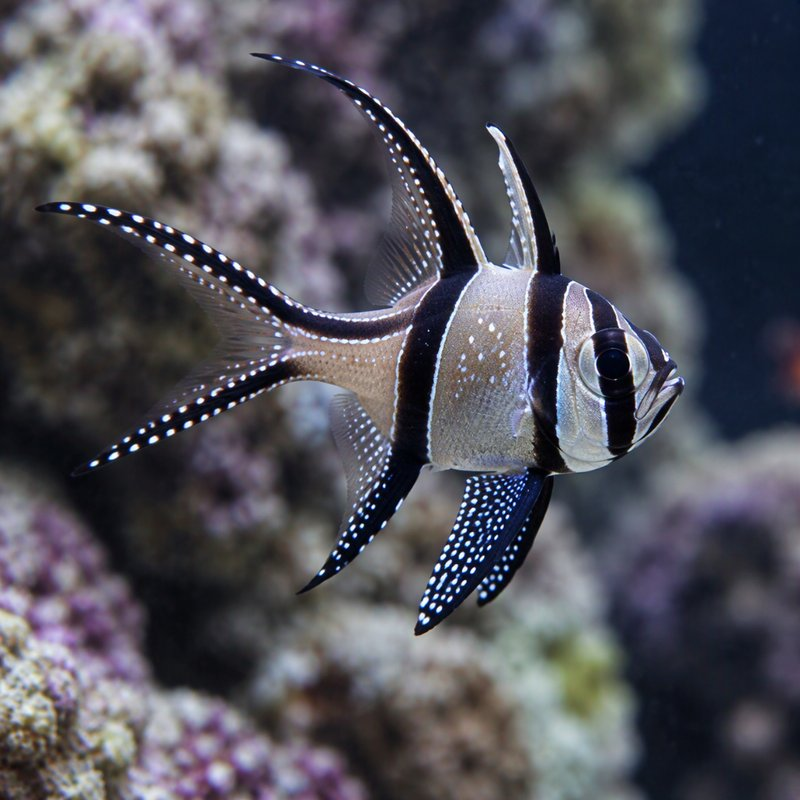

# Cardenal de Banggai — *Pterapogon kauderni* Koumans, 1933

> Archivo generado desde `especies/datos/catalogo_inicial.json` con `especies/herramientas/generar_fichas.py`. No editar a mano.

*Imagen ilustrativa generada con IA por Brayan (2026-11-16). No es una fotografía de un ejemplar real; puede contener errores anatómicos.*

**Grupo:** pez  
**Otros nombres:** Banggai cardinalfish, Kaudern's cardinal  
**Fecha de consulta:** 2026-11-16  
**Confianza global:** media  
**Estado:** verificada; pendiente de revisión del equipo

## Ficha AIRI

| Campo | Valor |
|---|---|
| Nombre común | Cardenal de Banggai |
| Nombre científico | *Pterapogon kauderni* |
| Temperamento | Semiagresivo *LiveAquaria lo clasifica como semiagresivo; su agresión se dirige sobre todo a ejemplares de su misma especie.* |
| Comportamiento | Territorial. Nadador lento y pausado. Agresivo con su propia especie: no conviene mantenerlo en grupos grandes. El macho incuba los huevos en la boca. |
| Adecuado para arrecife | Sí. La única fuente consultada que lo evalúa (LiveAquaria) lo considera compatible con arrecife; no hay verificación independiente. |
| Tipo de alimentación | Carnívoro: copépodos y otro plancton (en la naturaleza), crustáceos pequeños, alimentos cárnicos: camarón, carne marina. |
| Temperatura | 22.2–25.6 °C *FishBase y NOAA no indican rango de temperatura.* |
| Litraje recomendado | 113.6 L (30 gal EE. UU.). *Es el mínimo recomendado por una sola fuente comercial; ninguna fuente científica consultada establece un litraje.* |
| Tamaño adulto | 8.6 cm (longitud total (hembra)). Al venderse mide 2.5–5.1 cm (juvenil o subadulto). Madura desde 4.1 cm. *NOAA: hasta 3.4 in (8.6 cm), igual que FishBase; LiveAquaria indica 3 in (7.6 cm).* |

## Detalle verificado

| Campo | Dato | Confianza | Fuentes |
|---|---|---|---|
| Clasificación taxonómica | Clase Teleostei; orden Apogoniformes (WoRMS); familia Apogonidae; subfamilia Apogoninae. WoRMS AphiaID 282494 (aceptado). El orden varía según la fuente: Apogoniformes (WoRMS), Kurtiformes (FishBase) y Perciformes (NOAA). La familia Apogonidae coincide en las tres. Se toma WoRMS como referencia. | alta | [worms_pterapogon_kauderni](https://www.marinespecies.org/aphia.php?p=taxdetails&id=282494), [fishbase_pterapogon_kauderni](https://www.fishbase.se/summary/Pterapogon-kauderni.html), [noaa_banggai](https://www.fisheries.noaa.gov/species/banggai-cardinalfish) |
| Hábitat natural | Endémico del archipiélago de Banggai (Indonesia). Vive en aguas someras y tranquilas, entre arrecifes coralinos y praderas marinas (Enhalus acoroides) sobre fondos de arena limosa. Se asocia al erizo de espinas largas Diadema setosum y, cuando es juvenil, también a anémonas, que usa como refugio. Ha sido introducido fuera de su área natural a través del comercio ornamental. Profundidad: 0–16 m (habitual 1–2 m). Distribución: Islas Banggai, Indonesia; también islotes al este de Taliabu y cerca de Luwuk. | alta | [fishbase_pterapogon_kauderni](https://www.fishbase.se/summary/Pterapogon-kauderni.html), [noaa_banggai](https://www.fisheries.noaa.gov/species/banggai-cardinalfish) |
| Tamaño adulto | Máx. 8.6 cm (longitud total (hembra)). NOAA: hasta 3.4 in (≈ 8.6 cm); LiveAquaria: 3 in (≈ 7.6 cm). | alta | [fishbase_pterapogon_kauderni](https://www.fishbase.se/summary/Pterapogon-kauderni.html), [noaa_banggai](https://www.fisheries.noaa.gov/species/banggai-cardinalfish) |
| Alimentación | Carnívoro. En la naturaleza se alimenta sobre todo de copépodos, además de otros organismos planctónicos (NOAA); FishBase indica que probablemente come crustáceos bentónicos y planctónicos de noche. En acuario: alimentos cárnicos (camarón, carne de origen marino, larvas de mosquito). | alta | [noaa_banggai](https://www.fisheries.noaa.gov/species/banggai-cardinalfish), [fishbase_pterapogon_kauderni](https://www.fishbase.se/summary/Pterapogon-kauderni.html), [liveaquaria_pterapogon_kauderni](https://www.liveaquaria.com/products/kauderns-cardinal-1) |
| Temperatura del agua | Acuario: 22.2–25.6 °C (72–78 °F). FishBase y NOAA no indican rango de temperatura. | baja | [liveaquaria_pterapogon_kauderni](https://www.liveaquaria.com/products/kauderns-cardinal-1) |
| Rango de pH | Fuente de acuario: 8.1–8.4. Rango prudente AIRI: 8.1–8.3. Criterio: Intersección con la tabla MSD para agua salada (7.8–8.3). | media | [liveaquaria_pterapogon_kauderni](https://www.liveaquaria.com/products/kauderns-cardinal-1), [msd_tabla_referencia](https://www.msdvetmanual.com/multimedia/table/normal-reference-ranges-for-routine-water-quality-analysis), [msd_capitulo](https://www.msdvetmanual.com/exotic-and-laboratory-animals/aquatic-systems/environmental-diseases-of-aquatic-animals-in-aquatic-systems) |
| Salinidad | 1.020–1.025 de gravedad específica (adimensional). Agua de mar media: 35 ppt (UF/IFAS). No se convierte a ppt porque la equivalencia depende de la temperatura. | media | [liveaquaria_pterapogon_kauderni](https://www.liveaquaria.com/products/kauderns-cardinal-1), [ufifas_ph_sal_temp](https://waterwatch.ifas.ufl.edu/media/waterwatchifasufledu/FactSheet_pH_Sal_Temp.pdf) |
| Volumen mínimo | 113.6 L (30 gal EE. UU.). Justificación: Cifra de LiveAquaria, que pide rocas con cuevas. Aunque es un pez pequeño (8.6 cm), es agresivo con su propia especie y no debe mantenerse en grupos grandes. El volumen da espacio para separar territorios. | baja | [liveaquaria_pterapogon_kauderni](https://www.liveaquaria.com/products/kauderns-cardinal-1) |
| Comportamiento | Nadador lento y pausado. Los machos incuban los huevos en la boca y liberan juveniles ya formados, sin fase planctónica. Vive entre 2.5 y 3 años, y como máximo hasta 5. LiveAquaria lo clasifica como semiagresivo y fácil de reproducir en acuario. | alta | [noaa_banggai](https://www.fisheries.noaa.gov/species/banggai-cardinalfish), [fishbase_pterapogon_kauderni](https://www.fishbase.se/summary/Pterapogon-kauderni.html), [liveaquaria_pterapogon_kauderni](https://www.liveaquaria.com/products/kauderns-cardinal-1) |
| Territorialidad y refugio | Es agresivo con ejemplares de su misma especie. En la naturaleza se refugia entre las espinas de los erizos Diadema; en acuario necesita rocas con cuevas. | media | [fishbase_pterapogon_kauderni](https://www.fishbase.se/summary/Pterapogon-kauderni.html), [liveaquaria_pterapogon_kauderni](https://www.liveaquaria.com/products/kauderns-cardinal-1) |
| Compatibilidad con arrecife | sí (según la fuente; sin verificación independiente) | baja | [liveaquaria_pterapogon_kauderni](https://www.liveaquaria.com/products/kauderns-cardinal-1) |
| Convivencia: condiciones | Compañeros de acuario pacíficos. · No mantenerlo en grupos grandes de la misma especie. | baja | [liveaquaria_pterapogon_kauderni](https://www.liveaquaria.com/products/kauderns-cardinal-1) |
| Convivencia: riesgos | Agresión entre ejemplares de su especie. | baja | [liveaquaria_pterapogon_kauderni](https://www.liveaquaria.com/products/kauderns-cardinal-1) |
| Conservación | En peligro (EN, B2ab(ii,iii,iv,v)), evaluada el 01/03/2007, según FishBase. Clasificado como amenazado bajo la Ley de Especies en Peligro de EE. UU. (ESA) desde 2016. Sus principales amenazas son la captura para el comercio ornamental y la destrucción del hábitat (NOAA). Por su estado de conservación, AIRI debe advertirlo siempre que se consulte esta especie. Se trata de una advertencia derivada de las fuentes, no de una norma legal. | alta | [fishbase_pterapogon_kauderni](https://www.fishbase.se/summary/Pterapogon-kauderni.html), [noaa_banggai](https://www.fisheries.noaa.gov/species/banggai-cardinalfish) |

**Regla AIRI:** compartir rangos de agua no implica compatibilidad entre especies. Los rangos de acuario provienen de una fuente comercial y no son límites veterinarios.

## Fuentes

- **worms_pterapogon_kauderni** (taxonomía): WoRMS — Pterapogon kauderni Koumans, 1933 (AphiaID 282494). <https://www.marinespecies.org/aphia.php?p=taxdetails&id=282494>. Consultada el 2026-11-16.
- **fishbase_pterapogon_kauderni** (biología): FishBase — Pterapogon kauderni, Banggai cardinal fish. <https://www.fishbase.se/summary/Pterapogon-kauderni.html>. Consultada el 2026-11-16.
- **noaa_banggai** (institucional): NOAA Fisheries — Banggai Cardinalfish (Species Directory; actualizada el 18/10/2023). <https://www.fisheries.noaa.gov/species/banggai-cardinalfish>. Consultada el 2026-11-16.
- **liveaquaria_pterapogon_kauderni** (comercial): LiveAquaria — Kaudern's Cardinal. <https://www.liveaquaria.com/products/kauderns-cardinal-1>. Consultada el 2026-11-16.
- **msd_tabla_referencia** (veterinaria): MSD Veterinary Manual — “Normal” Reference Ranges for Routine Water Quality Analysis. <https://www.msdvetmanual.com/multimedia/table/normal-reference-ranges-for-routine-water-quality-analysis>. Consultada el 2026-11-12. Reutilizada del registro del motor (motor/airi_motor/datos/fuentes.json); no se volvió a consultar para estas fichas.
- **ufifas_ph_sal_temp** (institucional): UF/IFAS — pH, Salinity and Temperature (hoja informativa). <https://waterwatch.ifas.ufl.edu/media/waterwatchifasufledu/FactSheet_pH_Sal_Temp.pdf>. Consultada el 2026-11-12. Reutilizada del registro del motor (motor/airi_motor/datos/fuentes.json); no se volvió a consultar para estas fichas.
- **msd_capitulo** (veterinaria): MSD Veterinary Manual — Environmental Diseases of Aquatic Animals in Aquatic Systems. <https://www.msdvetmanual.com/exotic-and-laboratory-animals/aquatic-systems/environmental-diseases-of-aquatic-animals-in-aquatic-systems>. Consultada el 2026-11-12. Reutilizada del registro del motor (motor/airi_motor/datos/fuentes.json); no se volvió a consultar para estas fichas.
