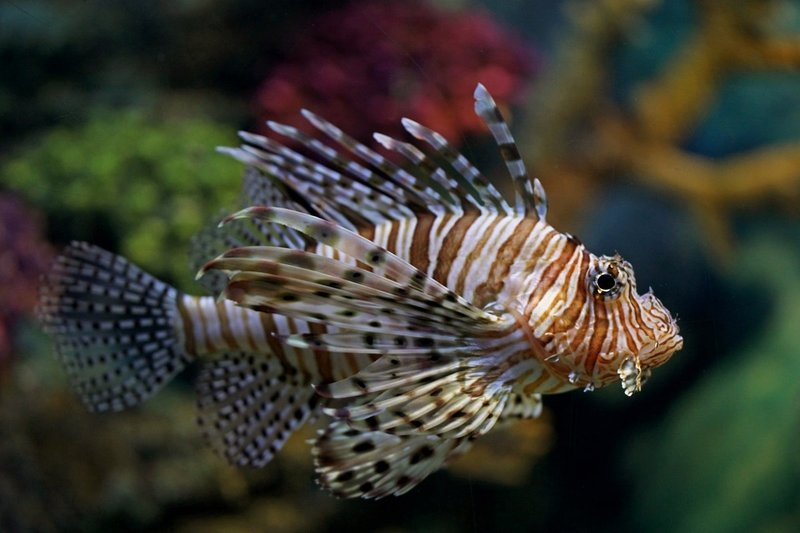

# Pez león — *Pterois volitans* (Linnaeus, 1758)

> Archivo generado desde `especies/datos/catalogo_inicial.json` con `especies/herramientas/generar_fichas.py`. No editar a mano.

*Imagen ilustrativa generada con IA por Brayan (2026-11-18). No es una fotografía de un ejemplar real; puede contener errores anatómicos.*

**Grupo:** pez  
**Otros nombres:** Red lionfish, Volitan lionfish, Turkeyfish  
**Fecha de consulta:** 2026-11-18  
**Confianza global:** media  
**Estado:** verificada; pendiente de revisión del equipo

## Ficha AIRI

| Campo | Valor |
|---|---|
| Nombre común | Pez león |
| Nombre científico | *Pterois volitans* |
| Temperamento | Semiagresivo |
| Comportamiento | Solitario. Depredador: se come peces pequeños y crustáceos. Sus espinas son venenosas. |
| Adecuado para arrecife | Con precaución. LiveAquaria lo marca «con precaución»: puede comerse peces pequeños, camarones y otros crustáceos. |
| Tipo de alimentación | Carnívoro: peces pequeños, camarones y cangrejos, camarón crudo, pescado y calamar congelados. |
| Temperatura | 22.2–25.6 °C |
| Litraje recomendado | 454.2 L (120 gal EE. UU.). *Es el mínimo recomendado por una sola fuente comercial; ninguna fuente científica consultada establece un litraje.* |
| Tamaño adulto | 45.7 cm (longitud total). Al venderse mide 7.6–15.2 cm (juvenil o subadulto). *Diferencia menor entre fuentes: FishBase 45.7 cm; LiveAquaria 15 in (≈ 38.1 cm).* |

## Detalle verificado

| Campo | Dato | Confianza | Fuentes |
|---|---|---|---|
| Clasificación taxonómica | Clase Teleostei; orden Perciformes; familia Scorpaenidae. WoRMS AphiaID 159559 (aceptado). Sinónimos: Gasterosteus volitans Linnaeus, 1758 (combinación original). LiveAquaria indica que es muy parecido al pez león Miles (Pterois miles), propio del océano Índico, que tiene menos espinas en las aletas dorsal y anal. | alta | [worms_pterois_volitans](https://www.marinespecies.org/aphia.php?p=taxdetails&id=159559), [fishbase_pterois_volitans](https://www.fishbase.se/summary/Pterois-volitans.html) |
| Hábitat natural | Lagunas y arrecifes externos, desde aguas costeras turbias hasta 50 m. De día se esconde casi inmóvil, a menudo cabeza abajo (FishBase). Profundidad: 2–55 m. Distribución: Océano Pacífico: de las islas Cocos-Keeling y Australia occidental a las Marquesas y Pitcairn; al norte hasta el sur de Japón y Corea. | alta | [fishbase_pterois_volitans](https://www.fishbase.se/summary/Pterois-volitans.html) |
| Tamaño adulto | Máx. 45.7 cm (longitud total). Diferencia menor entre fuentes: FishBase 45.7 cm; LiveAquaria 15 in (≈ 38.1 cm). | media | [fishbase_pterois_volitans](https://www.fishbase.se/summary/Pterois-volitans.html), [liveaquaria_pterois_volitans](https://www.liveaquaria.com/products/volitan-lionfish-colored) |
| Alimentación | De noche caza peces pequeños, camarones y cangrejos acorralándolos con sus grandes aletas pectorales (FishBase). En acuario, al principio camarón vivo; después puede aceptar camarón crudo, pescado y calamar congelados (LiveAquaria). | alta | [fishbase_pterois_volitans](https://www.fishbase.se/summary/Pterois-volitans.html), [liveaquaria_pterois_volitans](https://www.liveaquaria.com/products/volitan-lionfish-colored) |
| Temperatura del agua | Acuario: 22.2–25.6 °C (72–78 °F). Medio natural: 22–28 °C. El rango de acuario cae dentro del rango registrado en el medio natural. | media | [liveaquaria_pterois_volitans](https://www.liveaquaria.com/products/volitan-lionfish-colored), [fishbase_pterois_volitans](https://www.fishbase.se/summary/Pterois-volitans.html) |
| Rango de pH | Fuente de acuario: 8.1–8.4. Rango prudente AIRI: 8.1–8.3. Criterio: Intersección con la tabla MSD para agua salada (7.8–8.3). | media | [liveaquaria_pterois_volitans](https://www.liveaquaria.com/products/volitan-lionfish-colored), [msd_tabla_referencia](https://www.msdvetmanual.com/multimedia/table/normal-reference-ranges-for-routine-water-quality-analysis), [msd_capitulo](https://www.msdvetmanual.com/exotic-and-laboratory-animals/aquatic-systems/environmental-diseases-of-aquatic-animals-in-aquatic-systems) |
| Salinidad | 1.020–1.025 de gravedad específica (adimensional). Agua de mar media: 35 ppt (UF/IFAS). No se convierte a ppt porque la equivalencia depende de la temperatura. | media | [liveaquaria_pterois_volitans](https://www.liveaquaria.com/products/volitan-lionfish-colored), [ufifas_ph_sal_temp](https://waterwatch.ifas.ufl.edu/media/waterwatchifasufledu/FactSheet_pH_Sal_Temp.pdf) |
| Volumen mínimo | 454.2 L (120 gal EE. UU.). Justificación: Cifra de LiveAquaria (120 gal), con numerosos escondites. | baja | [liveaquaria_pterois_volitans](https://www.liveaquaria.com/products/volitan-lionfish-colored) |
| Comportamiento | Suele ser solitario (FishBase). Se esconde mientras se aclimata y después pasa más tiempo a la vista (LiveAquaria). | media | [fishbase_pterois_volitans](https://www.fishbase.se/summary/Pterois-volitans.html), [liveaquaria_pterois_volitans](https://www.liveaquaria.com/products/volitan-lionfish-colored) |
| Territorialidad y refugio | Necesita numerosos escondites (LiveAquaria). | media | [liveaquaria_pterois_volitans](https://www.liveaquaria.com/products/volitan-lionfish-colored) |
| Compatibilidad con arrecife | con precaución (según la fuente; sin verificación independiente) | baja | [liveaquaria_pterois_volitans](https://www.liveaquaria.com/products/volitan-lionfish-colored) |
| Convivencia: condiciones | Acuario de 120 gal o más con escondites. · Sin peces pequeños ni camarones. | baja | [liveaquaria_pterois_volitans](https://www.liveaquaria.com/products/volitan-lionfish-colored), [fishbase_pterois_volitans](https://www.fishbase.se/summary/Pterois-volitans.html) |
| Convivencia: riesgos | Espinas dorsales, pélvicas y anales venenosas: la picadura es como la de una abeja pero más fuerte (LiveAquaria; FishBase lo clasifica como venenoso). · Se come peces pequeños y crustáceos. | baja | [liveaquaria_pterois_volitans](https://www.liveaquaria.com/products/volitan-lionfish-colored), [fishbase_pterois_volitans](https://www.fishbase.se/summary/Pterois-volitans.html) |
| Conservación | Preocupación menor (LC), evaluada el 03/03/2015, según FishBase. | media | [fishbase_pterois_volitans](https://www.fishbase.se/summary/Pterois-volitans.html) |

**Regla AIRI:** compartir rangos de agua no implica compatibilidad entre especies. Los rangos de acuario provienen de una fuente comercial y no son límites veterinarios.

## Fuentes

- **worms_pterois_volitans** (taxonomía): WoRMS — Pterois volitans (Linnaeus, 1758) (AphiaID 159559). <https://www.marinespecies.org/aphia.php?p=taxdetails&id=159559>. Consultada el 2026-11-18.
- **fishbase_pterois_volitans** (biología): FishBase — Pterois volitans. <https://www.fishbase.se/summary/Pterois-volitans.html>. Consultada el 2026-11-18.
- **liveaquaria_pterois_volitans** (comercial): LiveAquaria — Volitan Lionfish, Colored (Pterois volitans). <https://www.liveaquaria.com/products/volitan-lionfish-colored>. Consultada el 2026-11-18.
- **msd_tabla_referencia** (veterinaria): MSD Veterinary Manual — “Normal” Reference Ranges for Routine Water Quality Analysis. <https://www.msdvetmanual.com/multimedia/table/normal-reference-ranges-for-routine-water-quality-analysis>. Consultada el 2026-11-12. Reutilizada del registro del motor (motor/airi_motor/datos/fuentes.json); no se volvió a consultar para estas fichas.
- **ufifas_ph_sal_temp** (institucional): UF/IFAS — pH, Salinity and Temperature (hoja informativa). <https://waterwatch.ifas.ufl.edu/media/waterwatchifasufledu/FactSheet_pH_Sal_Temp.pdf>. Consultada el 2026-11-12. Reutilizada del registro del motor (motor/airi_motor/datos/fuentes.json); no se volvió a consultar para estas fichas.
- **msd_capitulo** (veterinaria): MSD Veterinary Manual — Environmental Diseases of Aquatic Animals in Aquatic Systems. <https://www.msdvetmanual.com/exotic-and-laboratory-animals/aquatic-systems/environmental-diseases-of-aquatic-animals-in-aquatic-systems>. Consultada el 2026-11-12. Reutilizada del registro del motor (motor/airi_motor/datos/fuentes.json); no se volvió a consultar para estas fichas.
