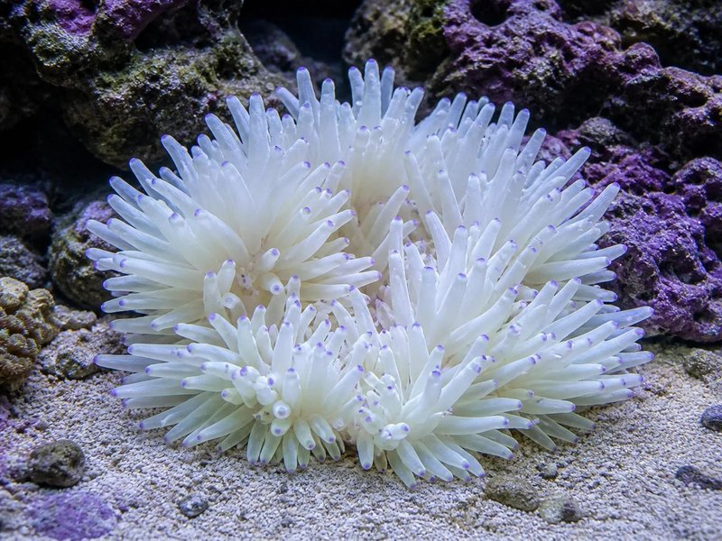

# Anémona sebae — *Radianthus crispa* (Hemprich & Ehrenberg in Ehrenberg, 1834)

> Archivo generado desde `especies/datos/catalogo_inicial.json` con `especies/herramientas/generar_fichas.py`. No editar a mano.

*Imagen ilustrativa generada con IA por Brayan (2026-11-16). No es una fotografía de un ejemplar real; puede contener errores anatómicos.*

**Grupo:** anémona  
**Otros nombres:** Sebae anemone, Leathery sea anemone, Heteractis crispa (nombre anterior)  
**Fecha de consulta:** 2026-11-16  
**Confianza global:** baja  
**Estado:** verificada; pendiente de revisión del equipo

## Ficha AIRI

| Campo | Valor |
|---|---|
| Nombre común | Anémona sebae |
| Nombre científico | *Radianthus crispa* |
| Temperamento | Agresivo |
| Comportamiento | . Agresiva y difícil de aclimatar: solo para expertos. Hospeda peces payaso. Necesita luz intensa. |
| Adecuado para arrecife | Con precaución. LiveAquaria la marca «con precaución» en sus datos rápidos y la clasifica como agresiva. |
| Tipo de alimentación | Carnívoro: pescado y camarón, gusanos y almejas, luz intensa. |
| Temperatura | 22.2–25.6 °C |
| Litraje recomendado | 113.6 L (30 gal EE. UU.). *Es el mínimo recomendado por una sola fuente comercial; ninguna fuente científica consultada establece un litraje.* |
| Tamaño adulto | 50.8 cm (diámetro). Al venderse mide 5.1–10.2 cm (juvenil o subadulto). *SeaLifeBase no indica tamaño; LiveAquaria indica 20 in (≈ 50.8 cm), en una página que mezcla dos especies.* |

## Detalle verificado

| Campo | Dato | Confianza | Fuentes |
|---|---|---|---|
| Clasificación taxonómica | Clase Anthozoa (Hexacorallia); orden Actiniaria; familia Stichodactylidae. WoRMS AphiaID 290089 (aceptado). Sinónimos: Actinia (Entacmaea) crispa (combinación original), Heteractis crispa (nombre usado en acuariofilia), Radianthus crispus. WoRMS acepta Radianthus crispa; SeaLifeBase y LiveAquaria siguen usando Heteractis crispa. En el comercio, «sebae» también se aplica a Heteractis malu: la página de LiveAquaria mezcla las dos especies, así que sus datos tienen confianza baja. | alta | [worms_radianthus_crispa](https://www.marinespecies.org/aphia.php?p=taxdetails&id=290089), [sealifebase_radianthus_crispa](https://www.sealifebase.se/summary/Heteractis-crispa.html) |
| Hábitat natural | Submareal, entre coral muerto y cascajo rocoso (SeaLifeBase). Profundidad: no indicada. Distribución: Indo-Pacífico occidental. | media | [sealifebase_radianthus_crispa](https://www.sealifebase.se/summary/Heteractis-crispa.html) |
| Tamaño adulto | Máx. 50.8 cm (diámetro). SeaLifeBase no indica tamaño; LiveAquaria indica 20 in (≈ 50.8 cm), en una página que mezcla dos especies. | baja | [sealifebase_radianthus_crispa](https://www.sealifebase.se/summary/Heteractis-crispa.html), [liveaquaria_radianthus_crispa](https://www.liveaquaria.com/products/sebae-anemone) |
| Alimentación | Carnívora: una vez aclimatada, se le da pescado, gusanos, almejas, camarón y otros alimentos cárnicos una vez por semana. Necesita iluminación intensa (LiveAquaria). | baja | [liveaquaria_radianthus_crispa](https://www.liveaquaria.com/products/sebae-anemone) |
| Temperatura del agua | Acuario: 22.2–25.6 °C (72–78 °F). SeaLifeBase no indica rango de temperatura para esta especie. | baja | [liveaquaria_radianthus_crispa](https://www.liveaquaria.com/products/sebae-anemone) |
| Rango de pH | Fuente de acuario: 8.1–8.4. Rango prudente AIRI: 8.1–8.3. Criterio: Intersección con la tabla MSD para agua salada (7.8–8.3). | media | [liveaquaria_radianthus_crispa](https://www.liveaquaria.com/products/sebae-anemone), [msd_tabla_referencia](https://www.msdvetmanual.com/multimedia/table/normal-reference-ranges-for-routine-water-quality-analysis), [msd_capitulo](https://www.msdvetmanual.com/exotic-and-laboratory-animals/aquatic-systems/environmental-diseases-of-aquatic-animals-in-aquatic-systems) |
| Salinidad | 1.020–1.025 de gravedad específica (adimensional). Agua de mar media: 35 ppt (UF/IFAS). No se convierte a ppt porque la equivalencia depende de la temperatura. | media | [liveaquaria_radianthus_crispa](https://www.liveaquaria.com/products/sebae-anemone), [ufifas_ph_sal_temp](https://waterwatch.ifas.ufl.edu/media/waterwatchifasufledu/FactSheet_pH_Sal_Temp.pdf) |
| Volumen mínimo | 113.6 L (30 gal EE. UU.). Justificación: Cifra de los datos rápidos de LiveAquaria (30 gal). | baja | [liveaquaria_radianthus_crispa](https://www.liveaquaria.com/products/sebae-anemone) |
| Comportamiento | Su aclimatación es muy difícil: solo para aficionados muy expertos. Un pez payaso ayuda a que se adapte. Cuando está sana se vuelve muy pegajosa y es difícil despegarla sin dañarla (LiveAquaria). | media | [sealifebase_radianthus_crispa](https://www.sealifebase.se/summary/Heteractis-crispa.html), [liveaquaria_radianthus_crispa](https://www.liveaquaria.com/products/sebae-anemone) |
| Territorialidad y refugio | Elige su lugar entre zonas de arena y roca porosa. | media | [liveaquaria_radianthus_crispa](https://www.liveaquaria.com/products/sebae-anemone), [sealifebase_radianthus_crispa](https://www.sealifebase.se/summary/Heteractis-crispa.html) |
| Compatibilidad con arrecife | con precaución (según la fuente; sin verificación independiente) | baja | [liveaquaria_radianthus_crispa](https://www.liveaquaria.com/products/sebae-anemone) |
| Convivencia: condiciones | Solo para expertos. · Luz intensa. · Arena y roca viva porosa. | baja | [liveaquaria_radianthus_crispa](https://www.liveaquaria.com/products/sebae-anemone), [sealifebase_radianthus_crispa](https://www.sealifebase.se/summary/Heteractis-crispa.html) |
| Convivencia: riesgos | Aclimatación muy difícil. · Se pega con fuerza a lo que toca y es difícil despegarla sin dañarla. | baja | [liveaquaria_radianthus_crispa](https://www.liveaquaria.com/products/sebae-anemone), [sealifebase_radianthus_crispa](https://www.sealifebase.se/summary/Heteractis-crispa.html) |
| Conservación | No evaluada por la UICN, según SeaLifeBase. | media | [sealifebase_radianthus_crispa](https://www.sealifebase.se/summary/Heteractis-crispa.html) |

**Regla AIRI:** compartir rangos de agua no implica compatibilidad entre especies. Los rangos de acuario provienen de una fuente comercial y no son límites veterinarios.

## Fuentes

- **worms_radianthus_crispa** (taxonomía): WoRMS — Radianthus crispa (Hemprich & Ehrenberg in Ehrenberg, 1834) (AphiaID 290089). <https://www.marinespecies.org/aphia.php?p=taxdetails&id=290089>. Consultada el 2026-11-16.
- **sealifebase_radianthus_crispa** (biología): SeaLifeBase — Heteractis crispa. <https://www.sealifebase.se/summary/Heteractis-crispa.html>. Consultada el 2026-11-16.
- **liveaquaria_radianthus_crispa** (comercial): LiveAquaria — Sebae Anemone (Heteractis crispa). <https://www.liveaquaria.com/products/sebae-anemone>. Consultada el 2026-11-16.
- **msd_tabla_referencia** (veterinaria): MSD Veterinary Manual — “Normal” Reference Ranges for Routine Water Quality Analysis. <https://www.msdvetmanual.com/multimedia/table/normal-reference-ranges-for-routine-water-quality-analysis>. Consultada el 2026-11-12. Reutilizada del registro del motor (motor/airi_motor/datos/fuentes.json); no se volvió a consultar para estas fichas.
- **ufifas_ph_sal_temp** (institucional): UF/IFAS — pH, Salinity and Temperature (hoja informativa). <https://waterwatch.ifas.ufl.edu/media/waterwatchifasufledu/FactSheet_pH_Sal_Temp.pdf>. Consultada el 2026-11-12. Reutilizada del registro del motor (motor/airi_motor/datos/fuentes.json); no se volvió a consultar para estas fichas.
- **msd_capitulo** (veterinaria): MSD Veterinary Manual — Environmental Diseases of Aquatic Animals in Aquatic Systems. <https://www.msdvetmanual.com/exotic-and-laboratory-animals/aquatic-systems/environmental-diseases-of-aquatic-animals-in-aquatic-systems>. Consultada el 2026-11-12. Reutilizada del registro del motor (motor/airi_motor/datos/fuentes.json); no se volvió a consultar para estas fichas.
