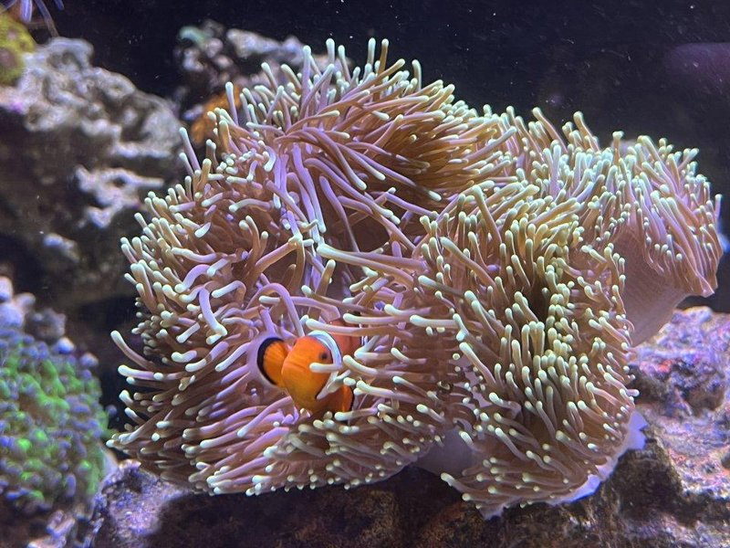

# Anémona magnífica — *Radianthus magnifica* (Quoy & Gaimard, 1833)

> Archivo generado desde `especies/datos/catalogo_inicial.json` con `especies/herramientas/generar_fichas.py`. No editar a mano.

*Imagen ilustrativa generada con IA por Brayan (2026-11-16). No es una fotografía de un ejemplar real; puede contener errores anatómicos.*

**Grupo:** anémona  
**Otros nombres:** Magnificent anemone, Ritteri anemone, Heteractis magnifica (nombre anterior)  
**Fecha de consulta:** 2026-11-16  
**Confianza global:** baja  
**Estado:** verificada; pendiente de revisión del equipo

## Ficha AIRI

| Campo | Valor |
|---|---|
| Nombre común | Anémona magnífica |
| Nombre científico | *Radianthus magnifica* |
| Temperamento | Agresivo *Quality Marine indica «Behavior: Agressive».* |
| Comportamiento | . Agresiva y difícil (solo expertos). Puede desplazarse por el acuario. Hospeda peces payaso. Necesita luz intensa. |
| Adecuado para arrecife | Con precaución. Criterio de AIRI: Quality Marine no indica si es apta para arrecife, pero advierte que puede desplazarse por el acuario y la clasifica como agresiva. |
| Tipo de alimentación | Carnívoro: trocitos de alimentos cárnicos, luz intensa (zooxantelas simbióticas). *Combina la captura de alimento con la fotosíntesis de sus zooxantelas.* |
| Temperatura | 22.2–25.6 °C *Rango de Quality Marine.* |
| Litraje recomendado | null (no verificado). *Ninguna fuente consultada publica un litraje mínimo para este organismo; se deja en null en lugar de estimarlo.* |
| Tamaño adulto | 91.4 cm (diámetro). *SeaLifeBase no indica tamaño; Quality Marine indica que puede llegar a casi 36 in (≈ 91.4 cm) y que es la segunda anémona más grande.* |

## Detalle verificado

| Campo | Dato | Confianza | Fuentes |
|---|---|---|---|
| Clasificación taxonómica | Clase Anthozoa (Hexacorallia); orden Actiniaria; familia Stichodactylidae. WoRMS AphiaID 854493 (aceptado). Sinónimos: Actinia magnifica Quoy & Gaimard, 1833 (combinación original), Heteractis magnifica (nombre usado en acuariofilia), Heteractis ritteri, Radianthus ritteri. WoRMS acepta Radianthus magnifica; Heteractis magnifica es su nombre anterior y SeaLifeBase todavía lo usa. En el comercio también se llama «ritteri». | alta | [worms_radianthus_magnifica](https://www.marinespecies.org/aphia.php?p=taxdetails&id=854493), [sealifebase_radianthus_magnifica](https://www.sealifebase.se/summary/Heteractis-magnifica.html) |
| Hábitat natural | Sésil y solitaria (SeaLifeBase). Profundidad: 1–50 m. Distribución: Indo-Pacífico. | media | [sealifebase_radianthus_magnifica](https://www.sealifebase.se/summary/Heteractis-magnifica.html) |
| Tamaño adulto | Máx. 91.4 cm (diámetro). SeaLifeBase no indica tamaño; Quality Marine indica que puede llegar a casi 36 in (≈ 91.4 cm) y que es la segunda anémona más grande. | baja | [qualitymarine_radianthus_magnifica](https://www.qualitymarine.com/quality-marine/invertebrates/anemones/heteractis/ritteri-50017/) |
| Alimentación | Carnívora: Quality Marine recomienda darle a mano trocitos de alimentos cárnicos. Además necesita luz intensa para alimentar a sus zooxantelas simbióticas por fotosíntesis. | baja | [qualitymarine_radianthus_magnifica](https://www.qualitymarine.com/quality-marine/invertebrates/anemones/heteractis/ritteri-50017/) |
| Temperatura del agua | Acuario: 22.2–25.6 °C (72–78 °F). Ninguna fuente científica consultada indica temperatura; el rango es de Quality Marine. | baja | [qualitymarine_radianthus_magnifica](https://www.qualitymarine.com/quality-marine/invertebrates/anemones/heteractis/ritteri-50017/) |
| Rango de pH | Fuente de acuario: 8.1–8.4. Rango prudente AIRI: 8.1–8.3. Criterio: Intersección con la tabla MSD para agua salada (7.8–8.3). | media | [qualitymarine_radianthus_magnifica](https://www.qualitymarine.com/quality-marine/invertebrates/anemones/heteractis/ritteri-50017/), [msd_tabla_referencia](https://www.msdvetmanual.com/multimedia/table/normal-reference-ranges-for-routine-water-quality-analysis), [msd_capitulo](https://www.msdvetmanual.com/exotic-and-laboratory-animals/aquatic-systems/environmental-diseases-of-aquatic-animals-in-aquatic-systems) |
| Salinidad | 1.023–1.025 de gravedad específica (adimensional). Agua de mar media: 35 ppt (UF/IFAS). No se convierte a ppt porque la equivalencia depende de la temperatura. | media | [qualitymarine_radianthus_magnifica](https://www.qualitymarine.com/quality-marine/invertebrates/anemones/heteractis/ritteri-50017/), [ufifas_ph_sal_temp](https://waterwatch.ifas.ufl.edu/media/waterwatchifasufledu/FactSheet_pH_Sal_Temp.pdf) |
| Volumen mínimo | null (no verificado). Justificación: Quality Marine recomienda acuarios grandes por su tamaño, pero no da una cifra. | baja |  |
| Comportamiento | Puede desplazarse con su pie hasta el lugar del acuario que más le conviene. Hospeda muchas especies de peces payaso, entre ellas A. ocellaris y A. percula. Quality Marine la clasifica como agresiva y de cuidado difícil. | media | [qualitymarine_radianthus_magnifica](https://www.qualitymarine.com/quality-marine/invertebrates/anemones/heteractis/ritteri-50017/) |
| Territorialidad y refugio | Busca un lugar donde enterrar su pie en fondo arenoso, fangoso o de cascajo. | media | [qualitymarine_radianthus_magnifica](https://www.qualitymarine.com/quality-marine/invertebrates/anemones/heteractis/ritteri-50017/) |
| Compatibilidad con arrecife | con precaución (según la fuente; sin verificación independiente) | baja | [qualitymarine_radianthus_magnifica](https://www.qualitymarine.com/quality-marine/invertebrates/anemones/heteractis/ritteri-50017/) |
| Convivencia: condiciones | Acuario grande y bien establecido. · Luz intensa. · Fondo de arena o cascajo donde fijar su pie. | baja | [qualitymarine_radianthus_magnifica](https://www.qualitymarine.com/quality-marine/invertebrates/anemones/heteractis/ritteri-50017/) |
| Convivencia: riesgos | Cuidado difícil. · Puede desplazarse por el acuario. · No tolera medicamentos con cobre. | baja | [qualitymarine_radianthus_magnifica](https://www.qualitymarine.com/quality-marine/invertebrates/anemones/heteractis/ritteri-50017/) |
| Conservación | No evaluada por la UICN, según SeaLifeBase. | media | [sealifebase_radianthus_magnifica](https://www.sealifebase.se/summary/Heteractis-magnifica.html) |

**Regla AIRI:** compartir rangos de agua no implica compatibilidad entre especies. Los rangos de acuario provienen de una fuente comercial y no son límites veterinarios.

## Fuentes

- **worms_radianthus_magnifica** (taxonomía): WoRMS — Radianthus magnifica (Quoy & Gaimard, 1833) (AphiaID 854493). <https://www.marinespecies.org/aphia.php?p=taxdetails&id=854493>. Consultada el 2026-11-16.
- **sealifebase_radianthus_magnifica** (biología): SeaLifeBase — Heteractis magnifica. <https://www.sealifebase.se/summary/Heteractis-magnifica.html>. Consultada el 2026-11-16.
- **qualitymarine_radianthus_magnifica** (comercial): Quality Marine — Ritteri Anemone. <https://www.qualitymarine.com/quality-marine/invertebrates/anemones/heteractis/ritteri-50017/>. Consultada el 2026-11-16.
- **msd_tabla_referencia** (veterinaria): MSD Veterinary Manual — “Normal” Reference Ranges for Routine Water Quality Analysis. <https://www.msdvetmanual.com/multimedia/table/normal-reference-ranges-for-routine-water-quality-analysis>. Consultada el 2026-11-12. Reutilizada del registro del motor (motor/airi_motor/datos/fuentes.json); no se volvió a consultar para estas fichas.
- **ufifas_ph_sal_temp** (institucional): UF/IFAS — pH, Salinity and Temperature (hoja informativa). <https://waterwatch.ifas.ufl.edu/media/waterwatchifasufledu/FactSheet_pH_Sal_Temp.pdf>. Consultada el 2026-11-12. Reutilizada del registro del motor (motor/airi_motor/datos/fuentes.json); no se volvió a consultar para estas fichas.
- **msd_capitulo** (veterinaria): MSD Veterinary Manual — Environmental Diseases of Aquatic Animals in Aquatic Systems. <https://www.msdvetmanual.com/exotic-and-laboratory-animals/aquatic-systems/environmental-diseases-of-aquatic-animals-in-aquatic-systems>. Consultada el 2026-11-12. Reutilizada del registro del motor (motor/airi_motor/datos/fuentes.json); no se volvió a consultar para estas fichas.
