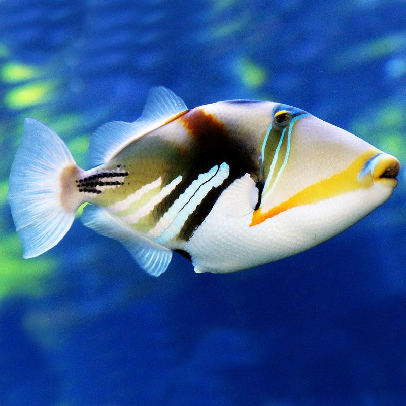

# Pez ballesta Picasso — *Rhinecanthus aculeatus* (Linnaeus, 1758)

> Archivo generado desde `especies/datos/catalogo_inicial.json` con `especies/herramientas/generar_fichas.py`. No editar a mano.

*Imagen ilustrativa generada con IA por Brayan (2026-11-16). No es una fotografía de un ejemplar real; puede contener errores anatómicos.*

**Grupo:** pez  
**Otros nombres:** Picasso triggerfish, Humu Picasso triggerfish, White-banded triggerfish  
**Fecha de consulta:** 2026-11-16  
**Confianza global:** media  
**Estado:** verificada; pendiente de revisión del equipo

## Ficha AIRI

| Campo | Valor |
|---|---|
| Nombre común | Pez ballesta Picasso |
| Nombre científico | *Rhinecanthus aculeatus* |
| Temperamento | Agresivo |
| Comportamiento | Territorial. Agresivo y territorial. Mueve las rocas del acuario y emite gruñidos. Come invertebrados y peces pequeños. |
| Adecuado para arrecife | No. LiveAquaria no lo considera apto para arrecife; en la naturaleza come corales e invertebrados. |
| Tipo de alimentación | Omnívoro: moluscos, crustáceos y erizos, algas y detritos, calamar, krill y almejas, camarones de caparazón duro. *LiveAquaria lo clasifica como carnívoro en acuario; FishBase describe una dieta omnívora en la naturaleza.* |
| Temperatura | 22.2–25.6 °C |
| Litraje recomendado | 681.3 L (180 gal EE. UU.). *Es el mínimo recomendado por una sola fuente comercial; ninguna fuente científica consultada establece un litraje.* |
| Tamaño adulto | 30 cm (longitud total). Al venderse mide 2.5–14 cm (juvenil o subadulto). Madura desde 14 cm. *Diferencia entre fuentes: FishBase 30 cm (longitud habitual 15 cm); LiveAquaria 10 in (≈ 25.4 cm).* |

## Detalle verificado

| Campo | Dato | Confianza | Fuentes |
|---|---|---|---|
| Clasificación taxonómica | Clase Teleostei; orden Tetraodontiformes; familia Balistidae. WoRMS AphiaID 219890 (aceptado). Sinónimos: Balistes aculeatus Linnaeus, 1758 (combinación original), Balistapus aculeatus. | alta | [worms_rhinecanthus_aculeatus](https://www.marinespecies.org/aphia.php?p=taxdetails&id=219890), [fishbase_rhinecanthus_aculeatus](https://www.fishbase.se/summary/Rhinecanthus-aculeatus.html) |
| Hábitat natural | Planicies arrecifales submareales y lagunas someras protegidas. Los juveniles se esconden entre el cascajo; los adultos nadan a la vista pero son tímidos. Profundidad: 0–50 m. Distribución: Indo-Pacífico, de África oriental por el norte de Australia a Hawái, Marquesas y Tuamotu; al norte hasta el sur de Japón. | media | [fishbase_rhinecanthus_aculeatus](https://www.fishbase.se/summary/Rhinecanthus-aculeatus.html) |
| Tamaño adulto | Máx. 30 cm (longitud total). Diferencia entre fuentes: FishBase 30 cm (longitud habitual 15 cm); LiveAquaria 10 in (≈ 25.4 cm). | media | [fishbase_rhinecanthus_aculeatus](https://www.fishbase.se/summary/Rhinecanthus-aculeatus.html), [liveaquaria_rhinecanthus_aculeatus](https://www.liveaquaria.com/products/humu-picasso-triggerfish) |
| Alimentación | Omnívoro en la naturaleza: algas, detritos, moluscos, crustáceos, gusanos, erizos, peces, corales, tunicados, foraminíferos y huevos (FishBase). En acuario, LiveAquaria recomienda alimentos cárnicos (calamar, krill, almejas, peces pequeños y camarones de caparazón duro) para desgastar sus dientes, que crecen sin parar. | alta | [fishbase_rhinecanthus_aculeatus](https://www.fishbase.se/summary/Rhinecanthus-aculeatus.html), [liveaquaria_rhinecanthus_aculeatus](https://www.liveaquaria.com/products/humu-picasso-triggerfish) |
| Temperatura del agua | Acuario: 22.2–25.6 °C (72–78 °F). FishBase no indica rango de temperatura para esta especie. | baja | [liveaquaria_rhinecanthus_aculeatus](https://www.liveaquaria.com/products/humu-picasso-triggerfish) |
| Rango de pH | Fuente de acuario: 8.1–8.4. Rango prudente AIRI: 8.1–8.3. Criterio: Intersección con la tabla MSD para agua salada (7.8–8.3). | media | [liveaquaria_rhinecanthus_aculeatus](https://www.liveaquaria.com/products/humu-picasso-triggerfish), [msd_tabla_referencia](https://www.msdvetmanual.com/multimedia/table/normal-reference-ranges-for-routine-water-quality-analysis), [msd_capitulo](https://www.msdvetmanual.com/exotic-and-laboratory-animals/aquatic-systems/environmental-diseases-of-aquatic-animals-in-aquatic-systems) |
| Salinidad | 1.020–1.025 de gravedad específica (adimensional). Agua de mar media: 35 ppt (UF/IFAS). No se convierte a ppt porque la equivalencia depende de la temperatura. | media | [liveaquaria_rhinecanthus_aculeatus](https://www.liveaquaria.com/products/humu-picasso-triggerfish), [ufifas_ph_sal_temp](https://waterwatch.ifas.ufl.edu/media/waterwatchifasufledu/FactSheet_pH_Sal_Temp.pdf) |
| Volumen mínimo | 681.3 L (180 gal EE. UU.). Justificación: Cifra de LiveAquaria (180 gal), con rocas y cuevas; suele reorganizar las rocas del acuario. | baja | [liveaquaria_rhinecanthus_aculeatus](https://www.liveaquaria.com/products/humu-picasso-triggerfish) |
| Comportamiento | Territorial (FishBase); duerme de lado y hace un zumbido cuando se alarma. Las hembras son territoriales y cuidan los huevos. En acuario es agresivo, reorganiza las rocas y emite gruñidos (LiveAquaria). | media | [fishbase_rhinecanthus_aculeatus](https://www.fishbase.se/summary/Rhinecanthus-aculeatus.html), [liveaquaria_rhinecanthus_aculeatus](https://www.liveaquaria.com/products/humu-picasso-triggerfish) |
| Territorialidad y refugio | Territorial. Necesita rocas y cuevas. | media | [liveaquaria_rhinecanthus_aculeatus](https://www.liveaquaria.com/products/humu-picasso-triggerfish), [fishbase_rhinecanthus_aculeatus](https://www.fishbase.se/summary/Rhinecanthus-aculeatus.html) |
| Compatibilidad con arrecife | no (según la fuente; sin verificación independiente) | baja | [liveaquaria_rhinecanthus_aculeatus](https://www.liveaquaria.com/products/humu-picasso-triggerfish) |
| Convivencia: condiciones | Acuario grande con rocas firmes y cuevas. · Compañeros grandes y robustos. | baja | [liveaquaria_rhinecanthus_aculeatus](https://www.liveaquaria.com/products/humu-picasso-triggerfish), [fishbase_rhinecanthus_aculeatus](https://www.fishbase.se/summary/Rhinecanthus-aculeatus.html) |
| Convivencia: riesgos | Come invertebrados y peces pequeños. · Mueve la decoración y las rocas. · FishBase registra casos de intoxicación por ciguatera al consumirlo. | baja | [liveaquaria_rhinecanthus_aculeatus](https://www.liveaquaria.com/products/humu-picasso-triggerfish), [fishbase_rhinecanthus_aculeatus](https://www.fishbase.se/summary/Rhinecanthus-aculeatus.html) |
| Conservación | Preocupación menor (LC), evaluada el 14/01/2022, según FishBase. | media | [fishbase_rhinecanthus_aculeatus](https://www.fishbase.se/summary/Rhinecanthus-aculeatus.html) |

**Regla AIRI:** compartir rangos de agua no implica compatibilidad entre especies. Los rangos de acuario provienen de una fuente comercial y no son límites veterinarios.

## Fuentes

- **worms_rhinecanthus_aculeatus** (taxonomía): WoRMS — Rhinecanthus aculeatus (Linnaeus, 1758) (AphiaID 219890). <https://www.marinespecies.org/aphia.php?p=taxdetails&id=219890>. Consultada el 2026-11-16.
- **fishbase_rhinecanthus_aculeatus** (biología): FishBase — Rhinecanthus aculeatus. <https://www.fishbase.se/summary/Rhinecanthus-aculeatus.html>. Consultada el 2026-11-16.
- **liveaquaria_rhinecanthus_aculeatus** (comercial): LiveAquaria — Humu Picasso Triggerfish. <https://www.liveaquaria.com/products/humu-picasso-triggerfish>. Consultada el 2026-11-16.
- **msd_tabla_referencia** (veterinaria): MSD Veterinary Manual — “Normal” Reference Ranges for Routine Water Quality Analysis. <https://www.msdvetmanual.com/multimedia/table/normal-reference-ranges-for-routine-water-quality-analysis>. Consultada el 2026-11-12. Reutilizada del registro del motor (motor/airi_motor/datos/fuentes.json); no se volvió a consultar para estas fichas.
- **ufifas_ph_sal_temp** (institucional): UF/IFAS — pH, Salinity and Temperature (hoja informativa). <https://waterwatch.ifas.ufl.edu/media/waterwatchifasufledu/FactSheet_pH_Sal_Temp.pdf>. Consultada el 2026-11-12. Reutilizada del registro del motor (motor/airi_motor/datos/fuentes.json); no se volvió a consultar para estas fichas.
- **msd_capitulo** (veterinaria): MSD Veterinary Manual — Environmental Diseases of Aquatic Animals in Aquatic Systems. <https://www.msdvetmanual.com/exotic-and-laboratory-animals/aquatic-systems/environmental-diseases-of-aquatic-animals-in-aquatic-systems>. Consultada el 2026-11-12. Reutilizada del registro del motor (motor/airi_motor/datos/fuentes.json); no se volvió a consultar para estas fichas.
