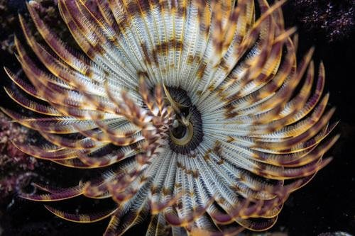

# Gusano plumero — *Sabellastarte sp.* Krøyer, 1856 (género)

> Archivo generado desde `especies/datos/catalogo_inicial.json` con `especies/herramientas/generar_fichas.py`. No editar a mano.

*Imagen ilustrativa generada con IA por Brayan (2026-11-16). No es una fotografía de un ejemplar real; puede contener errores anatómicos.*

**Grupo:** gusano  
**Otros nombres:** Feather duster, Giant feather duster  
**Fecha de consulta:** 2026-11-16  
**Confianza global:** baja  
**Estado:** verificada; pendiente de revisión del equipo

## Ficha AIRI

| Campo | Valor |
|---|---|
| Nombre común | Gusano plumero |
| Nombre científico | *Sabellastarte sp.* |
| Temperamento | Pacífico |
| Comportamiento | Pacífico. Pacífico. Vive en un tubo y filtra plancton con su corona de plumas, que retrae al instante si se le molesta. |
| Adecuado para arrecife | Sí. LiveAquaria y Saltwaterfish lo consideran apto para arrecife. |
| Tipo de alimentación | Filtrador: plancton, fitoplancton, alimentos orgánicos líquidos. *Los datos rápidos de LiveAquaria lo clasifican como omnívoro; su descripción y Saltwaterfish, como filtrador.* |
| Temperatura | 22.2–25.6 °C *Rango de LiveAquaria.* |
| Litraje recomendado | 37.9 L (10 gal EE. UU.). *Es el mínimo de una sola fuente comercial.* |
| Tamaño adulto | 17.8 cm (diámetro de la corona). Al venderse mide 5.1–10.2 cm (juvenil o subadulto). *Diferencia entre fuentes: LiveAquaria indica que la corona puede llegar a 7 in (≈ 17.8 cm) en algunas localidades; Saltwaterfish indica 1 in (≈ 2.5 cm).* |

## Detalle verificado

| Campo | Dato | Confianza | Fuentes |
|---|---|---|---|
| Clasificación taxonómica | Clase Polychaeta; orden Sabellida; familia Sabellidae. WoRMS AphiaID 206071 (aceptado). Ficha a nivel de género: LiveAquaria lo vende como Sabellastarte sp. y Saltwaterfish como S. magnifica. WoRMS acepta 8 especies en el género. | alta | [worms_sabellastarte_sp](https://www.marinespecies.org/aphia.php?p=taxdetails&id=206071) |
| Hábitat natural | Las fuentes consultadas no describen su hábitat natural. En acuario suele instalarse en el cascajo de coral del fondo e incorpora parte de él a su tubo (LiveAquaria). Profundidad: no indicada. Distribución: No indicada para el género en las fuentes consultadas. | baja | [liveaquaria_sabellastarte_sp](https://www.liveaquaria.com/products/feather-duster) |
| Tamaño adulto | Máx. 17.8 cm (diámetro de la corona). Diferencia entre fuentes: LiveAquaria indica que la corona puede llegar a 7 in (≈ 17.8 cm) en algunas localidades; Saltwaterfish indica 1 in (≈ 2.5 cm). | baja | [liveaquaria_sabellastarte_sp](https://www.liveaquaria.com/products/feather-duster) |
| Alimentación | Filtrador: usa su corona de plumas (radiola) para atrapar pequeños organismos en suspensión. Depende del plancton, así que necesita un arrecife bien establecido y aportes de fitoplancton y alimentos orgánicos líquidos (LiveAquaria). | media | [liveaquaria_sabellastarte_sp](https://www.liveaquaria.com/products/feather-duster) |
| Temperatura del agua | Acuario: 22.2–25.6 °C (72–78 °F). Ninguna fuente científica consultada indica rango de temperatura para este taxón. | baja | [liveaquaria_sabellastarte_sp](https://www.liveaquaria.com/products/feather-duster) |
| Rango de pH | Fuente de acuario: 8.1–8.4. Rango prudente AIRI: 8.1–8.3. Criterio: Intersección con la tabla MSD para agua salada (7.8–8.3). | media | [liveaquaria_sabellastarte_sp](https://www.liveaquaria.com/products/feather-duster), [msd_tabla_referencia](https://www.msdvetmanual.com/multimedia/table/normal-reference-ranges-for-routine-water-quality-analysis), [msd_capitulo](https://www.msdvetmanual.com/exotic-and-laboratory-animals/aquatic-systems/environmental-diseases-of-aquatic-animals-in-aquatic-systems) |
| Salinidad | 1.023–1.025 de gravedad específica (adimensional). Agua de mar media: 35 ppt (UF/IFAS). No se convierte a ppt porque la equivalencia depende de la temperatura. | media | [liveaquaria_sabellastarte_sp](https://www.liveaquaria.com/products/feather-duster), [ufifas_ph_sal_temp](https://waterwatch.ifas.ufl.edu/media/waterwatchifasufledu/FactSheet_pH_Sal_Temp.pdf) |
| Volumen mínimo | 37.9 L (10 gal EE. UU.). Justificación: Cifra de Saltwaterfish («Minimum Tank Size: 10 Gallons»). | baja | [saltwaterfish_sabellastarte_sp](https://www.saltwaterfish.com/product-feather-duster) |
| Comportamiento | Vive dentro de un tubo apergaminado que él mismo segrega. Si se le molesta, retrae la corona al instante; si sufre mucho estrés puede desprenderse de ella y regenerarla después (LiveAquaria). | media | [liveaquaria_sabellastarte_sp](https://www.liveaquaria.com/products/feather-duster) |
| Territorialidad y refugio | Vive fijo dentro de su tubo. | media | [liveaquaria_sabellastarte_sp](https://www.liveaquaria.com/products/feather-duster) |
| Compatibilidad con arrecife | sí (según la fuente; sin verificación independiente) | baja | [liveaquaria_sabellastarte_sp](https://www.liveaquaria.com/products/feather-duster), [saltwaterfish_sabellastarte_sp](https://www.saltwaterfish.com/product-feather-duster) |
| Convivencia: condiciones | Arrecife bien establecido con plancton. · Fitoplancton y alimentos líquidos. · Corriente media. | baja | [liveaquaria_sabellastarte_sp](https://www.liveaquaria.com/products/feather-duster) |
| Convivencia: riesgos | Muy intolerante a los medicamentos con cobre. · Algunos peces (por ejemplo, el pez mariposa bandas de cobre y el pez cofre del catálogo) pueden picarlo. | baja | [liveaquaria_sabellastarte_sp](https://www.liveaquaria.com/products/feather-duster) |
| Conservación | No aplica (ficha de género). | media | [worms_sabellastarte_sp](https://www.marinespecies.org/aphia.php?p=taxdetails&id=206071) |

**Regla AIRI:** compartir rangos de agua no implica compatibilidad entre especies. Los rangos de acuario provienen de una fuente comercial y no son límites veterinarios.

## Fuentes

- **worms_sabellastarte_sp** (taxonomía): WoRMS — Sabellastarte Krøyer, 1856 (género) (AphiaID 206071). <https://www.marinespecies.org/aphia.php?p=taxdetails&id=206071>. Consultada el 2026-11-16.
- **liveaquaria_sabellastarte_sp** (comercial): LiveAquaria — Feather Duster (Sabellastarte sp.). <https://www.liveaquaria.com/products/feather-duster>. Consultada el 2026-11-16.
- **saltwaterfish_sabellastarte_sp** (comercial): Saltwaterfish — Feather Duster. <https://www.saltwaterfish.com/product-feather-duster>. Consultada el 2026-11-16.
- **msd_tabla_referencia** (veterinaria): MSD Veterinary Manual — “Normal” Reference Ranges for Routine Water Quality Analysis. <https://www.msdvetmanual.com/multimedia/table/normal-reference-ranges-for-routine-water-quality-analysis>. Consultada el 2026-11-12. Reutilizada del registro del motor (motor/airi_motor/datos/fuentes.json); no se volvió a consultar para estas fichas.
- **ufifas_ph_sal_temp** (institucional): UF/IFAS — pH, Salinity and Temperature (hoja informativa). <https://waterwatch.ifas.ufl.edu/media/waterwatchifasufledu/FactSheet_pH_Sal_Temp.pdf>. Consultada el 2026-11-12. Reutilizada del registro del motor (motor/airi_motor/datos/fuentes.json); no se volvió a consultar para estas fichas.
- **msd_capitulo** (veterinaria): MSD Veterinary Manual — Environmental Diseases of Aquatic Animals in Aquatic Systems. <https://www.msdvetmanual.com/exotic-and-laboratory-animals/aquatic-systems/environmental-diseases-of-aquatic-animals-in-aquatic-systems>. Consultada el 2026-11-12. Reutilizada del registro del motor (motor/airi_motor/datos/fuentes.json); no se volvió a consultar para estas fichas.
