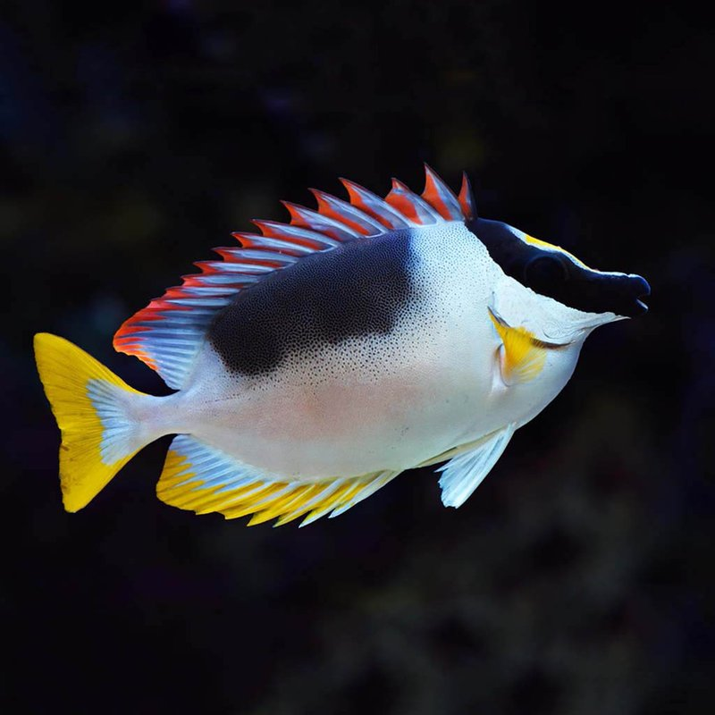

# Foxface magnífico — *Siganus magnificus* (Burgess, 1977)

> Archivo generado desde `especies/datos/catalogo_inicial.json` con `especies/herramientas/generar_fichas.py`. No editar a mano.

*Imagen ilustrativa generada con IA por Brayan (2026-11-18). No es una fotografía de un ejemplar real; puede contener errores anatómicos.*

**Grupo:** pez  
**Otros nombres:** Magnificent foxface, Magnificent rabbitfish, Andaman foxface  
**Fecha de consulta:** 2026-11-18  
**Confianza global:** media  
**Estado:** verificada; pendiente de revisión del equipo

## Ficha AIRI

| Campo | Valor |
|---|---|
| Nombre común | Foxface magnífico |
| Nombre científico | *Siganus magnificus* |
| Temperamento | Pacífico |
| Comportamiento | Pacífico. Pacífico y resistente, salvo con otros peces conejo. Espinas dorsales venenosas. |
| Adecuado para arrecife | Con precaución. Criterio de AIRI: LiveAquaria lo marca compatible, pero advierte que, si no está bien alimentado, puede picar corales LPS y blandos. |
| Tipo de alimentación | Herbívoro: algas, verduras frescas. *FishBase incluye pequeños invertebrados en su dieta natural.* |
| Temperatura | 22.2–25.6 °C |
| Litraje recomendado | 492.1 L (130 gal EE. UU.). *Es el mínimo recomendado por una sola fuente comercial; ninguna fuente científica consultada establece un litraje.* |
| Tamaño adulto | 24 cm (longitud estándar). Al venderse mide 5.1–17.8 cm (juvenil o subadulto). *FishBase 24 cm (longitud estándar) y LiveAquaria 9 in (≈ 22.9 cm) prácticamente coinciden.* |

## Detalle verificado

| Campo | Dato | Confianza | Fuentes |
|---|---|---|---|
| Clasificación taxonómica | Clase Teleostei; orden Eupercaria (incertae sedis); familia Siganidae. WoRMS AphiaID 273917 (aceptado). Sinónimos: Lo magnificus Burgess, 1977 (combinación original). | alta | [worms_siganus_magnificus](https://www.marinespecies.org/aphia.php?p=taxdetails&id=273917), [fishbase_siganus_magnificus](https://www.fishbase.se/summary/Siganus-magnificus.html) |
| Hábitat natural | Arrecifes coralinos; los adultos van en pareja y los juveniles se esconden entre corales (FishBase). Profundidad: 2–30 m. Distribución: Océano Índico oriental: de Tailandia, incluidas las islas Similan, a Java (Indonesia). | alta | [fishbase_siganus_magnificus](https://www.fishbase.se/summary/Siganus-magnificus.html) |
| Tamaño adulto | Máx. 24 cm (longitud estándar). FishBase 24 cm (longitud estándar) y LiveAquaria 9 in (≈ 22.9 cm) prácticamente coinciden. | alta | [fishbase_siganus_magnificus](https://www.fishbase.se/summary/Siganus-magnificus.html), [liveaquaria_siganus_magnificus](https://www.liveaquaria.com/products/magnificent-foxface) |
| Alimentación | Come algas y pequeños invertebrados (FishBase). En acuario: verduras frescas y algas indeseadas; puede picar pólipos de corales blandos y duros (LiveAquaria). | media | [fishbase_siganus_magnificus](https://www.fishbase.se/summary/Siganus-magnificus.html), [liveaquaria_siganus_magnificus](https://www.liveaquaria.com/products/magnificent-foxface) |
| Temperatura del agua | Acuario: 22.2–25.6 °C (72–78 °F). Medio natural: 24–28 °C. El rango de acuario no cae por completo dentro del rango natural registrado por FishBase. | baja | [liveaquaria_siganus_magnificus](https://www.liveaquaria.com/products/magnificent-foxface), [fishbase_siganus_magnificus](https://www.fishbase.se/summary/Siganus-magnificus.html) |
| Rango de pH | Fuente de acuario: 8.1–8.4. Rango prudente AIRI: 8.1–8.3. Criterio: Intersección con la tabla MSD para agua salada (7.8–8.3). | media | [liveaquaria_siganus_magnificus](https://www.liveaquaria.com/products/magnificent-foxface), [msd_tabla_referencia](https://www.msdvetmanual.com/multimedia/table/normal-reference-ranges-for-routine-water-quality-analysis), [msd_capitulo](https://www.msdvetmanual.com/exotic-and-laboratory-animals/aquatic-systems/environmental-diseases-of-aquatic-animals-in-aquatic-systems) |
| Salinidad | 1.020–1.025 de gravedad específica (adimensional). Agua de mar media: 35 ppt (UF/IFAS). No se convierte a ppt porque la equivalencia depende de la temperatura. | media | [liveaquaria_siganus_magnificus](https://www.liveaquaria.com/products/magnificent-foxface), [ufifas_ph_sal_temp](https://waterwatch.ifas.ufl.edu/media/waterwatchifasufledu/FactSheet_pH_Sal_Temp.pdf) |
| Volumen mínimo | 492.1 L (130 gal EE. UU.). Justificación: Cifra de los datos rápidos de LiveAquaria (130 gal); su descripción indica 125 gal o más. | baja | [liveaquaria_siganus_magnificus](https://www.liveaquaria.com/products/magnificent-foxface) |
| Comportamiento | Los adultos van en pareja y a veces solos (FishBase). Muy pacífico salvo con otros peces conejo, y muy resistente. Sus espinas dorsales venenosas lo protegen de los depredadores (LiveAquaria). | media | [fishbase_siganus_magnificus](https://www.fishbase.se/summary/Siganus-magnificus.html), [liveaquaria_siganus_magnificus](https://www.liveaquaria.com/products/magnificent-foxface) |
| Territorialidad y refugio | Los juveniles se esconden entre corales (FishBase). | media | [fishbase_siganus_magnificus](https://www.fishbase.se/summary/Siganus-magnificus.html) |
| Compatibilidad con arrecife | con precaución (según la fuente; sin verificación independiente) | baja | [liveaquaria_siganus_magnificus](https://www.liveaquaria.com/products/magnificent-foxface) |
| Convivencia: condiciones | Acuario de 130 gal o más. · Bien alimentado con algas. | baja | [liveaquaria_siganus_magnificus](https://www.liveaquaria.com/products/magnificent-foxface) |
| Convivencia: riesgos | Espinas dorsales venenosas. · Puede picar pólipos de coral si pasa hambre. · Agresivo con otros peces conejo. | baja | [liveaquaria_siganus_magnificus](https://www.liveaquaria.com/products/magnificent-foxface) |
| Conservación | Preocupación menor (LC), evaluada el 04/02/2009, según FishBase. | media | [fishbase_siganus_magnificus](https://www.fishbase.se/summary/Siganus-magnificus.html) |

**Regla AIRI:** compartir rangos de agua no implica compatibilidad entre especies. Los rangos de acuario provienen de una fuente comercial y no son límites veterinarios.

## Fuentes

- **worms_siganus_magnificus** (taxonomía): WoRMS — Siganus magnificus (Burgess, 1977) (AphiaID 273917). <https://www.marinespecies.org/aphia.php?p=taxdetails&id=273917>. Consultada el 2026-11-18.
- **fishbase_siganus_magnificus** (biología): FishBase — Siganus magnificus. <https://www.fishbase.se/summary/Siganus-magnificus.html>. Consultada el 2026-11-18.
- **liveaquaria_siganus_magnificus** (comercial): LiveAquaria — Magnificent Foxface (Siganus magnificus). <https://www.liveaquaria.com/products/magnificent-foxface>. Consultada el 2026-11-18.
- **msd_tabla_referencia** (veterinaria): MSD Veterinary Manual — “Normal” Reference Ranges for Routine Water Quality Analysis. <https://www.msdvetmanual.com/multimedia/table/normal-reference-ranges-for-routine-water-quality-analysis>. Consultada el 2026-11-12. Reutilizada del registro del motor (motor/airi_motor/datos/fuentes.json); no se volvió a consultar para estas fichas.
- **ufifas_ph_sal_temp** (institucional): UF/IFAS — pH, Salinity and Temperature (hoja informativa). <https://waterwatch.ifas.ufl.edu/media/waterwatchifasufledu/FactSheet_pH_Sal_Temp.pdf>. Consultada el 2026-11-12. Reutilizada del registro del motor (motor/airi_motor/datos/fuentes.json); no se volvió a consultar para estas fichas.
- **msd_capitulo** (veterinaria): MSD Veterinary Manual — Environmental Diseases of Aquatic Animals in Aquatic Systems. <https://www.msdvetmanual.com/exotic-and-laboratory-animals/aquatic-systems/environmental-diseases-of-aquatic-animals-in-aquatic-systems>. Consultada el 2026-11-12. Reutilizada del registro del motor (motor/airi_motor/datos/fuentes.json); no se volvió a consultar para estas fichas.
