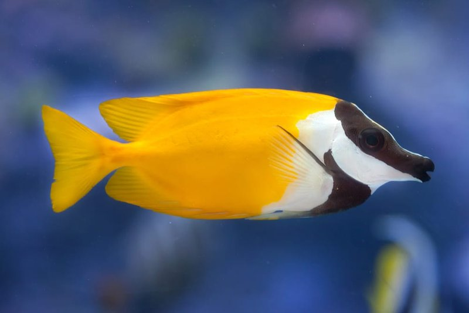

# Pez zorro (foxface) — *Siganus vulpinus* (Schlegel & Müller, 1845)

> Archivo generado desde `especies/datos/catalogo_inicial.json` con `especies/herramientas/generar_fichas.py`. No editar a mano.

*Imagen ilustrativa generada con IA por Brayan (2026-11-16). No es una fotografía de un ejemplar real; puede contener errores anatómicos.*

**Grupo:** pez  
**Otros nombres:** Foxface rabbitfish, Foxface Lo  
**Fecha de consulta:** 2026-11-16  
**Confianza global:** media  
**Estado:** verificada; pendiente de revisión del equipo

## Ficha AIRI

| Campo | Valor |
|---|---|
| Nombre común | Pez zorro (foxface) |
| Nombre científico | *Siganus vulpinus* |
| Temperamento | Pacífico |
| Comportamiento | Pacífico, Territorial. Pacífico, salvo con otros peces conejo; a veces territorial. Tiene espinas dorsales venenosas que causan picaduras dolorosas: manipular con cuidado. |
| Adecuado para arrecife | Con precaución. Si no está bien alimentado puede picar y comer pólipos de corales blandos y LPS (LiveAquaria). |
| Tipo de alimentación | Herbívoro: algas, verduras frescas, algas indeseables del acuario. |
| Temperatura | 22.2–25.6 °C *FishBase no indica rango de temperatura para esta especie.* |
| Litraje recomendado | 473.1 L (125 gal EE. UU.). *Es el mínimo recomendado por una sola fuente comercial; ninguna fuente científica consultada establece un litraje.* |
| Tamaño adulto | 25 cm (longitud estándar). Al venderse mide 2.5–20.3 cm (juvenil o subadulto). *LiveAquaria: 9 in (≈ 22.9 cm). FishBase da una longitud habitual de 20 cm (longitud total).* |

## Detalle verificado

| Campo | Dato | Confianza | Fuentes |
|---|---|---|---|
| Clasificación taxonómica | Clase Teleostei; orden Eupercaria incertae sedis (WoRMS); familia Siganidae. WoRMS AphiaID 273929 (aceptado). Sinónimos: Amphacanthus vulpinus Schlegel & Müller, 1845 (combinación original), Lo vulpinus. El orden varía según la fuente: Eupercaria incertae sedis (WoRMS) y Acanthuriformes (FishBase). Se toma WoRMS como referencia. | alta | [worms_siganus_vulpinus](https://www.marinespecies.org/aphia.php?p=taxdetails&id=273929), [fishbase_siganus_vulpinus](https://www.fishbase.se/summary/Siganus-vulpinus.html) |
| Hábitat natural | Zonas ricas en coral de lagunas y arrecifes externos, a menudo entre corales cuerno de ciervo. Suele ir solo o en parejas; juveniles y subadultos forman a veces grandes cardúmenes entre Acropora, donde comen algas. Profundidad: 0–30 m (habitual 1–30 m). Distribución: Pacífico occidental: oeste de Filipinas, Indonesia, Nueva Guinea, Gran Barrera de Coral, Nueva Caledonia, islas Carolinas y Marshall; registrado recientemente en Tonga. | media | [fishbase_siganus_vulpinus](https://www.fishbase.se/summary/Siganus-vulpinus.html) |
| Tamaño adulto | Máx. 25 cm (longitud estándar). LiveAquaria: 9 in (≈ 22.9 cm). FishBase da una longitud habitual de 20 cm (longitud total). | media | [fishbase_siganus_vulpinus](https://www.fishbase.se/summary/Siganus-vulpinus.html), [liveaquaria_siganus_vulpinus](https://www.liveaquaria.com/products/foxface-lo) |
| Alimentación | Herbívoro: en la naturaleza come algas. En acuario, verduras frescas y algas indeseables. Si no está bien alimentado puede picar pólipos de corales blandos y LPS. | alta | [fishbase_siganus_vulpinus](https://www.fishbase.se/summary/Siganus-vulpinus.html), [liveaquaria_siganus_vulpinus](https://www.liveaquaria.com/products/foxface-lo) |
| Temperatura del agua | Acuario: 22.2–25.6 °C (72–78 °F). FishBase no indica rango de temperatura para esta especie. | baja | [liveaquaria_siganus_vulpinus](https://www.liveaquaria.com/products/foxface-lo) |
| Rango de pH | Fuente de acuario: 8.1–8.4. Rango prudente AIRI: 8.1–8.3. Criterio: Intersección con la tabla MSD para agua salada (7.8–8.3). | media | [liveaquaria_siganus_vulpinus](https://www.liveaquaria.com/products/foxface-lo), [msd_tabla_referencia](https://www.msdvetmanual.com/multimedia/table/normal-reference-ranges-for-routine-water-quality-analysis), [msd_capitulo](https://www.msdvetmanual.com/exotic-and-laboratory-animals/aquatic-systems/environmental-diseases-of-aquatic-animals-in-aquatic-systems) |
| Salinidad | 1.020–1.025 de gravedad específica (adimensional). Agua de mar media: 35 ppt (UF/IFAS). No se convierte a ppt porque la equivalencia depende de la temperatura. | media | [liveaquaria_siganus_vulpinus](https://www.liveaquaria.com/products/foxface-lo), [ufifas_ph_sal_temp](https://waterwatch.ifas.ufl.edu/media/waterwatchifasufledu/FactSheet_pH_Sal_Temp.pdf) |
| Volumen mínimo | 473.1 L (125 gal EE. UU.). Justificación: Cifra de LiveAquaria (125 gal). Alcanza 22–25 cm y es un nadador de tamaño medio que necesita espacio. | baja | [liveaquaria_siganus_vulpinus](https://www.liveaquaria.com/products/foxface-lo), [fishbase_siganus_vulpinus](https://www.fishbase.se/summary/Siganus-vulpinus.html) |
| Comportamiento | Muy pacífico, salvo con otros peces conejo (LiveAquaria). FishBase indica que a veces es territorial. Tiene espinas venenosas capaces de causar picaduras dolorosas; por eso sus depredadores suelen dejarlo en paz. | media | [fishbase_siganus_vulpinus](https://www.fishbase.se/summary/Siganus-vulpinus.html), [liveaquaria_siganus_vulpinus](https://www.liveaquaria.com/products/foxface-lo) |
| Territorialidad y refugio | A veces territorial (FishBase); agresivo con otros peces conejo (LiveAquaria). | media | [liveaquaria_siganus_vulpinus](https://www.liveaquaria.com/products/foxface-lo), [fishbase_siganus_vulpinus](https://www.fishbase.se/summary/Siganus-vulpinus.html) |
| Compatibilidad con arrecife | con precaución (según la fuente; sin verificación independiente) | baja | [liveaquaria_siganus_vulpinus](https://www.liveaquaria.com/products/foxface-lo) |
| Convivencia: condiciones | Puede convivir con peces más agresivos. · Un solo pez conejo por acuario. · Bien alimentado con algas para proteger los corales. | baja | [liveaquaria_siganus_vulpinus](https://www.liveaquaria.com/products/foxface-lo), [fishbase_siganus_vulpinus](https://www.fishbase.se/summary/Siganus-vulpinus.html) |
| Convivencia: riesgos | Espinas venenosas: picaduras dolorosas para las personas. · Puede picar corales blandos y LPS. · Agresión hacia otros peces conejo. | baja | [liveaquaria_siganus_vulpinus](https://www.liveaquaria.com/products/foxface-lo), [fishbase_siganus_vulpinus](https://www.fishbase.se/summary/Siganus-vulpinus.html) |
| Conservación | Preocupación menor (LC), evaluada el 12/03/2015, según FishBase. | media | [fishbase_siganus_vulpinus](https://www.fishbase.se/summary/Siganus-vulpinus.html) |

**Regla AIRI:** compartir rangos de agua no implica compatibilidad entre especies. Los rangos de acuario provienen de una fuente comercial y no son límites veterinarios.

## Fuentes

- **worms_siganus_vulpinus** (taxonomía): WoRMS — Siganus vulpinus (Schlegel & Müller, 1845) (AphiaID 273929). <https://www.marinespecies.org/aphia.php?p=taxdetails&id=273929>. Consultada el 2026-11-16.
- **fishbase_siganus_vulpinus** (biología): FishBase — Siganus vulpinus (Schlegel & Müller, 1845). <https://www.fishbase.se/summary/Siganus-vulpinus.html>. Consultada el 2026-11-16.
- **liveaquaria_siganus_vulpinus** (comercial): LiveAquaria — Foxface Lo. <https://www.liveaquaria.com/products/foxface-lo>. Consultada el 2026-11-16.
- **msd_tabla_referencia** (veterinaria): MSD Veterinary Manual — “Normal” Reference Ranges for Routine Water Quality Analysis. <https://www.msdvetmanual.com/multimedia/table/normal-reference-ranges-for-routine-water-quality-analysis>. Consultada el 2026-11-12. Reutilizada del registro del motor (motor/airi_motor/datos/fuentes.json); no se volvió a consultar para estas fichas.
- **ufifas_ph_sal_temp** (institucional): UF/IFAS — pH, Salinity and Temperature (hoja informativa). <https://waterwatch.ifas.ufl.edu/media/waterwatchifasufledu/FactSheet_pH_Sal_Temp.pdf>. Consultada el 2026-11-12. Reutilizada del registro del motor (motor/airi_motor/datos/fuentes.json); no se volvió a consultar para estas fichas.
- **msd_capitulo** (veterinaria): MSD Veterinary Manual — Environmental Diseases of Aquatic Animals in Aquatic Systems. <https://www.msdvetmanual.com/exotic-and-laboratory-animals/aquatic-systems/environmental-diseases-of-aquatic-animals-in-aquatic-systems>. Consultada el 2026-11-12. Reutilizada del registro del motor (motor/airi_motor/datos/fuentes.json); no se volvió a consultar para estas fichas.
