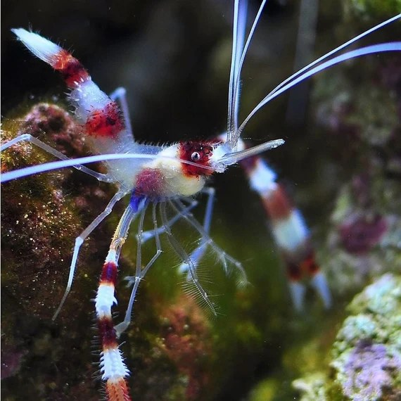

# Camarón boxeador — *Stenopus hispidus* (Olivier, 1811)

> Archivo generado desde `especies/datos/catalogo_inicial.json` con `especies/herramientas/generar_fichas.py`. No editar a mano.

*Imagen ilustrativa generada con IA por Brayan (2026-11-16). No es una fotografía de un ejemplar real; puede contener errores anatómicos.*

**Grupo:** crustáceo  
**Otros nombres:** Banded coral shrimp, Coral banded shrimp, Boxing shrimp  
**Fecha de consulta:** 2026-11-16  
**Confianza global:** media  
**Estado:** verificada; pendiente de revisión del equipo

## Ficha AIRI

| Campo | Valor |
|---|---|
| Nombre común | Camarón boxeador |
| Nombre científico | *Stenopus hispidus* |
| Temperamento | Semiagresivo |
| Comportamiento | Territorial. Pacífico con peces y corales, pero agresivo con otros camarones boxeadores y camarones pequeños. Un solo ejemplar o una pareja formada. |
| Adecuado para arrecife | Sí. LiveAquaria lo considera compatible con arrecife. |
| Tipo de alimentación | Carnívoro: pequeños artrópodos e invertebrados, parásitos y tejido dañado de peces, restos de comida. |
| Temperatura | 22.2–25.6 °C |
| Litraje recomendado | null (no verificado). *Ninguna fuente consultada publica un litraje mínimo para esta especie; se deja en null en lugar de estimarlo.* |
| Tamaño adulto | 7.6 cm (longitud del cuerpo). *SeaLifeBase no indica tamaño; LiveAquaria indica que rara vez supera 3 in (≈ 7.6 cm), o 6 in (≈ 15.2 cm) con las antenas.* |

## Detalle verificado

| Campo | Dato | Confianza | Fuentes |
|---|---|---|---|
| Clasificación taxonómica | Clase Malacostraca; orden Decapoda; familia Stenopodidae. WoRMS AphiaID 210370 (aceptado). Sinónimos: Palaemon hispidus Olivier, 1811 (combinación original). | alta | [worms_stenopus_hispidus](https://www.marinespecies.org/aphia.php?p=taxdetails&id=210370), [sealifebase_stenopus_hispidus](https://www.sealifebase.se/summary/Stenopus-hispidus.html) |
| Hábitat natural | Fondos rocosos y arrecifes coralinos; vive en grietas profundas y bajo salientes del arrecife. LiveAquaria indica que suele colgar boca abajo en cuevas, con solo las antenas fuera. Profundidad: 1–200 m. Distribución: Indo-Pacífico (del Mar Rojo y Sudáfrica a las Tuamotu, Hawái e isla de Pascua) y Atlántico occidental (de Carolina del Norte y Bermudas al Caribe y São Paulo, Brasil). | media | [sealifebase_stenopus_hispidus](https://www.sealifebase.se/summary/Stenopus-hispidus.html) |
| Tamaño adulto | Máx. 7.6 cm (longitud del cuerpo). SeaLifeBase no indica tamaño; LiveAquaria indica que rara vez supera 3 in (≈ 7.6 cm), o 6 in (≈ 15.2 cm) con las antenas. | baja | [sealifebase_stenopus_hispidus](https://www.sealifebase.se/summary/Stenopus-hispidus.html), [liveaquaria_stenopus_hispidus](https://www.liveaquaria.com/products/banded-coral-shrimp) |
| Alimentación | Carnívoro: come sobre todo pequeños artrópodos y otros invertebrados marinos. Además actúa como limpiador: retira parásitos, tejido dañado y restos de comida de los peces (SeaLifeBase). | alta | [sealifebase_stenopus_hispidus](https://www.sealifebase.se/summary/Stenopus-hispidus.html), [liveaquaria_stenopus_hispidus](https://www.liveaquaria.com/products/banded-coral-shrimp) |
| Temperatura del agua | Acuario: 22.2–25.6 °C (72–78 °F). SeaLifeBase no indica rango de temperatura para esta especie. | baja | [liveaquaria_stenopus_hispidus](https://www.liveaquaria.com/products/banded-coral-shrimp) |
| Rango de pH | Fuente de acuario: 8.1–8.4. Rango prudente AIRI: 8.1–8.3. Criterio: Intersección con la tabla MSD para agua salada (7.8–8.3). | media | [liveaquaria_stenopus_hispidus](https://www.liveaquaria.com/products/banded-coral-shrimp), [msd_tabla_referencia](https://www.msdvetmanual.com/multimedia/table/normal-reference-ranges-for-routine-water-quality-analysis), [msd_capitulo](https://www.msdvetmanual.com/exotic-and-laboratory-animals/aquatic-systems/environmental-diseases-of-aquatic-animals-in-aquatic-systems) |
| Salinidad | 1.023–1.025 de gravedad específica (adimensional). Agua de mar media: 35 ppt (UF/IFAS). No se convierte a ppt porque la equivalencia depende de la temperatura. | media | [liveaquaria_stenopus_hispidus](https://www.liveaquaria.com/products/banded-coral-shrimp), [ufifas_ph_sal_temp](https://waterwatch.ifas.ufl.edu/media/waterwatchifasufledu/FactSheet_pH_Sal_Temp.pdf) |
| Volumen mínimo | null (no verificado). Justificación: Ninguna fuente consultada publica un litraje mínimo para esta especie; se deja en null en lugar de estimarlo. | baja | [liveaquaria_stenopus_hispidus](https://www.liveaquaria.com/products/banded-coral-shrimp) |
| Comportamiento | Activo; sostiene en alto sus pinzas grandes como un boxeador. Agresivo con otros camarones boxeadores y con camarones más pequeños, pero pacífico con peces, corales e invertebrados (LiveAquaria). Se esconde 1–2 días al mudar. | media | [sealifebase_stenopus_hispidus](https://www.sealifebase.se/summary/Stenopus-hispidus.html), [liveaquaria_stenopus_hispidus](https://www.liveaquaria.com/products/banded-coral-shrimp) |
| Territorialidad y refugio | Territorial con su especie. Se refugia en cuevas y grietas; necesita espacio para que sus antenas no toquen corales ni anémonas. | media | [liveaquaria_stenopus_hispidus](https://www.liveaquaria.com/products/banded-coral-shrimp), [sealifebase_stenopus_hispidus](https://www.sealifebase.se/summary/Stenopus-hispidus.html) |
| Compatibilidad con arrecife | sí (según la fuente; sin verificación independiente) | baja | [liveaquaria_stenopus_hispidus](https://www.liveaquaria.com/products/banded-coral-shrimp) |
| Convivencia: condiciones | Un solo ejemplar o una pareja formada. · Cuevas y grietas en la roca. | baja | [liveaquaria_stenopus_hispidus](https://www.liveaquaria.com/products/banded-coral-shrimp), [sealifebase_stenopus_hispidus](https://www.sealifebase.se/summary/Stenopus-hispidus.html) |
| Convivencia: riesgos | Agresión hacia otros camarones boxeadores y camarones más pequeños. · No tolera medicamentos con cobre ni cambios bruscos de salinidad, pH u oxígeno; requiere aclimatación por goteo. | baja | [liveaquaria_stenopus_hispidus](https://www.liveaquaria.com/products/banded-coral-shrimp), [sealifebase_stenopus_hispidus](https://www.sealifebase.se/summary/Stenopus-hispidus.html) |
| Conservación | No evaluado por la UICN, según SeaLifeBase. | media | [sealifebase_stenopus_hispidus](https://www.sealifebase.se/summary/Stenopus-hispidus.html) |

**Regla AIRI:** compartir rangos de agua no implica compatibilidad entre especies. Los rangos de acuario provienen de una fuente comercial y no son límites veterinarios.

## Fuentes

- **worms_stenopus_hispidus** (taxonomía): WoRMS — Stenopus hispidus (Olivier, 1811) (AphiaID 210370). <https://www.marinespecies.org/aphia.php?p=taxdetails&id=210370>. Consultada el 2026-11-16.
- **sealifebase_stenopus_hispidus** (biología): SeaLifeBase — Stenopus hispidus. <https://www.sealifebase.se/summary/Stenopus-hispidus.html>. Consultada el 2026-11-16.
- **liveaquaria_stenopus_hispidus** (comercial): LiveAquaria — Banded Coral Shrimp. <https://www.liveaquaria.com/products/banded-coral-shrimp>. Consultada el 2026-11-16.
- **msd_tabla_referencia** (veterinaria): MSD Veterinary Manual — “Normal” Reference Ranges for Routine Water Quality Analysis. <https://www.msdvetmanual.com/multimedia/table/normal-reference-ranges-for-routine-water-quality-analysis>. Consultada el 2026-11-12. Reutilizada del registro del motor (motor/airi_motor/datos/fuentes.json); no se volvió a consultar para estas fichas.
- **ufifas_ph_sal_temp** (institucional): UF/IFAS — pH, Salinity and Temperature (hoja informativa). <https://waterwatch.ifas.ufl.edu/media/waterwatchifasufledu/FactSheet_pH_Sal_Temp.pdf>. Consultada el 2026-11-12. Reutilizada del registro del motor (motor/airi_motor/datos/fuentes.json); no se volvió a consultar para estas fichas.
- **msd_capitulo** (veterinaria): MSD Veterinary Manual — Environmental Diseases of Aquatic Animals in Aquatic Systems. <https://www.msdvetmanual.com/exotic-and-laboratory-animals/aquatic-systems/environmental-diseases-of-aquatic-animals-in-aquatic-systems>. Consultada el 2026-11-12. Reutilizada del registro del motor (motor/airi_motor/datos/fuentes.json); no se volvió a consultar para estas fichas.
