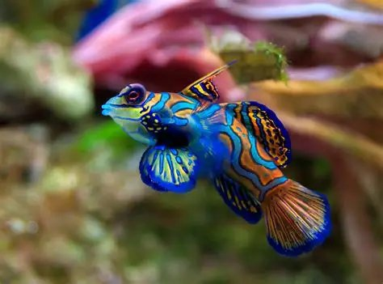

# Mandarín — *Synchiropus splendidus* (Herre, 1927)

> Archivo generado desde `especies/datos/catalogo_inicial.json` con `especies/herramientas/generar_fichas.py`. No editar a mano.

*Imagen ilustrativa generada con IA por Brayan (2026-11-16). No es una fotografía de un ejemplar real; puede contener errores anatómicos.*

**Grupo:** pez  
**Otros nombres:** Mandarinfish, Green mandarin, Gobio mandarín (nombre común incorrecto)  
**Fecha de consulta:** 2026-11-16  
**Confianza global:** baja  
**Estado:** verificada; pendiente de revisión del equipo

## Ficha AIRI

| Campo | Valor |
|---|---|
| Nombre común | Mandarín |
| Nombre científico | *Synchiropus splendidus* |
| Temperamento | Pacífico *LiveAquaria no publica datos rápidos; su descripción indica que no es muy agresivo salvo con su especie.* |
| Comportamiento | Pacífico, Territorial. Pacífico con otros peces, pero no con los de su especie. Necesita un acuario maduro con mucha roca viva y arena viva donde cazar presas pequeñas. |
| Adecuado para arrecife | Sí. LiveAquaria lo describe como moderadamente resistente en acuarios de arrecife si recibe cuidados especiales. |
| Tipo de alimentación | Carnívoro: presas vivas de la roca y la arena (pequeños crustáceos), artemia viva enriquecida, gusanos negros vivos. |
| Temperatura | null (no verificado) |
| Litraje recomendado | 113.6 L (30 gal EE. UU.). *LiveAquaria no publica datos rápidos de esta especie; la cifra sale de su descripción.* |
| Tamaño adulto | 7 cm (longitud total). Al venderse mide 2.5–7.6 cm (juvenil o subadulto). *Diferencia entre fuentes: FishBase registra un máximo de 7 cm de longitud total, pero LiveAquaria vende ejemplares de hasta 3 in (≈ 7.6 cm).* |

## Detalle verificado

| Campo | Dato | Confianza | Fuentes |
|---|---|---|---|
| Clasificación taxonómica | Clase Teleostei; orden Callionymiformes; familia Callionymidae. WoRMS AphiaID 273264 (aceptado). Sinónimos: Callionymus splendidus Herre, 1927 (combinación original), Pterosynchiropus splendidus, Neosynchiropus splendidus. Aunque en acuariofilia se le llama «gobio mandarín», no es un gobio: pertenece a los dragoncillos (familia Callionymidae). | alta | [worms_synchiropus_splendidus](https://www.marinespecies.org/aphia.php?p=taxdetails&id=273264), [fishbase_synchiropus_splendidus](https://www.fishbase.se/summary/Synchiropus-splendidus.html) |
| Hábitat natural | Lagunas protegidas someras y arrecifes costeros, sobre fondos limosos con coral y cascajo. Suele vivir en grupos pequeños repartidos en un área reducida. Profundidad: 1–18 m. Distribución: Pacífico occidental: de las islas Ryukyu a Australia. | media | [fishbase_synchiropus_splendidus](https://www.fishbase.se/summary/Synchiropus-splendidus.html) |
| Tamaño adulto | Máx. 7 cm (longitud total). Diferencia entre fuentes: FishBase registra un máximo de 7 cm de longitud total, pero LiveAquaria vende ejemplares de hasta 3 in (≈ 7.6 cm). | media | [fishbase_synchiropus_splendidus](https://www.fishbase.se/summary/Synchiropus-splendidus.html) |
| Alimentación | Carnívoro: en acuario come artemia viva enriquecida, gusanos negros vivos y presas naturales de la roca viva y la arena viva (LiveAquaria). | baja | [liveaquaria_synchiropus_splendidus](https://www.liveaquaria.com/products/green-mandarin) |
| Temperatura del agua | Acuario: null (no verificado). FishBase no indica rango de temperatura y la página de LiveAquaria no publica datos rápidos de esta especie. | media |  |
| Rango de pH | null (no verificado). Ninguna fuente específica de la especie publica un rango de pH. Referencia general para agua salada: 7.8–8.3 (MSD). | baja | [msd_tabla_referencia](https://www.msdvetmanual.com/multimedia/table/normal-reference-ranges-for-routine-water-quality-analysis) |
| Salinidad | null (no verificado). Agua de mar media: 35 ppt (UF/IFAS). | baja | [ufifas_ph_sal_temp](https://waterwatch.ifas.ufl.edu/media/waterwatchifasufledu/FactSheet_pH_Sal_Temp.pdf) |
| Volumen mínimo | 113.6 L (30 gal EE. UU.). Justificación: LiveAquaria pide un acuario bien establecido de 30 gal o más, con roca viva, arena viva y muchos escondites, porque se alimenta de presas que viven en ellos. | baja | [liveaquaria_synchiropus_splendidus](https://www.liveaquaria.com/products/green-mandarin) |
| Comportamiento | No es muy agresivo con otros peces, salvo con los de su especie (LiveAquaria). Se ha reproducido en acuario (FishBase y LiveAquaria). | media | [fishbase_synchiropus_splendidus](https://www.fishbase.se/summary/Synchiropus-splendidus.html), [liveaquaria_synchiropus_splendidus](https://www.liveaquaria.com/products/green-mandarin) |
| Territorialidad y refugio | Agresivo con su propia especie. Necesita muchos escondites. | media | [liveaquaria_synchiropus_splendidus](https://www.liveaquaria.com/products/green-mandarin), [fishbase_synchiropus_splendidus](https://www.fishbase.se/summary/Synchiropus-splendidus.html) |
| Compatibilidad con arrecife | sí (según la fuente; sin verificación independiente) | baja | [liveaquaria_synchiropus_splendidus](https://www.liveaquaria.com/products/green-mandarin) |
| Convivencia: condiciones | Acuario bien establecido con roca viva y arena viva. · Un solo ejemplar o una pareja. | baja | [liveaquaria_synchiropus_splendidus](https://www.liveaquaria.com/products/green-mandarin), [fishbase_synchiropus_splendidus](https://www.fishbase.se/summary/Synchiropus-splendidus.html) |
| Convivencia: riesgos | Puede morir de hambre si el acuario no tiene suficientes presas vivas. · Agresión hacia otros mandarines. | baja | [liveaquaria_synchiropus_splendidus](https://www.liveaquaria.com/products/green-mandarin), [fishbase_synchiropus_splendidus](https://www.fishbase.se/summary/Synchiropus-splendidus.html) |
| Conservación | Preocupación menor (LC), evaluada el 12/10/2018, según FishBase. | media | [fishbase_synchiropus_splendidus](https://www.fishbase.se/summary/Synchiropus-splendidus.html) |

**Regla AIRI:** compartir rangos de agua no implica compatibilidad entre especies. Los rangos de acuario provienen de una fuente comercial y no son límites veterinarios.

## Fuentes

- **worms_synchiropus_splendidus** (taxonomía): WoRMS — Synchiropus splendidus (Herre, 1927) (AphiaID 273264). <https://www.marinespecies.org/aphia.php?p=taxdetails&id=273264>. Consultada el 2026-11-16.
- **fishbase_synchiropus_splendidus** (biología): FishBase — Synchiropus splendidus. <https://www.fishbase.se/summary/Synchiropus-splendidus.html>. Consultada el 2026-11-16.
- **liveaquaria_synchiropus_splendidus** (comercial): LiveAquaria — Green Mandarin. <https://www.liveaquaria.com/products/green-mandarin>. Consultada el 2026-11-16.
- **msd_tabla_referencia** (veterinaria): MSD Veterinary Manual — “Normal” Reference Ranges for Routine Water Quality Analysis. <https://www.msdvetmanual.com/multimedia/table/normal-reference-ranges-for-routine-water-quality-analysis>. Consultada el 2026-11-12. Reutilizada del registro del motor (motor/airi_motor/datos/fuentes.json); no se volvió a consultar para estas fichas.
- **ufifas_ph_sal_temp** (institucional): UF/IFAS — pH, Salinity and Temperature (hoja informativa). <https://waterwatch.ifas.ufl.edu/media/waterwatchifasufledu/FactSheet_pH_Sal_Temp.pdf>. Consultada el 2026-11-12. Reutilizada del registro del motor (motor/airi_motor/datos/fuentes.json); no se volvió a consultar para estas fichas.
- **msd_capitulo** (veterinaria): MSD Veterinary Manual — Environmental Diseases of Aquatic Animals in Aquatic Systems. <https://www.msdvetmanual.com/exotic-and-laboratory-animals/aquatic-systems/environmental-diseases-of-aquatic-animals-in-aquatic-systems>. Consultada el 2026-11-12. Reutilizada del registro del motor (motor/airi_motor/datos/fuentes.json); no se volvió a consultar para estas fichas.
