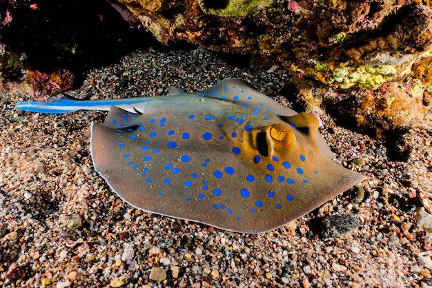

# Raya de manchas azules — *Taeniura lymma* (Fabricius, 1775)

> Archivo generado desde `especies/datos/catalogo_inicial.json` con `especies/herramientas/generar_fichas.py`. No editar a mano.

*Imagen ilustrativa generada con IA por Brayan (2026-11-18). No es una fotografía de un ejemplar real; puede contener errores anatómicos.*

**Grupo:** pez  
**Otros nombres:** Bluespotted ribbontail ray, Blue spotted stingray, Ribbontail stingray  
**Fecha de consulta:** 2026-11-18  
**Confianza global:** baja  
**Estado:** verificada; pendiente de revisión del equipo

## Ficha AIRI

| Campo | Valor |
|---|---|
| Nombre común | Raya de manchas azules |
| Nombre científico | *Taeniura lymma* |
| Temperamento | Agresivo *Quality Marine indica «Behavior: Agressive».* |
| Comportamiento | Sociable. Difícil: FishBase indica que no se adapta bien al acuario. Tiene una espina venenosa en la cola. Necesita un acuario enorme con arena fina. |
| Adecuado para arrecife | Con precaución. Criterio de AIRI: Quality Marine no indica si es apta para arrecife, pero en el medio natural come camarones y cangrejos (FishBase). |
| Tipo de alimentación | Carnívoro: moluscos, gusanos, camarones y cangrejos, alimentos cárneos congelados o vivos. |
| Temperatura | 22.2–25.6 °C *Rango de Quality Marine.* |
| Litraje recomendado | 946.2 L (250 gal EE. UU.). *Es el mínimo de una sola fuente comercial. LiveAquaria no vende esta especie.* |
| Tamaño adulto | 35 cm (anchura del disco). Madura desde 20.3 cm. *FishBase: 35 cm de anchura del disco (unos 70 cm de longitud total); Quality Marine: algo más de 12 in (≈ 30.5 cm).* |

## Detalle verificado

| Campo | Dato | Confianza | Fuentes |
|---|---|---|---|
| Clasificación taxonómica | Clase Elasmobranchii; orden Myliobatiformes; familia Dasyatidae. WoRMS AphiaID 217422 (aceptado). Sinónimos: Raja lymma Fabricius, 1775 (combinación original), Trygon ornatus Gray, 1830. | alta | [worms_taeniura_lymma](https://www.marinespecies.org/aphia.php?p=taxdetails&id=217422), [fishbase_taeniura_lymma](https://www.fishbase.se/summary/Taeniura-lymma.html) |
| Hábitat natural | Alrededor de arrecifes coralinos. Con la marea alta entra en grupos en zonas arenosas someras para alimentarse y con la baja se refugia en cuevas y bajo cornisas; rara vez se entierra (FishBase). Profundidad: 0–20 m. Distribución: Indo-Pacífico occidental: del golfo Pérsico, el mar Rojo y África oriental a las Islas Salomón; al norte hasta el sur de Japón y al sur hasta el norte de Australia. | alta | [fishbase_taeniura_lymma](https://www.fishbase.se/summary/Taeniura-lymma.html) |
| Tamaño adulto | Máx. 35 cm (anchura del disco). FishBase: 35 cm de anchura del disco (unos 70 cm de longitud total); Quality Marine: algo más de 12 in (≈ 30.5 cm). | media | [fishbase_taeniura_lymma](https://www.fishbase.se/summary/Taeniura-lymma.html), [qualitymarine_taeniura_lymma](https://www.qualitymarine.com/quality-marine/fish/rays/taeniura/blue-dot-lymma-27502/) |
| Alimentación | Come moluscos, gusanos, camarones y cangrejos (FishBase). En acuario necesita una dieta rica en alimentos cárneos (Quality Marine). | alta | [fishbase_taeniura_lymma](https://www.fishbase.se/summary/Taeniura-lymma.html), [qualitymarine_taeniura_lymma](https://www.qualitymarine.com/quality-marine/fish/rays/taeniura/blue-dot-lymma-27502/) |
| Temperatura del agua | Acuario: 22.2–25.6 °C (72–78 °F). FishBase no indica rango de temperatura para esta especie. | baja | [qualitymarine_taeniura_lymma](https://www.qualitymarine.com/quality-marine/fish/rays/taeniura/blue-dot-lymma-27502/) |
| Rango de pH | Fuente de acuario: 8.1–8.4. Rango prudente AIRI: 8.1–8.3. Criterio: Intersección con la tabla MSD para agua salada (7.8–8.3). | media | [qualitymarine_taeniura_lymma](https://www.qualitymarine.com/quality-marine/fish/rays/taeniura/blue-dot-lymma-27502/), [msd_tabla_referencia](https://www.msdvetmanual.com/multimedia/table/normal-reference-ranges-for-routine-water-quality-analysis), [msd_capitulo](https://www.msdvetmanual.com/exotic-and-laboratory-animals/aquatic-systems/environmental-diseases-of-aquatic-animals-in-aquatic-systems) |
| Salinidad | 1.020–1.025 de gravedad específica (adimensional). Agua de mar media: 35 ppt (UF/IFAS). No se convierte a ppt porque la equivalencia depende de la temperatura. | media | [qualitymarine_taeniura_lymma](https://www.qualitymarine.com/quality-marine/fish/rays/taeniura/blue-dot-lymma-27502/), [ufifas_ph_sal_temp](https://waterwatch.ifas.ufl.edu/media/waterwatchifasufledu/FactSheet_pH_Sal_Temp.pdf) |
| Volumen mínimo | 946.2 L (250 gal EE. UU.). Justificación: Cifra de Quality Marine (250 gal), con amplias zonas abiertas para nadar. | baja | [qualitymarine_taeniura_lymma](https://www.qualitymarine.com/quality-marine/fish/rays/taeniura/blue-dot-lymma-27502/) |
| Comportamiento | FishBase advierte que no se adapta bien a los acuarios. Quality Marine la clasifica como agresiva y de cuidado difícil; es sociable con los de su especie y puede saltar. | media | [fishbase_taeniura_lymma](https://www.fishbase.se/summary/Taeniura-lymma.html), [qualitymarine_taeniura_lymma](https://www.qualitymarine.com/quality-marine/fish/rays/taeniura/blue-dot-lymma-27502/) |
| Territorialidad y refugio | Necesita fondo de arena fina y amplias zonas abiertas para nadar (Quality Marine). | media | [qualitymarine_taeniura_lymma](https://www.qualitymarine.com/quality-marine/fish/rays/taeniura/blue-dot-lymma-27502/) |
| Compatibilidad con arrecife | con precaución (según la fuente; sin verificación independiente) | baja | [qualitymarine_taeniura_lymma](https://www.qualitymarine.com/quality-marine/fish/rays/taeniura/blue-dot-lymma-27502/), [fishbase_taeniura_lymma](https://www.fishbase.se/summary/Taeniura-lymma.html) |
| Convivencia: condiciones | Acuario de 250 gal o más con mucho espacio abierto. · Arena fina. · Tapa bien ajustada. · Sin cobre. | baja | [qualitymarine_taeniura_lymma](https://www.qualitymarine.com/quality-marine/fish/rays/taeniura/blue-dot-lymma-27502/), [fishbase_taeniura_lymma](https://www.fishbase.se/summary/Taeniura-lymma.html) |
| Convivencia: riesgos | Venenosa (FishBase): espina en la cola. · No se adapta bien al acuario (FishBase). · Se come crustáceos y moluscos. | baja | [qualitymarine_taeniura_lymma](https://www.qualitymarine.com/quality-marine/fish/rays/taeniura/blue-dot-lymma-27502/), [fishbase_taeniura_lymma](https://www.fishbase.se/summary/Taeniura-lymma.html) |
| Conservación | Preocupación menor (LC), evaluada el 01/09/2020, según FishBase. | media | [fishbase_taeniura_lymma](https://www.fishbase.se/summary/Taeniura-lymma.html) |

**Regla AIRI:** compartir rangos de agua no implica compatibilidad entre especies. Los rangos de acuario provienen de una fuente comercial y no son límites veterinarios.

## Fuentes

- **worms_taeniura_lymma** (taxonomía): WoRMS — Taeniura lymma (Fabricius, 1775) (AphiaID 217422). <https://www.marinespecies.org/aphia.php?p=taxdetails&id=217422>. Consultada el 2026-11-18.
- **fishbase_taeniura_lymma** (biología): FishBase — Taeniura lymma. <https://www.fishbase.se/summary/Taeniura-lymma.html>. Consultada el 2026-11-18.
- **qualitymarine_taeniura_lymma** (comercial): Quality Marine — Blue Spotted Stingray (Taeniura lymma). <https://www.qualitymarine.com/quality-marine/fish/rays/taeniura/blue-dot-lymma-27502/>. Consultada el 2026-11-18.
- **msd_tabla_referencia** (veterinaria): MSD Veterinary Manual — “Normal” Reference Ranges for Routine Water Quality Analysis. <https://www.msdvetmanual.com/multimedia/table/normal-reference-ranges-for-routine-water-quality-analysis>. Consultada el 2026-11-12. Reutilizada del registro del motor (motor/airi_motor/datos/fuentes.json); no se volvió a consultar para estas fichas.
- **ufifas_ph_sal_temp** (institucional): UF/IFAS — pH, Salinity and Temperature (hoja informativa). <https://waterwatch.ifas.ufl.edu/media/waterwatchifasufledu/FactSheet_pH_Sal_Temp.pdf>. Consultada el 2026-11-12. Reutilizada del registro del motor (motor/airi_motor/datos/fuentes.json); no se volvió a consultar para estas fichas.
- **msd_capitulo** (veterinaria): MSD Veterinary Manual — Environmental Diseases of Aquatic Animals in Aquatic Systems. <https://www.msdvetmanual.com/exotic-and-laboratory-animals/aquatic-systems/environmental-diseases-of-aquatic-animals-in-aquatic-systems>. Consultada el 2026-11-12. Reutilizada del registro del motor (motor/airi_motor/datos/fuentes.json); no se volvió a consultar para estas fichas.
