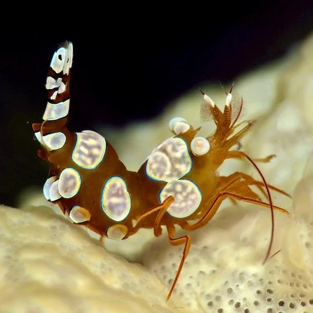

# Camarón sexy — *Thor amboinensis* (De Man, 1888)

> Archivo generado desde `especies/datos/catalogo_inicial.json` con `especies/herramientas/generar_fichas.py`. No editar a mano.

*Imagen ilustrativa generada con IA por Brayan (2026-11-16). No es una fotografía de un ejemplar real; puede contener errores anatómicos.*

**Grupo:** crustáceo  
**Otros nombres:** Sexy anemone shrimp, Squat anemone shrimp  
**Fecha de consulta:** 2026-11-16  
**Confianza global:** baja  
**Estado:** verificada; pendiente de revisión del equipo

## Ficha AIRI

| Campo | Valor |
|---|---|
| Nombre común | Camarón sexy |
| Nombre científico | *Thor amboinensis* |
| Temperamento | Pacífico |
| Comportamiento | Pacífico, Sociable. Pacífico; mejor en grupos pequeños. Suele vivir entre los tentáculos de una anémona. Mueve el abdomen al caminar. |
| Adecuado para arrecife | Sí. LiveAquaria lo considera compatible con arrecife. |
| Tipo de alimentación | Carnívoro: plancton, alimentos congelados y cárnicos, escamas. |
| Temperatura | 22.2–25.6 °C |
| Litraje recomendado | 18.9 L (5 gal EE. UU.). *Es el mínimo de una sola fuente comercial.* |
| Tamaño adulto | 3.8 cm (longitud). Al venderse mide 0.6–1.9 cm (juvenil o subadulto). *SeaLifeBase no indica tamaño. LiveAquaria se contradice: sus datos rápidos dicen ½ in (≈ 1.3 cm) y su descripción, que la mayoría llega a unas 1½ in (≈ 3.8 cm).* |

## Detalle verificado

| Campo | Dato | Confianza | Fuentes |
|---|---|---|---|
| Clasificación taxonómica | Clase Malacostraca; orden Decapoda; familia Thoridae. WoRMS AphiaID 107534 (aceptado). Sinónimos: Hippolyte amboinensis De Man, 1888 (combinación original), Thor discosomatis Kemp, 1916. LiveAquaria lo sitúa en la familia Hippolytidae; WoRMS y SeaLifeBase, en Thoridae. Se toma WoRMS como referencia. | alta | [worms_thor_amboinensis](https://www.marinespecies.org/aphia.php?p=taxdetails&id=107534), [sealifebase_thor_amboinensis](https://www.sealifebase.se/summary/Thor-amboinensis.html) |
| Hábitat natural | Bentónico, en bahías y zonas costeras. Vive asociado a anémonas de mar como simbionte generalista, en arrecifes y praderas marinas. Profundidad: 0–60 m. Distribución: Indo-Pacífico y océano Atlántico, en aguas tropicales y subtropicales. | media | [sealifebase_thor_amboinensis](https://www.sealifebase.se/summary/Thor-amboinensis.html) |
| Tamaño adulto | Máx. 3.8 cm (longitud). SeaLifeBase no indica tamaño. LiveAquaria se contradice: sus datos rápidos dicen ½ in (≈ 1.3 cm) y su descripción, que la mayoría llega a unas 1½ in (≈ 3.8 cm). | baja | [sealifebase_thor_amboinensis](https://www.sealifebase.se/summary/Thor-amboinensis.html), [liveaquaria_thor_amboinensis](https://www.liveaquaria.com/products/sexy-anemone-shrimp) |
| Alimentación | Carnívoro: en acuario come plancton y alimentos en escamas, congelados y cárnicos (LiveAquaria). | baja | [liveaquaria_thor_amboinensis](https://www.liveaquaria.com/products/sexy-anemone-shrimp) |
| Temperatura del agua | Acuario: 22.2–25.6 °C (72–78 °F). SeaLifeBase no indica rango de temperatura para esta especie. | baja | [liveaquaria_thor_amboinensis](https://www.liveaquaria.com/products/sexy-anemone-shrimp) |
| Rango de pH | Fuente de acuario: 8.1–8.4. Rango prudente AIRI: 8.1–8.3. Criterio: Intersección con la tabla MSD para agua salada (7.8–8.3). | media | [liveaquaria_thor_amboinensis](https://www.liveaquaria.com/products/sexy-anemone-shrimp), [msd_tabla_referencia](https://www.msdvetmanual.com/multimedia/table/normal-reference-ranges-for-routine-water-quality-analysis), [msd_capitulo](https://www.msdvetmanual.com/exotic-and-laboratory-animals/aquatic-systems/environmental-diseases-of-aquatic-animals-in-aquatic-systems) |
| Salinidad | 1.023–1.025 de gravedad específica (adimensional). Agua de mar media: 35 ppt (UF/IFAS). No se convierte a ppt porque la equivalencia depende de la temperatura. | media | [liveaquaria_thor_amboinensis](https://www.liveaquaria.com/products/sexy-anemone-shrimp), [ufifas_ph_sal_temp](https://waterwatch.ifas.ufl.edu/media/waterwatchifasufledu/FactSheet_pH_Sal_Temp.pdf) |
| Volumen mínimo | 18.9 L (5 gal EE. UU.). Justificación: Cifra de Saltwaterfish («Minimum Tank Size: 5 Gallons»). LiveAquaria y las fuentes científicas consultadas no publican un litraje para esta especie. | baja | [saltwaterfish_thor_amboinensis](https://www.saltwaterfish.com/product-sexy-shrimp) |
| Comportamiento | Pacífico con los de su especie y con otros habitantes. Mueve el abdomen de un lado a otro al caminar, de ahí su nombre. Crece rápido y muda aproximadamente una vez al mes (LiveAquaria). | media | [sealifebase_thor_amboinensis](https://www.sealifebase.se/summary/Thor-amboinensis.html), [liveaquaria_thor_amboinensis](https://www.liveaquaria.com/products/sexy-anemone-shrimp) |
| Territorialidad y refugio | No territorial. En la naturaleza se refugia entre los tentáculos de una anémona. | media | [liveaquaria_thor_amboinensis](https://www.liveaquaria.com/products/sexy-anemone-shrimp), [sealifebase_thor_amboinensis](https://www.sealifebase.se/summary/Thor-amboinensis.html) |
| Compatibilidad con arrecife | sí (según la fuente; sin verificación independiente) | baja | [liveaquaria_thor_amboinensis](https://www.liveaquaria.com/products/sexy-anemone-shrimp) |
| Convivencia: condiciones | En grupos pequeños. · Sin peces depredadores. · Yodo suficiente para que mude bien. | baja | [liveaquaria_thor_amboinensis](https://www.liveaquaria.com/products/sexy-anemone-shrimp), [sealifebase_thor_amboinensis](https://www.sealifebase.se/summary/Thor-amboinensis.html) |
| Convivencia: riesgos | Los peces depredadores pueden comérselo por su tamaño pequeño. · No tolera nitratos altos. · No tolera medicamentos con cobre ni cambios bruscos de salinidad, pH u oxígeno; requiere aclimatación por goteo. | baja | [liveaquaria_thor_amboinensis](https://www.liveaquaria.com/products/sexy-anemone-shrimp), [sealifebase_thor_amboinensis](https://www.sealifebase.se/summary/Thor-amboinensis.html) |
| Conservación | No evaluado por la UICN, según SeaLifeBase. | media | [sealifebase_thor_amboinensis](https://www.sealifebase.se/summary/Thor-amboinensis.html) |

**Regla AIRI:** compartir rangos de agua no implica compatibilidad entre especies. Los rangos de acuario provienen de una fuente comercial y no son límites veterinarios.

## Fuentes

- **worms_thor_amboinensis** (taxonomía): WoRMS — Thor amboinensis (De Man, 1888) (AphiaID 107534). <https://www.marinespecies.org/aphia.php?p=taxdetails&id=107534>. Consultada el 2026-11-16.
- **sealifebase_thor_amboinensis** (biología): SeaLifeBase — Thor amboinensis. <https://www.sealifebase.se/summary/Thor-amboinensis.html>. Consultada el 2026-11-16.
- **liveaquaria_thor_amboinensis** (comercial): LiveAquaria — Sexy Anemone Shrimp. <https://www.liveaquaria.com/products/sexy-anemone-shrimp>. Consultada el 2026-11-16.
- **msd_tabla_referencia** (veterinaria): MSD Veterinary Manual — “Normal” Reference Ranges for Routine Water Quality Analysis. <https://www.msdvetmanual.com/multimedia/table/normal-reference-ranges-for-routine-water-quality-analysis>. Consultada el 2026-11-12. Reutilizada del registro del motor (motor/airi_motor/datos/fuentes.json); no se volvió a consultar para estas fichas.
- **ufifas_ph_sal_temp** (institucional): UF/IFAS — pH, Salinity and Temperature (hoja informativa). <https://waterwatch.ifas.ufl.edu/media/waterwatchifasufledu/FactSheet_pH_Sal_Temp.pdf>. Consultada el 2026-11-12. Reutilizada del registro del motor (motor/airi_motor/datos/fuentes.json); no se volvió a consultar para estas fichas.
- **saltwaterfish_thor_amboinensis** (comercial): Saltwaterfish — Sexy Shrimp. <https://www.saltwaterfish.com/product-sexy-shrimp>. Consultada el 2026-11-16.
- **msd_capitulo** (veterinaria): MSD Veterinary Manual — Environmental Diseases of Aquatic Animals in Aquatic Systems. <https://www.msdvetmanual.com/exotic-and-laboratory-animals/aquatic-systems/environmental-diseases-of-aquatic-animals-in-aquatic-systems>. Consultada el 2026-11-12. Reutilizada del registro del motor (motor/airi_motor/datos/fuentes.json); no se volvió a consultar para estas fichas.
