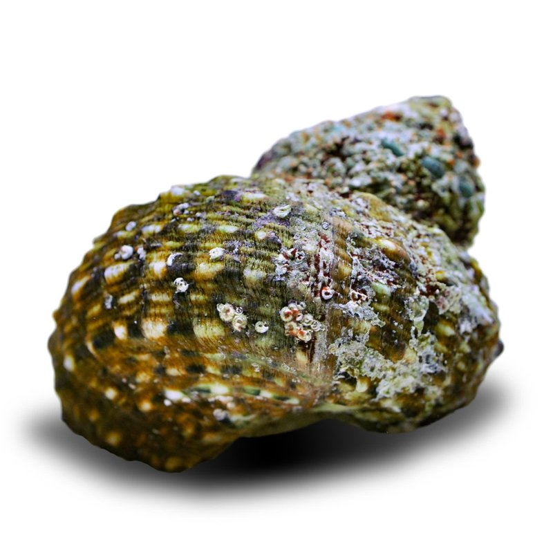

# Caracol turbo — *Turbo fluctuosus* W. Wood, 1828

> Archivo generado desde `especies/datos/catalogo_inicial.json` con `especies/herramientas/generar_fichas.py`. No editar a mano.

*Imagen ilustrativa generada con IA por Brayan (2026-11-16). No es una fotografía de un ejemplar real; puede contener errores anatómicos.*

**Grupo:** caracol  
**Otros nombres:** Mexican turbo snail, Turban snail, Turbo fluctuosa (grafía comercial)  
**Fecha de consulta:** 2026-11-16  
**Confianza global:** baja  
**Estado:** verificada; pendiente de revisión del equipo

## Ficha AIRI

| Campo | Valor |
|---|---|
| Nombre común | Caracol turbo |
| Nombre científico | *Turbo fluctuosus* |
| Temperamento | Pacífico |
| Comportamiento | Pacífico. Herbívoro pacífico del «equipo de limpieza»: come algas de pelo. Puede derribar rocas sueltas. |
| Adecuado para arrecife | Sí. LiveAquaria lo considera apto para arrecife; conviene fijar bien la roca porque puede derribar piezas sueltas. |
| Tipo de alimentación | Herbívoro: algas de pelo, algas de la roca y el vidrio, alga seca (suplemento). |
| Temperatura | 22.2–25.6 °C *Rango de LiveAquaria.* |
| Litraje recomendado | null (no verificado). *Ninguna fuente consultada publica un litraje mínimo para este organismo; se deja en null en lugar de estimarlo.* |
| Tamaño adulto | 5.1 cm (longitud de la concha). *LiveAquaria indica 2 in (≈ 5.1 cm); SeaLifeBase no tiene datos.* |

## Detalle verificado

| Campo | Dato | Confianza | Fuentes |
|---|---|---|---|
| Clasificación taxonómica | Clase Gastropoda; orden Trochida; familia Turbinidae. WoRMS AphiaID 413380 (aceptado). Sinónimos: Turbo fluctuatus Reeve, 1848, Callopoma fluctuatum. WoRMS acepta Turbo fluctuosus; LiveAquaria escribe «fluctuosa». SeaLifeBase no tiene información de la especie. | alta | [worms_turbo_fluctuosus](https://www.marinespecies.org/aphia.php?p=taxdetails&id=413380) |
| Hábitat natural | Vive en grietas y agujeros de los arrecifes naturales (LiveAquaria). Profundidad: no indicada. Distribución: Golfo de California, frente a México (LiveAquaria). | baja | [liveaquaria_turbo_fluctuosus](https://www.liveaquaria.com/products/mexican-turbo-snail) |
| Tamaño adulto | Máx. 5.1 cm (longitud de la concha). LiveAquaria indica 2 in (≈ 5.1 cm); SeaLifeBase no tiene datos. | baja | [liveaquaria_turbo_fluctuosus](https://www.liveaquaria.com/products/mexican-turbo-snail) |
| Alimentación | Herbívoro: come grandes cantidades de algas molestas, sobre todo algas de pelo, de la roca y el vidrio. Si faltan algas, se complementa con alga seca. Necesita calcio suficiente para formar su concha (LiveAquaria). | baja | [liveaquaria_turbo_fluctuosus](https://www.liveaquaria.com/products/mexican-turbo-snail) |
| Temperatura del agua | Acuario: 22.2–25.6 °C (72–78 °F). Ninguna fuente científica consultada indica rango de temperatura para este taxón. | baja | [liveaquaria_turbo_fluctuosus](https://www.liveaquaria.com/products/mexican-turbo-snail) |
| Rango de pH | Fuente de acuario: 8.1–8.4. Rango prudente AIRI: 8.1–8.3. Criterio: Intersección con la tabla MSD para agua salada (7.8–8.3). | media | [liveaquaria_turbo_fluctuosus](https://www.liveaquaria.com/products/mexican-turbo-snail), [msd_tabla_referencia](https://www.msdvetmanual.com/multimedia/table/normal-reference-ranges-for-routine-water-quality-analysis), [msd_capitulo](https://www.msdvetmanual.com/exotic-and-laboratory-animals/aquatic-systems/environmental-diseases-of-aquatic-animals-in-aquatic-systems) |
| Salinidad | 1.023–1.025 de gravedad específica (adimensional). Agua de mar media: 35 ppt (UF/IFAS). No se convierte a ppt porque la equivalencia depende de la temperatura. | media | [liveaquaria_turbo_fluctuosus](https://www.liveaquaria.com/products/mexican-turbo-snail), [ufifas_ph_sal_temp](https://waterwatch.ifas.ufl.edu/media/waterwatchifasufledu/FactSheet_pH_Sal_Temp.pdf) |
| Volumen mínimo | null (no verificado). Justificación: Ninguna fuente consultada publica un litraje para esta especie. | baja |  |
| Comportamiento | Muy activo; puede derribar rocas sueltas buscando alimento, por eso conviene fijar bien la roca. No debe convivir con compañeros agresivos que lo dominen (LiveAquaria). | media | [liveaquaria_turbo_fluctuosus](https://www.liveaquaria.com/products/mexican-turbo-snail) |
| Territorialidad y refugio | Necesita escondites y amplias superficies donde pastar. | media | [liveaquaria_turbo_fluctuosus](https://www.liveaquaria.com/products/mexican-turbo-snail) |
| Compatibilidad con arrecife | sí (según la fuente; sin verificación independiente) | baja | [liveaquaria_turbo_fluctuosus](https://www.liveaquaria.com/products/mexican-turbo-snail) |
| Convivencia: condiciones | Roca bien fijada. · Algas suficientes o alga seca. · Calcio adecuado. | baja | [liveaquaria_turbo_fluctuosus](https://www.liveaquaria.com/products/mexican-turbo-snail) |
| Convivencia: riesgos | Puede derribar rocas sueltas. · No tolera medicamentos con cobre ni nitratos altos. | baja | [liveaquaria_turbo_fluctuosus](https://www.liveaquaria.com/products/mexican-turbo-snail) |
| Conservación | No evaluado (SeaLifeBase no tiene información de la especie). | media | [worms_turbo_fluctuosus](https://www.marinespecies.org/aphia.php?p=taxdetails&id=413380) |

**Regla AIRI:** compartir rangos de agua no implica compatibilidad entre especies. Los rangos de acuario provienen de una fuente comercial y no son límites veterinarios.

## Fuentes

- **worms_turbo_fluctuosus** (taxonomía): WoRMS — Turbo fluctuosus W. Wood, 1828 (AphiaID 413380). <https://www.marinespecies.org/aphia.php?p=taxdetails&id=413380>. Consultada el 2026-11-16.
- **liveaquaria_turbo_fluctuosus** (comercial): LiveAquaria — Mexican Turbo Snail (Turbo fluctuosa). <https://www.liveaquaria.com/products/mexican-turbo-snail>. Consultada el 2026-11-16.
- **msd_tabla_referencia** (veterinaria): MSD Veterinary Manual — “Normal” Reference Ranges for Routine Water Quality Analysis. <https://www.msdvetmanual.com/multimedia/table/normal-reference-ranges-for-routine-water-quality-analysis>. Consultada el 2026-11-12. Reutilizada del registro del motor (motor/airi_motor/datos/fuentes.json); no se volvió a consultar para estas fichas.
- **ufifas_ph_sal_temp** (institucional): UF/IFAS — pH, Salinity and Temperature (hoja informativa). <https://waterwatch.ifas.ufl.edu/media/waterwatchifasufledu/FactSheet_pH_Sal_Temp.pdf>. Consultada el 2026-11-12. Reutilizada del registro del motor (motor/airi_motor/datos/fuentes.json); no se volvió a consultar para estas fichas.
- **msd_capitulo** (veterinaria): MSD Veterinary Manual — Environmental Diseases of Aquatic Animals in Aquatic Systems. <https://www.msdvetmanual.com/exotic-and-laboratory-animals/aquatic-systems/environmental-diseases-of-aquatic-animals-in-aquatic-systems>. Consultada el 2026-11-12. Reutilizada del registro del motor (motor/airi_motor/datos/fuentes.json); no se volvió a consultar para estas fichas.
