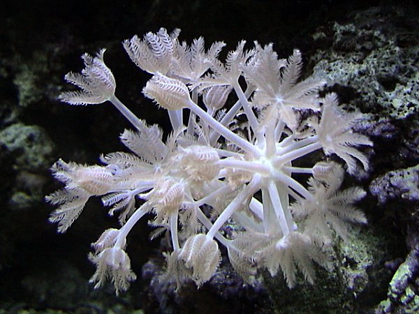

# Xenia pulsante — *Xenia elongata* Dana, 1846

> Archivo generado desde `especies/datos/catalogo_inicial.json` con `especies/herramientas/generar_fichas.py`. No editar a mano.

*Imagen ilustrativa generada con IA por Brayan (2026-11-16). No es una fotografía de un ejemplar real; puede contener errores anatómicos.*

**Grupo:** coral  
**Otros nombres:** Pulsing xenia, Pumping xenia, Fast pulse coral  
**Fecha de consulta:** 2026-11-16  
**Confianza global:** baja  
**Estado:** verificada; pendiente de revisión del equipo

## Ficha AIRI

| Campo | Valor |
|---|---|
| Nombre común | Xenia pulsante |
| Nombre científico | *Xenia elongata* |
| Temperamento | Pacífico |
| Comportamiento | Pacífico. Coral blando pacífico cuyos pólipos «laten». Se reproduce rápido: hay que dejarle espacio, sobre todo respecto a otros corales blandos. |
| Adecuado para arrecife | Sí. Coral de arrecife; Saltwaterfish lo marca como apto. Se reproduce rápido, así que conviene dejar espacio con otros corales blandos (LiveAquaria). |
| Tipo de alimentación | Fotosintético: luz (zooxantelas simbióticas), yodo y oligoelementos. |
| Temperatura | 22.2–25.6 °C *Rango de LiveAquaria.* |
| Litraje recomendado | 94.6 L (25 gal EE. UU.). *Es el mínimo de una sola fuente comercial y corresponde a otra variedad de xenia.* |
| Tamaño adulto | null (no verificado). *Ninguna fuente indica un tamaño máximo.* |

## Detalle verificado

| Campo | Dato | Confianza | Fuentes |
|---|---|---|---|
| Clasificación taxonómica | Clase Octocorallia; orden Malacalcyonacea; familia Xeniidae. WoRMS AphiaID 287872 (aceptado). Sinónimos: Loridella elongata. SeaLifeBase no tiene información pública de esta especie. El litraje viene de una xenia «pom pom» de Saltwaterfish, que puede ser otra especie de Xenia. | alta | [worms_xenia_elongata](https://www.marinespecies.org/aphia.php?p=taxdetails&id=287872) |
| Hábitat natural | Las fuentes consultadas no describen su hábitat natural. LiveAquaria la describe como coral colonial de pólipos de ocho tentáculos que forman tallos al crecer. Profundidad: no indicada. Distribución: No indicada en las fuentes consultadas. | baja | [liveaquaria_xenia_elongata](https://www.liveaquaria.com/products/liveaquaria%C2%AE-ccgc-aquacultured-silver-branch-pumping-xenia-coral) |
| Tamaño adulto | null (no verificado). Ninguna fuente indica un tamaño máximo. | baja | [liveaquaria_xenia_elongata](https://www.liveaquaria.com/products/liveaquaria%C2%AE-ccgc-aquacultured-silver-branch-pumping-xenia-coral) |
| Alimentación | Fotosintética: sus zooxantelas simbióticas le aportan la mayor parte del alimento. Necesita yodo y oligoelementos (LiveAquaria). | baja | [liveaquaria_xenia_elongata](https://www.liveaquaria.com/products/liveaquaria%C2%AE-ccgc-aquacultured-silver-branch-pumping-xenia-coral) |
| Temperatura del agua | Acuario: 22.2–25.6 °C (72–78 °F). Ninguna fuente científica consultada indica rango de temperatura para este taxón. | baja | [liveaquaria_xenia_elongata](https://www.liveaquaria.com/products/liveaquaria%C2%AE-ccgc-aquacultured-silver-branch-pumping-xenia-coral) |
| Rango de pH | Fuente de acuario: 8.1–8.4. Rango prudente AIRI: 8.1–8.3. Criterio: Intersección con la tabla MSD para agua salada (7.8–8.3). | media | [liveaquaria_xenia_elongata](https://www.liveaquaria.com/products/liveaquaria%C2%AE-ccgc-aquacultured-silver-branch-pumping-xenia-coral), [msd_tabla_referencia](https://www.msdvetmanual.com/multimedia/table/normal-reference-ranges-for-routine-water-quality-analysis), [msd_capitulo](https://www.msdvetmanual.com/exotic-and-laboratory-animals/aquatic-systems/environmental-diseases-of-aquatic-animals-in-aquatic-systems) |
| Salinidad | 1.023–1.025 de gravedad específica (adimensional). Agua de mar media: 35 ppt (UF/IFAS). No se convierte a ppt porque la equivalencia depende de la temperatura. | media | [liveaquaria_xenia_elongata](https://www.liveaquaria.com/products/liveaquaria%C2%AE-ccgc-aquacultured-silver-branch-pumping-xenia-coral), [ufifas_ph_sal_temp](https://waterwatch.ifas.ufl.edu/media/waterwatchifasufledu/FactSheet_pH_Sal_Temp.pdf) |
| Volumen mínimo | 94.6 L (25 gal EE. UU.). Justificación: Cifra de Saltwaterfish para una xenia pulsante «pom pom» (25 gal). | baja | [saltwaterfish_xenia_elongata](https://www.saltwaterfish.com/product-pom-pom-xenia-pumping-fiji) |
| Comportamiento | Sus pólipos «laten» abriéndose y cerrándose; no se sabe con certeza por qué, y dejar de hacerlo no indica necesariamente mala salud. Las xenias de acuicultura son más resistentes y se reproducen rápido (LiveAquaria). | media | [liveaquaria_xenia_elongata](https://www.liveaquaria.com/products/liveaquaria%C2%AE-ccgc-aquacultured-silver-branch-pumping-xenia-coral) |
| Territorialidad y refugio | Se extiende rápido; necesita espacio respecto a animales sésiles. | media | [liveaquaria_xenia_elongata](https://www.liveaquaria.com/products/liveaquaria%C2%AE-ccgc-aquacultured-silver-branch-pumping-xenia-coral) |
| Compatibilidad con arrecife | sí (según la fuente; sin verificación independiente) | baja | [saltwaterfish_xenia_elongata](https://www.saltwaterfish.com/product-pom-pom-xenia-pumping-fiji), [liveaquaria_xenia_elongata](https://www.liveaquaria.com/products/liveaquaria%C2%AE-ccgc-aquacultured-silver-branch-pumping-xenia-coral) |
| Convivencia: condiciones | Luz moderada a alta. · Corriente media a fuerte. · Yodo y oligoelementos. | baja | [liveaquaria_xenia_elongata](https://www.liveaquaria.com/products/liveaquaria%C2%AE-ccgc-aquacultured-silver-branch-pumping-xenia-coral) |
| Convivencia: riesgos | Puede invadir el espacio de otros corales blandos. | baja | [liveaquaria_xenia_elongata](https://www.liveaquaria.com/products/liveaquaria%C2%AE-ccgc-aquacultured-silver-branch-pumping-xenia-coral) |
| Conservación | No evaluada; SeaLifeBase no tiene información pública de la especie. | media | [worms_xenia_elongata](https://www.marinespecies.org/aphia.php?p=taxdetails&id=287872) |

**Regla AIRI:** compartir rangos de agua no implica compatibilidad entre especies. Los rangos de acuario provienen de una fuente comercial y no son límites veterinarios.

## Fuentes

- **worms_xenia_elongata** (taxonomía): WoRMS — Xenia elongata Dana, 1846 (AphiaID 287872). <https://www.marinespecies.org/aphia.php?p=taxdetails&id=287872>. Consultada el 2026-11-16.
- **liveaquaria_xenia_elongata** (comercial): LiveAquaria — Aquacultured Silver Branch Pumping Xenia (Xenia elongata). <https://www.liveaquaria.com/products/liveaquaria%C2%AE-ccgc-aquacultured-silver-branch-pumping-xenia-coral>. Consultada el 2026-11-16.
- **saltwaterfish_xenia_elongata** (comercial): Saltwaterfish — Pom Pom Xenia: Pumping. <https://www.saltwaterfish.com/product-pom-pom-xenia-pumping-fiji>. Consultada el 2026-11-16.
- **msd_tabla_referencia** (veterinaria): MSD Veterinary Manual — “Normal” Reference Ranges for Routine Water Quality Analysis. <https://www.msdvetmanual.com/multimedia/table/normal-reference-ranges-for-routine-water-quality-analysis>. Consultada el 2026-11-12. Reutilizada del registro del motor (motor/airi_motor/datos/fuentes.json); no se volvió a consultar para estas fichas.
- **ufifas_ph_sal_temp** (institucional): UF/IFAS — pH, Salinity and Temperature (hoja informativa). <https://waterwatch.ifas.ufl.edu/media/waterwatchifasufledu/FactSheet_pH_Sal_Temp.pdf>. Consultada el 2026-11-12. Reutilizada del registro del motor (motor/airi_motor/datos/fuentes.json); no se volvió a consultar para estas fichas.
- **msd_capitulo** (veterinaria): MSD Veterinary Manual — Environmental Diseases of Aquatic Animals in Aquatic Systems. <https://www.msdvetmanual.com/exotic-and-laboratory-animals/aquatic-systems/environmental-diseases-of-aquatic-animals-in-aquatic-systems>. Consultada el 2026-11-12. Reutilizada del registro del motor (motor/airi_motor/datos/fuentes.json); no se volvió a consultar para estas fichas.
