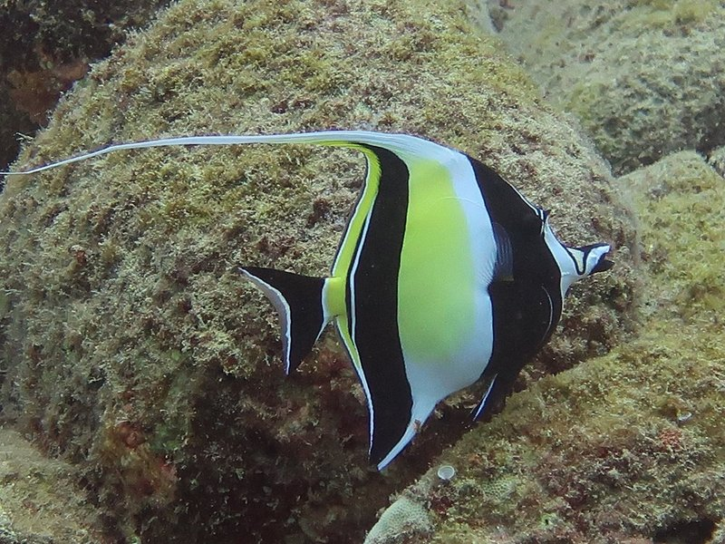

# Ídolo moro — *Zanclus cornutus* (Linnaeus, 1758)

> Archivo generado desde `especies/datos/catalogo_inicial.json` con `especies/herramientas/generar_fichas.py`. No editar a mano.

*Imagen ilustrativa generada con IA por Brayan (2026-11-16). No es una fotografía de un ejemplar real; puede contener errores anatómicos.*

**Grupo:** pez  
**Otros nombres:** Moorish idol, Kihikihi  
**Fecha de consulta:** 2026-11-16  
**Confianza global:** baja  
**Estado:** verificada; pendiente de revisión del equipo

## Ficha AIRI

| Campo | Valor |
|---|---|
| Nombre común | Ídolo moro |
| Nombre científico | *Zanclus cornutus* |
| Temperamento | Pacífico |
| Comportamiento | Pacífico, Sociable. Pacífico y gregario; necesita mucho espacio para nadar. Muy difícil de mantener: rara vez sobrevive en acuario. Solo para expertos. |
| Adecuado para arrecife | No. Come pólipos y corales, y también puede amenazar a invertebrados pequeños (LiveAquaria). |
| Tipo de alimentación | Omnívoro: pequeños animales incrustantes, esponjas, algas, misis y artemia enriquecida, espirulina. *FishBase describe una dieta animal; LiveAquaria recomienda en acuario una dieta mixta de alimentos cárnicos y algas.* |
| Temperatura | 24–28 °C *Rango del medio natural (FishBase); ninguna fuente consultada publica un rango para acuario.* |
| Litraje recomendado | 473.1 L (125 gal EE. UU.). *LiveAquaria no publica datos rápidos de esta especie; la cifra sale de su descripción. Ninguna fuente científica consultada establece un litraje.* |
| Tamaño adulto | 23 cm (longitud total). Al venderse mide 5.1–14 cm (juvenil o subadulto). *LiveAquaria: en la naturaleza llega a 7 in (≈ 17.8 cm), pero en acuario es más probable 4 in (≈ 10.2 cm).* |

## Detalle verificado

| Campo | Dato | Confianza | Fuentes |
|---|---|---|---|
| Clasificación taxonómica | Clase Teleostei; orden Acanthuriformes; familia Zanclidae. WoRMS AphiaID 220083 (aceptado). Sinónimos: Chaetodon cornutus Linnaeus, 1758 (combinación original), Zanclus canescens. Es el único miembro de la familia Zanclidae (LiveAquaria). | alta | [worms_zanclus_cornutus](https://www.marinespecies.org/aphia.php?p=taxdetails&id=220083), [fishbase_zanclus_cornutus](https://www.fishbase.se/summary/Zanclus-cornutus.html) |
| Hábitat natural | Lagunas interiores turbias, planicies arrecifales y arrecifes rocosos y coralinos de aguas claras. Suele ir en grupos pequeños de 2 o 3, a veces solo, en parejas o en grandes cardúmenes. Profundidad: 0–182 m (habitual 5–182 m). Distribución: Indo-Pacífico, de África oriental a las islas Rapa y Ducie; al norte hasta el sur de Japón y Hawái; al sur hasta Lord Howe. Pacífico oriental: del sur del golfo de California a Perú. | media | [fishbase_zanclus_cornutus](https://www.fishbase.se/summary/Zanclus-cornutus.html) |
| Tamaño adulto | Máx. 23 cm (longitud total). LiveAquaria: en la naturaleza llega a 7 in (≈ 17.8 cm), pero en acuario es más probable 4 in (≈ 10.2 cm). | media | [fishbase_zanclus_cornutus](https://www.fishbase.se/summary/Zanclus-cornutus.html), [liveaquaria_zanclus_cornutus](https://www.liveaquaria.com/products/moorish-idol-expert-only) |
| Alimentación | En la naturaleza come pequeños animales incrustantes (FishBase). En acuario es muy difícil de alimentar: roca viva con algas y esponjas para que se aclimate, y luego alimentos cárnicos picados, misis, artemia enriquecida, espirulina y algas, varias veces al día (LiveAquaria). | media | [fishbase_zanclus_cornutus](https://www.fishbase.se/summary/Zanclus-cornutus.html), [liveaquaria_zanclus_cornutus](https://www.liveaquaria.com/products/moorish-idol-expert-only) |
| Temperatura del agua | Acuario: null (no verificado). Medio natural: 24–28 °C. LiveAquaria no publica temperatura de acuario para esta especie; FishBase indica 24–28 °C en el medio natural. | media | [fishbase_zanclus_cornutus](https://www.fishbase.se/summary/Zanclus-cornutus.html) |
| Rango de pH | null (no verificado). Ninguna fuente específica de la especie publica un rango de pH. Referencia general para agua salada: 7.8–8.3 (MSD). | baja | [msd_tabla_referencia](https://www.msdvetmanual.com/multimedia/table/normal-reference-ranges-for-routine-water-quality-analysis) |
| Salinidad | null (no verificado). Agua de mar media: 35 ppt (UF/IFAS). | baja | [ufifas_ph_sal_temp](https://waterwatch.ifas.ufl.edu/media/waterwatchifasufledu/FactSheet_pH_Sal_Temp.pdf) |
| Volumen mínimo | 473.1 L (125 gal EE. UU.). Justificación: LiveAquaria pide al menos 125 gal por su tamaño, su naturaleza gregaria y su necesidad de espacio para nadar. | baja | [liveaquaria_zanclus_cornutus](https://www.liveaquaria.com/products/moorish-idol-expert-only), [fishbase_zanclus_cornutus](https://www.fishbase.se/summary/Zanclus-cornutus.html) |
| Comportamiento | Muy pacífico y gregario (LiveAquaria). FishBase advierte que, aunque es popular, rara vez sobrevive en acuario. LiveAquaria lo recomienda solo para aficionados expertos y sugiere admirarlo mejor en el mar o en un acuario público. | media | [fishbase_zanclus_cornutus](https://www.fishbase.se/summary/Zanclus-cornutus.html), [liveaquaria_zanclus_cornutus](https://www.liveaquaria.com/products/moorish-idol-expert-only) |
| Territorialidad y refugio | No se describe como territorial. Necesita mucho espacio libre para nadar. | media | [liveaquaria_zanclus_cornutus](https://www.liveaquaria.com/products/moorish-idol-expert-only), [fishbase_zanclus_cornutus](https://www.fishbase.se/summary/Zanclus-cornutus.html) |
| Compatibilidad con arrecife | no (según la fuente; sin verificación independiente) | baja | [liveaquaria_zanclus_cornutus](https://www.liveaquaria.com/products/moorish-idol-expert-only) |
| Convivencia: condiciones | Solo para aficionados expertos. · Roca viva con algas y esponjas. · Varias comidas al día. | baja | [liveaquaria_zanclus_cornutus](https://www.liveaquaria.com/products/moorish-idol-expert-only), [fishbase_zanclus_cornutus](https://www.fishbase.se/summary/Zanclus-cornutus.html) |
| Convivencia: riesgos | Rara vez sobrevive en acuario (FishBase). · Come pólipos y corales. · Puede amenazar a invertebrados pequeños. | baja | [liveaquaria_zanclus_cornutus](https://www.liveaquaria.com/products/moorish-idol-expert-only), [fishbase_zanclus_cornutus](https://www.fishbase.se/summary/Zanclus-cornutus.html) |
| Conservación | Preocupación menor (LC), evaluada el 10/03/2015, según FishBase. | media | [fishbase_zanclus_cornutus](https://www.fishbase.se/summary/Zanclus-cornutus.html) |

**Regla AIRI:** compartir rangos de agua no implica compatibilidad entre especies. Los rangos de acuario provienen de una fuente comercial y no son límites veterinarios.

## Fuentes

- **worms_zanclus_cornutus** (taxonomía): WoRMS — Zanclus cornutus (Linnaeus, 1758) (AphiaID 220083). <https://www.marinespecies.org/aphia.php?p=taxdetails&id=220083>. Consultada el 2026-11-16.
- **fishbase_zanclus_cornutus** (biología): FishBase — Zanclus cornutus (Linnaeus, 1758). <https://www.fishbase.se/summary/Zanclus-cornutus.html>. Consultada el 2026-11-16.
- **liveaquaria_zanclus_cornutus** (comercial): LiveAquaria — Moorish Idol (EXPERT ONLY). <https://www.liveaquaria.com/products/moorish-idol-expert-only>. Consultada el 2026-11-16.
- **msd_tabla_referencia** (veterinaria): MSD Veterinary Manual — “Normal” Reference Ranges for Routine Water Quality Analysis. <https://www.msdvetmanual.com/multimedia/table/normal-reference-ranges-for-routine-water-quality-analysis>. Consultada el 2026-11-12. Reutilizada del registro del motor (motor/airi_motor/datos/fuentes.json); no se volvió a consultar para estas fichas.
- **ufifas_ph_sal_temp** (institucional): UF/IFAS — pH, Salinity and Temperature (hoja informativa). <https://waterwatch.ifas.ufl.edu/media/waterwatchifasufledu/FactSheet_pH_Sal_Temp.pdf>. Consultada el 2026-11-12. Reutilizada del registro del motor (motor/airi_motor/datos/fuentes.json); no se volvió a consultar para estas fichas.
- **msd_capitulo** (veterinaria): MSD Veterinary Manual — Environmental Diseases of Aquatic Animals in Aquatic Systems. <https://www.msdvetmanual.com/exotic-and-laboratory-animals/aquatic-systems/environmental-diseases-of-aquatic-animals-in-aquatic-systems>. Consultada el 2026-11-12. Reutilizada del registro del motor (motor/airi_motor/datos/fuentes.json); no se volvió a consultar para estas fichas.
