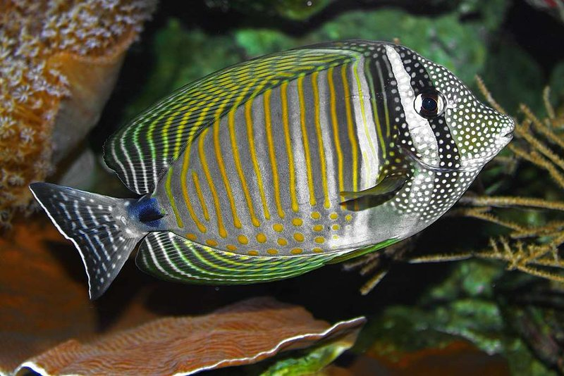

# Cirujano desjardini — *Zebrasoma desjardinii* (Bennett, 1836)

> Archivo generado desde `especies/datos/catalogo_inicial.json` con `especies/herramientas/generar_fichas.py`. No editar a mano.

*Imagen ilustrativa generada con IA por Brayan (2026-11-18). No es una fotografía de un ejemplar real; puede contener errores anatómicos.*

**Grupo:** pez  
**Otros nombres:** Desjardini sailfin tang, Indian Ocean sailfin tang, Red Sea sailfin tang  
**Fecha de consulta:** 2026-11-18  
**Confianza global:** media  
**Estado:** verificada; pendiente de revisión del equipo

## Ficha AIRI

| Campo | Valor |
|---|---|
| Nombre común | Cirujano desjardini |
| Nombre científico | *Zebrasoma desjardinii* |
| Temperamento | Semiagresivo |
| Comportamiento | Territorial. Agresivo con otros cirujanos y pacífico con el resto. Crece mucho: necesita un acuario muy grande. |
| Adecuado para arrecife | Sí. LiveAquaria lo considera compatible con arrecife. |
| Tipo de alimentación | Herbívoro: algas filamentosas, algas marinas, alga seca (nori). |
| Temperatura | 22.2–25.6 °C |
| Litraje recomendado | 681.3 L (180 gal EE. UU.). *Es el mínimo recomendado por una sola fuente comercial; ninguna fuente científica consultada establece un litraje.* |
| Tamaño adulto | 40 cm (longitud total). *FishBase 40 cm (longitud habitual 32 cm) y LiveAquaria 16 in (≈ 40.6 cm) coinciden.* |

## Detalle verificado

| Campo | Dato | Confianza | Fuentes |
|---|---|---|---|
| Clasificación taxonómica | Clase Teleostei; orden Acanthuriformes; familia Acanthuridae. WoRMS AphiaID 277555 (aceptado). Sinónimos: Acanthurus desjardinii Bennett, 1836 (combinación original), Zebrasoma desjardini (grafía alternativa). | alta | [worms_zebrasoma_desjardinii](https://www.marinespecies.org/aphia.php?p=taxdetails&id=277555), [fishbase_zebrasoma_desjardinii](https://www.fishbase.se/summary/Zebrasoma-desjardinii.html) |
| Hábitat natural | Lagunas y arrecifes externos hasta más de 30 m; los juveniles viven en zonas protegidas del arrecife interior, a menudo entre corales cuerno de ciervo (FishBase). Profundidad: 3–30 m. Distribución: Océano Índico: de África oriental y el mar Rojo al mar de Andamán y Sumatra occidental; raro en la isla de Navidad. | alta | [fishbase_zebrasoma_desjardinii](https://www.fishbase.se/summary/Zebrasoma-desjardinii.html) |
| Tamaño adulto | Máx. 40 cm (longitud total). FishBase 40 cm (longitud habitual 32 cm) y LiveAquaria 16 in (≈ 40.6 cm) coinciden. | alta | [fishbase_zebrasoma_desjardinii](https://www.fishbase.se/summary/Zebrasoma-desjardinii.html), [liveaquaria_zebrasoma_desjardinii](https://www.liveaquaria.com/products/sailfin-tang-desjardini) |
| Alimentación | Come algas filamentosas; en acuario necesita abundantes algas marinas y alga seca al menos tres veces por semana (LiveAquaria). | media | [liveaquaria_zebrasoma_desjardinii](https://www.liveaquaria.com/products/sailfin-tang-desjardini) |
| Temperatura del agua | Acuario: 22.2–25.6 °C (72–78 °F). FishBase no indica rango de temperatura para esta especie. | baja | [liveaquaria_zebrasoma_desjardinii](https://www.liveaquaria.com/products/sailfin-tang-desjardini) |
| Rango de pH | Fuente de acuario: 8.1–8.4. Rango prudente AIRI: 8.1–8.3. Criterio: Intersección con la tabla MSD para agua salada (7.8–8.3). | media | [liveaquaria_zebrasoma_desjardinii](https://www.liveaquaria.com/products/sailfin-tang-desjardini), [msd_tabla_referencia](https://www.msdvetmanual.com/multimedia/table/normal-reference-ranges-for-routine-water-quality-analysis), [msd_capitulo](https://www.msdvetmanual.com/exotic-and-laboratory-animals/aquatic-systems/environmental-diseases-of-aquatic-animals-in-aquatic-systems) |
| Salinidad | 1.020–1.025 de gravedad específica (adimensional). Agua de mar media: 35 ppt (UF/IFAS). No se convierte a ppt porque la equivalencia depende de la temperatura. | media | [liveaquaria_zebrasoma_desjardinii](https://www.liveaquaria.com/products/sailfin-tang-desjardini), [ufifas_ph_sal_temp](https://waterwatch.ifas.ufl.edu/media/waterwatchifasufledu/FactSheet_pH_Sal_Temp.pdf) |
| Volumen mínimo | 681.3 L (180 gal EE. UU.). Justificación: Cifra de LiveAquaria (180 gal), para que tenga mucho espacio para nadar. | baja | [liveaquaria_zebrasoma_desjardinii](https://www.liveaquaria.com/products/sailfin-tang-desjardini) |
| Comportamiento | Los adultos suelen ir en pareja; los juveniles son solitarios (FishBase). Agresivo con los de su especie y a veces con otros cirujanos, pero pacífico con el resto; puede casi duplicar su tamaño aparente desplegando sus aletas (LiveAquaria). | media | [fishbase_zebrasoma_desjardinii](https://www.fishbase.se/summary/Zebrasoma-desjardinii.html), [liveaquaria_zebrasoma_desjardinii](https://www.liveaquaria.com/products/sailfin-tang-desjardini) |
| Territorialidad y refugio | Necesita mucho espacio para nadar (LiveAquaria). | media | [liveaquaria_zebrasoma_desjardinii](https://www.liveaquaria.com/products/sailfin-tang-desjardini) |
| Compatibilidad con arrecife | sí (según la fuente; sin verificación independiente) | baja | [liveaquaria_zebrasoma_desjardinii](https://www.liveaquaria.com/products/sailfin-tang-desjardini) |
| Convivencia: condiciones | Acuario de 180 gal o más. · Solo uno por acuario, salvo en acuarios muy grandes. · Dieta rica en algas. | baja | [liveaquaria_zebrasoma_desjardinii](https://www.liveaquaria.com/products/sailfin-tang-desjardini) |
| Convivencia: riesgos | Agresivo con los de su especie y a veces con otros cirujanos. | baja | [liveaquaria_zebrasoma_desjardinii](https://www.liveaquaria.com/products/sailfin-tang-desjardini) |
| Conservación | Preocupación menor (LC), evaluada el 07/05/2010, según FishBase. | media | [fishbase_zebrasoma_desjardinii](https://www.fishbase.se/summary/Zebrasoma-desjardinii.html) |

**Regla AIRI:** compartir rangos de agua no implica compatibilidad entre especies. Los rangos de acuario provienen de una fuente comercial y no son límites veterinarios.

## Fuentes

- **worms_zebrasoma_desjardinii** (taxonomía): WoRMS — Zebrasoma desjardinii (Bennett, 1836) (AphiaID 277555). <https://www.marinespecies.org/aphia.php?p=taxdetails&id=277555>. Consultada el 2026-11-18.
- **fishbase_zebrasoma_desjardinii** (biología): FishBase — Zebrasoma desjardinii. <https://www.fishbase.se/summary/Zebrasoma-desjardinii.html>. Consultada el 2026-11-18.
- **liveaquaria_zebrasoma_desjardinii** (comercial): LiveAquaria — Desjardini Sailfin Tang (Zebrasoma desjardinii). <https://www.liveaquaria.com/products/sailfin-tang-desjardini>. Consultada el 2026-11-18.
- **msd_tabla_referencia** (veterinaria): MSD Veterinary Manual — “Normal” Reference Ranges for Routine Water Quality Analysis. <https://www.msdvetmanual.com/multimedia/table/normal-reference-ranges-for-routine-water-quality-analysis>. Consultada el 2026-11-12. Reutilizada del registro del motor (motor/airi_motor/datos/fuentes.json); no se volvió a consultar para estas fichas.
- **ufifas_ph_sal_temp** (institucional): UF/IFAS — pH, Salinity and Temperature (hoja informativa). <https://waterwatch.ifas.ufl.edu/media/waterwatchifasufledu/FactSheet_pH_Sal_Temp.pdf>. Consultada el 2026-11-12. Reutilizada del registro del motor (motor/airi_motor/datos/fuentes.json); no se volvió a consultar para estas fichas.
- **msd_capitulo** (veterinaria): MSD Veterinary Manual — Environmental Diseases of Aquatic Animals in Aquatic Systems. <https://www.msdvetmanual.com/exotic-and-laboratory-animals/aquatic-systems/environmental-diseases-of-aquatic-animals-in-aquatic-systems>. Consultada el 2026-11-12. Reutilizada del registro del motor (motor/airi_motor/datos/fuentes.json); no se volvió a consultar para estas fichas.
