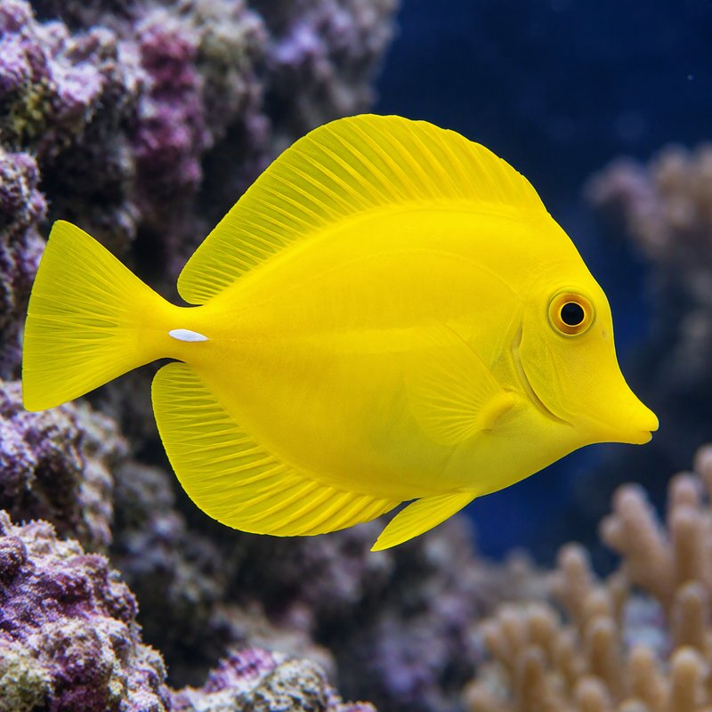

# Cirujano amarillo — *Zebrasoma flavescens* (Bennett, 1828)

> Archivo generado desde `especies/datos/catalogo_inicial.json` con `especies/herramientas/generar_fichas.py`. No editar a mano.

*Imagen ilustrativa generada con IA por Brayan (2026-11-16). No es una fotografía de un ejemplar real; puede contener errores anatómicos.*

**Grupo:** pez  
**Otros nombres:** Yellow tang, Yellow Hawaiian tang  
**Fecha de consulta:** 2026-11-16  
**Confianza global:** media  
**Estado:** verificada; pendiente de revisión del equipo

## Ficha AIRI

| Campo | Valor |
|---|---|
| Nombre común | Cirujano amarillo |
| Nombre científico | *Zebrasoma flavescens* |
| Temperamento | Semiagresivo |
| Comportamiento | Territorial, Solitario. Nadador activo en movimiento casi constante. Territorial con otros peces cirujano y con su especie: uno por acuario, salvo que varios se introduzcan a la vez. |
| Adecuado para arrecife | Sí. La única fuente consultada que lo evalúa (LiveAquaria) lo considera compatible con arrecife; no hay verificación independiente. |
| Tipo de alimentación | Herbívoro: algas filamentosas (en la naturaleza), alga marina seca, algas en general, al menos 3 veces por semana. |
| Temperatura | 22.2–25.6 °C *Discrepancia: el límite inferior de acuario (22.2 °C) está por debajo del mínimo natural indicado por FishBase (24 °C). Se recomienda que el equipo revise este dato.* |
| Litraje recomendado | 378.5 L (100 gal EE. UU.). *Es el mínimo recomendado por una sola fuente comercial; ninguna fuente científica consultada establece un litraje.* |
| Tamaño adulto | 20 cm (longitud total). Al venderse mide 6.3–8.3 cm (juvenil o subadulto). Madura desde 6.3 cm. *LiveAquaria indica 8 in (20.3 cm), coherente con FishBase (20 cm).* |

## Detalle verificado

| Campo | Dato | Confianza | Fuentes |
|---|---|---|---|
| Clasificación taxonómica | Clase Teleostei; orden Acanthuriformes; familia Acanthuridae; subfamilia Acanthurinae. WoRMS AphiaID 219683 (aceptado). Sinónimos: Acanthurus flavescens Bennett, 1828 (combinación original). | alta | [worms_zebrasoma_flavescens](https://www.marinespecies.org/aphia.php?p=taxdetails&id=219683), [fishbase_zebrasoma_flavescens](https://www.fishbase.se/summary/Zebrasoma-flavescens.html) |
| Hábitat natural | Zonas ricas en coral de lagunas y arrecifes externos del Pacífico, desde debajo de la zona de oleaje hasta unos 46 m. Vive solo o en grupos laxos. Profundidad: 2–46 m. Distribución: Océano Pacífico: islas Ryukyu, Marianas, Marshall, Marcus, Wake y Hawái. También hay registros frente a Florida. | media | [fishbase_zebrasoma_flavescens](https://www.fishbase.se/summary/Zebrasoma-flavescens.html) |
| Tamaño adulto | Máx. 20 cm (longitud total). LiveAquaria: 8 in (≈ 20.3 cm). | alta | [fishbase_zebrasoma_flavescens](https://www.fishbase.se/summary/Zebrasoma-flavescens.html), [liveaquaria_zebrasoma_flavescens](https://www.liveaquaria.com/products/yellow-tang-hawaii) |
| Alimentación | Herbívoro: ramonea algas filamentosas. En acuario necesita abundantes algas marinas (por ejemplo, alga seca sujeta a una roca o a una pinza) al menos tres veces por semana. Según LiveAquaria, esto refuerza su sistema inmunitario y reduce su agresividad. | alta | [fishbase_zebrasoma_flavescens](https://www.fishbase.se/summary/Zebrasoma-flavescens.html), [liveaquaria_zebrasoma_flavescens](https://www.liveaquaria.com/products/yellow-tang-hawaii) |
| Temperatura del agua | Acuario: 22.2–25.6 °C (72–78 °F). Medio natural: 24–28 °C. Discrepancia: el límite inferior de acuario (22.2 °C) está por debajo del mínimo natural indicado por FishBase (24 °C). Se recomienda que el equipo revise este dato. | baja | [liveaquaria_zebrasoma_flavescens](https://www.liveaquaria.com/products/yellow-tang-hawaii), [fishbase_zebrasoma_flavescens](https://www.fishbase.se/summary/Zebrasoma-flavescens.html) |
| Rango de pH | Fuente de acuario: 8.1–8.4. Rango prudente AIRI: 8.1–8.3. Criterio: Intersección con la tabla MSD para agua salada (7.8–8.3). | media | [liveaquaria_zebrasoma_flavescens](https://www.liveaquaria.com/products/yellow-tang-hawaii), [msd_tabla_referencia](https://www.msdvetmanual.com/multimedia/table/normal-reference-ranges-for-routine-water-quality-analysis), [msd_capitulo](https://www.msdvetmanual.com/exotic-and-laboratory-animals/aquatic-systems/environmental-diseases-of-aquatic-animals-in-aquatic-systems) |
| Salinidad | 1.020–1.025 de gravedad específica (adimensional). Agua de mar media: 35 ppt (UF/IFAS). No se convierte a ppt porque la equivalencia depende de la temperatura. | media | [liveaquaria_zebrasoma_flavescens](https://www.liveaquaria.com/products/yellow-tang-hawaii), [ufifas_ph_sal_temp](https://waterwatch.ifas.ufl.edu/media/waterwatchifasufledu/FactSheet_pH_Sal_Temp.pdf) |
| Volumen mínimo | 378.5 L (100 gal EE. UU.). Justificación: Cifra de LiveAquaria. Es la especie más grande del catálogo (20 cm), nada casi sin parar y necesita mucho espacio libre para nadar. | baja | [liveaquaria_zebrasoma_flavescens](https://www.liveaquaria.com/products/yellow-tang-hawaii), [fishbase_zebrasoma_flavescens](https://www.fishbase.se/summary/Zebrasoma-flavescens.html) |
| Comportamiento | Nadador activo, en movimiento casi constante. Desova en grupo o en parejas formadas por machos territoriales que cortejan a las hembras, con actividad en torno a la luna llena. LiveAquaria lo clasifica como semiagresivo. | media | [fishbase_zebrasoma_flavescens](https://www.fishbase.se/summary/Zebrasoma-flavescens.html), [liveaquaria_zebrasoma_flavescens](https://www.liveaquaria.com/products/yellow-tang-hawaii) |
| Territorialidad y refugio | Agresión territorial hacia su propia especie y hacia otros peces cirujano. Necesita roca viva y amplio espacio abierto para nadar. | baja | [liveaquaria_zebrasoma_flavescens](https://www.liveaquaria.com/products/yellow-tang-hawaii) |
| Compatibilidad con arrecife | sí (según la fuente; sin verificación independiente) | baja | [liveaquaria_zebrasoma_flavescens](https://www.liveaquaria.com/products/yellow-tang-hawaii) |
| Convivencia: condiciones | Un solo ejemplar por acuario, salvo que varios se introduzcan a la vez. · Dieta rica en algas para reducir la agresividad. | baja | [liveaquaria_zebrasoma_flavescens](https://www.liveaquaria.com/products/yellow-tang-hawaii) |
| Convivencia: riesgos | Agresión hacia otros peces cirujano y hacia los de su especie. | baja | [liveaquaria_zebrasoma_flavescens](https://www.liveaquaria.com/products/yellow-tang-hawaii) |
| Conservación | Preocupación menor (LC), evaluada el 07/05/2010, según FishBase. FishBase lo describe como el pez marino más exportado de Hawái. | media | [fishbase_zebrasoma_flavescens](https://www.fishbase.se/summary/Zebrasoma-flavescens.html) |

**Regla AIRI:** compartir rangos de agua no implica compatibilidad entre especies. Los rangos de acuario provienen de una fuente comercial y no son límites veterinarios.

## Fuentes

- **worms_zebrasoma_flavescens** (taxonomía): WoRMS — Zebrasoma flavescens (Bennett, 1828) (AphiaID 219683). <https://www.marinespecies.org/aphia.php?p=taxdetails&id=219683>. Consultada el 2026-11-16.
- **fishbase_zebrasoma_flavescens** (biología): FishBase — Zebrasoma flavescens, Yellow tang. <https://www.fishbase.se/summary/Zebrasoma-flavescens.html>. Consultada el 2026-11-16.
- **liveaquaria_zebrasoma_flavescens** (comercial): LiveAquaria — Yellow Tang, Hawaii. <https://www.liveaquaria.com/products/yellow-tang-hawaii>. Consultada el 2026-11-16.
- **msd_tabla_referencia** (veterinaria): MSD Veterinary Manual — “Normal” Reference Ranges for Routine Water Quality Analysis. <https://www.msdvetmanual.com/multimedia/table/normal-reference-ranges-for-routine-water-quality-analysis>. Consultada el 2026-11-12. Reutilizada del registro del motor (motor/airi_motor/datos/fuentes.json); no se volvió a consultar para estas fichas.
- **ufifas_ph_sal_temp** (institucional): UF/IFAS — pH, Salinity and Temperature (hoja informativa). <https://waterwatch.ifas.ufl.edu/media/waterwatchifasufledu/FactSheet_pH_Sal_Temp.pdf>. Consultada el 2026-11-12. Reutilizada del registro del motor (motor/airi_motor/datos/fuentes.json); no se volvió a consultar para estas fichas.
- **msd_capitulo** (veterinaria): MSD Veterinary Manual — Environmental Diseases of Aquatic Animals in Aquatic Systems. <https://www.msdvetmanual.com/exotic-and-laboratory-animals/aquatic-systems/environmental-diseases-of-aquatic-animals-in-aquatic-systems>. Consultada el 2026-11-12. Reutilizada del registro del motor (motor/airi_motor/datos/fuentes.json); no se volvió a consultar para estas fichas.
