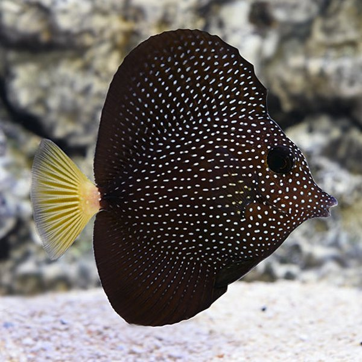

# Cirujano gemma — *Zebrasoma gemmatum* (Valenciennes, 1835)

> Archivo generado desde `especies/datos/catalogo_inicial.json` con `especies/herramientas/generar_fichas.py`. No editar a mano.

*Imagen ilustrativa generada con IA por Brayan (2026-11-18). No es una fotografía de un ejemplar real; puede contener errores anatómicos.*

**Grupo:** pez  
**Otros nombres:** Gem tang, Gemmatum tang, Spotted tang  
**Fecha de consulta:** 2026-11-18  
**Confianza global:** media  
**Estado:** verificada; pendiente de revisión del equipo

## Ficha AIRI

| Campo | Valor |
|---|---|
| Nombre común | Cirujano gemma |
| Nombre científico | *Zebrasoma gemmatum* |
| Temperamento | Semiagresivo |
| Comportamiento | Territorial, Solitario. Semiagresivo y muy territorial: solo uno por acuario y sin otros Zebrasoma. Muy cotizado y caro. |
| Adecuado para arrecife | Sí. LiveAquaria lo considera uno de los cirujanos más deseables para arrecife. |
| Tipo de alimentación | Herbívoro: algas marinas, alga seca (nori), alimentos cárneos ocasionales. |
| Temperatura | 22.2–25.6 °C |
| Litraje recomendado | 681.3 L (180 gal EE. UU.). *Es el mínimo recomendado por una sola fuente comercial; ninguna fuente científica consultada establece un litraje.* |
| Tamaño adulto | 22 cm (longitud total). *FishBase 22 cm y LiveAquaria 9 in (≈ 22.9 cm) prácticamente coinciden.* |

## Detalle verificado

| Campo | Dato | Confianza | Fuentes |
|---|---|---|---|
| Clasificación taxonómica | Clase Teleostei; orden Acanthuriformes; familia Acanthuridae. WoRMS AphiaID 219680 (aceptado). Sinónimos: Acanthurus gemmatus Valenciennes, 1835 (combinación original). | alta | [worms_zebrasoma_gemmatum](https://www.marinespecies.org/aphia.php?p=taxdetails&id=219680), [fishbase_zebrasoma_gemmatum](https://www.fishbase.se/summary/Zebrasoma-gemmatum.html) |
| Hábitat natural | Arrecifes coralinos y rocosos; los juveniles viven en aguas someras (FishBase). LiveAquaria indica que procede de aguas más profundas y zonas de oleaje. Profundidad: 10–61 m (habitual 25 m o más). Distribución: Océano Índico occidental: Mozambique y Sudáfrica; también Madagascar, Reunión y Mauricio. | alta | [fishbase_zebrasoma_gemmatum](https://www.fishbase.se/summary/Zebrasoma-gemmatum.html), [liveaquaria_zebrasoma_gemmatum](https://www.liveaquaria.com/products/gemmatum-tang) |
| Tamaño adulto | Máx. 22 cm (longitud total). FishBase 22 cm y LiveAquaria 9 in (≈ 22.9 cm) prácticamente coinciden. | alta | [fishbase_zebrasoma_gemmatum](https://www.fishbase.se/summary/Zebrasoma-gemmatum.html), [liveaquaria_zebrasoma_gemmatum](https://www.liveaquaria.com/products/gemmatum-tang) |
| Alimentación | Herbívoro: necesita abundantes algas marinas y alga seca; también acepta alimentos cárneos (LiveAquaria). FishBase no detalla su dieta. | baja | [liveaquaria_zebrasoma_gemmatum](https://www.liveaquaria.com/products/gemmatum-tang) |
| Temperatura del agua | Acuario: 22.2–25.6 °C (72–78 °F). Medio natural: 24–28 °C. El rango de acuario no cae por completo dentro del rango natural registrado por FishBase. | baja | [liveaquaria_zebrasoma_gemmatum](https://www.liveaquaria.com/products/gemmatum-tang), [fishbase_zebrasoma_gemmatum](https://www.fishbase.se/summary/Zebrasoma-gemmatum.html) |
| Rango de pH | Fuente de acuario: 8.1–8.4. Rango prudente AIRI: 8.1–8.3. Criterio: Intersección con la tabla MSD para agua salada (7.8–8.3). | media | [liveaquaria_zebrasoma_gemmatum](https://www.liveaquaria.com/products/gemmatum-tang), [msd_tabla_referencia](https://www.msdvetmanual.com/multimedia/table/normal-reference-ranges-for-routine-water-quality-analysis), [msd_capitulo](https://www.msdvetmanual.com/exotic-and-laboratory-animals/aquatic-systems/environmental-diseases-of-aquatic-animals-in-aquatic-systems) |
| Salinidad | 1.020–1.025 de gravedad específica (adimensional). Agua de mar media: 35 ppt (UF/IFAS). No se convierte a ppt porque la equivalencia depende de la temperatura. | media | [liveaquaria_zebrasoma_gemmatum](https://www.liveaquaria.com/products/gemmatum-tang), [ufifas_ph_sal_temp](https://waterwatch.ifas.ufl.edu/media/waterwatchifasufledu/FactSheet_pH_Sal_Temp.pdf) |
| Volumen mínimo | 681.3 L (180 gal EE. UU.). Justificación: Cifra de LiveAquaria (180 gal), con mucho espacio libre para nadar y escondites. | baja | [liveaquaria_zebrasoma_gemmatum](https://www.liveaquaria.com/products/gemmatum-tang) |
| Comportamiento | Extremadamente territorial y solitario (FishBase). Puede ser agresivo con los de su especie y no convive bien con peces de forma parecida, sobre todo otros Zebrasoma (LiveAquaria). | media | [fishbase_zebrasoma_gemmatum](https://www.fishbase.se/summary/Zebrasoma-gemmatum.html), [liveaquaria_zebrasoma_gemmatum](https://www.liveaquaria.com/products/gemmatum-tang) |
| Territorialidad y refugio | Extremadamente territorial (FishBase); necesita espacio libre para nadar y escondites (LiveAquaria). | media | [fishbase_zebrasoma_gemmatum](https://www.fishbase.se/summary/Zebrasoma-gemmatum.html), [liveaquaria_zebrasoma_gemmatum](https://www.liveaquaria.com/products/gemmatum-tang) |
| Compatibilidad con arrecife | sí (según la fuente; sin verificación independiente) | baja | [liveaquaria_zebrasoma_gemmatum](https://www.liveaquaria.com/products/gemmatum-tang) |
| Convivencia: condiciones | Acuario de 180 gal o más. · Buena iluminación, espacio para nadar y escondites. · Dieta rica en algas. | baja | [liveaquaria_zebrasoma_gemmatum](https://www.liveaquaria.com/products/gemmatum-tang) |
| Convivencia: riesgos | Agresivo con otros cirujanos, sobre todo del género Zebrasoma. | baja | [liveaquaria_zebrasoma_gemmatum](https://www.liveaquaria.com/products/gemmatum-tang) |
| Conservación | Datos insuficientes (DD), evaluada el 07/05/2010, según FishBase. | media | [fishbase_zebrasoma_gemmatum](https://www.fishbase.se/summary/Zebrasoma-gemmatum.html) |

**Regla AIRI:** compartir rangos de agua no implica compatibilidad entre especies. Los rangos de acuario provienen de una fuente comercial y no son límites veterinarios.

## Fuentes

- **worms_zebrasoma_gemmatum** (taxonomía): WoRMS — Zebrasoma gemmatum (Valenciennes, 1835) (AphiaID 219680). <https://www.marinespecies.org/aphia.php?p=taxdetails&id=219680>. Consultada el 2026-11-18.
- **fishbase_zebrasoma_gemmatum** (biología): FishBase — Zebrasoma gemmatum. <https://www.fishbase.se/summary/Zebrasoma-gemmatum.html>. Consultada el 2026-11-18.
- **liveaquaria_zebrasoma_gemmatum** (comercial): LiveAquaria — Gemmatum Tang (Zebrasoma gemmatum). <https://www.liveaquaria.com/products/gemmatum-tang>. Consultada el 2026-11-18.
- **msd_tabla_referencia** (veterinaria): MSD Veterinary Manual — “Normal” Reference Ranges for Routine Water Quality Analysis. <https://www.msdvetmanual.com/multimedia/table/normal-reference-ranges-for-routine-water-quality-analysis>. Consultada el 2026-11-12. Reutilizada del registro del motor (motor/airi_motor/datos/fuentes.json); no se volvió a consultar para estas fichas.
- **ufifas_ph_sal_temp** (institucional): UF/IFAS — pH, Salinity and Temperature (hoja informativa). <https://waterwatch.ifas.ufl.edu/media/waterwatchifasufledu/FactSheet_pH_Sal_Temp.pdf>. Consultada el 2026-11-12. Reutilizada del registro del motor (motor/airi_motor/datos/fuentes.json); no se volvió a consultar para estas fichas.
- **msd_capitulo** (veterinaria): MSD Veterinary Manual — Environmental Diseases of Aquatic Animals in Aquatic Systems. <https://www.msdvetmanual.com/exotic-and-laboratory-animals/aquatic-systems/environmental-diseases-of-aquatic-animals-in-aquatic-systems>. Consultada el 2026-11-12. Reutilizada del registro del motor (motor/airi_motor/datos/fuentes.json); no se volvió a consultar para estas fichas.
