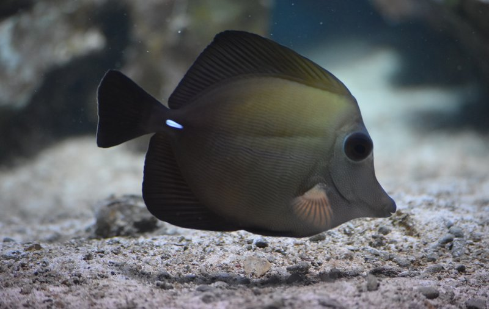

# Cirujano scopas — *Zebrasoma scopas* (Cuvier, 1829)

> Archivo generado desde `especies/datos/catalogo_inicial.json` con `especies/herramientas/generar_fichas.py`. No editar a mano.

*Imagen ilustrativa generada con IA por Brayan (2026-11-18). No es una fotografía de un ejemplar real; puede contener errores anatómicos.*

**Grupo:** pez  
**Otros nombres:** Scopas tang, Brown scopas tang, Twotone tang  
**Fecha de consulta:** 2026-11-18  
**Confianza global:** media  
**Estado:** verificada; pendiente de revisión del equipo

## Ficha AIRI

| Campo | Valor |
|---|---|
| Nombre común | Cirujano scopas |
| Nombre científico | *Zebrasoma scopas* |
| Temperamento | Semiagresivo |
| Comportamiento | Territorial. Semiagresivo con otros cirujanos: mejor uno por acuario. Buen pastador de algas. |
| Adecuado para arrecife | Sí. LiveAquaria lo considera compatible con arrecife. |
| Tipo de alimentación | Herbívoro: algas filamentosas, algas marinas, alga seca (nori). |
| Temperatura | 22.2–25.6 °C |
| Litraje recomendado | 492.1 L (130 gal EE. UU.). *Es el mínimo recomendado por una sola fuente comercial; ninguna fuente científica consultada establece un litraje.* |
| Tamaño adulto | 40 cm (longitud estándar). Al venderse mide 2.5–15.2 cm (juvenil o subadulto). *Diferencia entre fuentes: FishBase 40 cm (longitud estándar); LiveAquaria 12 in (≈ 30.5 cm).* |

## Detalle verificado

| Campo | Dato | Confianza | Fuentes |
|---|---|---|---|
| Clasificación taxonómica | Clase Teleostei; orden Acanthuriformes; familia Acanthuridae. WoRMS AphiaID 219679 (aceptado). Sinónimos: Acanthurus scopas Cuvier, 1829 (combinación original), Acanthurus altivelis Valenciennes, 1835. | alta | [worms_zebrasoma_scopas](https://www.marinespecies.org/aphia.php?p=taxdetails&id=219679), [fishbase_zebrasoma_scopas](https://www.fishbase.se/summary/Zebrasoma-scopas.html) |
| Hábitat natural | Zonas ricas en coral de lagunas y arrecifes externos; los juveniles son solitarios y viven entre corales (FishBase). Profundidad: 0–60 m. Distribución: Indo-Pacífico: de África oriental y las Mascareñas a las Tuamotu, al norte hasta el sur de Japón y al sur hasta Lord Howe y Rapa. | alta | [fishbase_zebrasoma_scopas](https://www.fishbase.se/summary/Zebrasoma-scopas.html) |
| Tamaño adulto | Máx. 40 cm (longitud estándar). Diferencia entre fuentes: FishBase 40 cm (longitud estándar); LiveAquaria 12 in (≈ 30.5 cm). | baja | [fishbase_zebrasoma_scopas](https://www.fishbase.se/summary/Zebrasoma-scopas.html), [liveaquaria_zebrasoma_scopas](https://www.liveaquaria.com/products/scopas-tang) |
| Alimentación | Pasta algas, normalmente en grupos de unos 20 individuos; sus dientes faríngeos parecen adaptados a las algas filamentosas (FishBase). En acuario: abundantes algas marinas y alga seca al menos tres veces por semana (LiveAquaria). | alta | [fishbase_zebrasoma_scopas](https://www.fishbase.se/summary/Zebrasoma-scopas.html), [liveaquaria_zebrasoma_scopas](https://www.liveaquaria.com/products/scopas-tang) |
| Temperatura del agua | Acuario: 22.2–25.6 °C (72–78 °F). Medio natural: 25–28 °C. El rango de acuario no cae por completo dentro del rango natural registrado por FishBase. | baja | [liveaquaria_zebrasoma_scopas](https://www.liveaquaria.com/products/scopas-tang), [fishbase_zebrasoma_scopas](https://www.fishbase.se/summary/Zebrasoma-scopas.html) |
| Rango de pH | Fuente de acuario: 8.1–8.4. Rango prudente AIRI: 8.1–8.3. Criterio: Intersección con la tabla MSD para agua salada (7.8–8.3). | media | [liveaquaria_zebrasoma_scopas](https://www.liveaquaria.com/products/scopas-tang), [msd_tabla_referencia](https://www.msdvetmanual.com/multimedia/table/normal-reference-ranges-for-routine-water-quality-analysis), [msd_capitulo](https://www.msdvetmanual.com/exotic-and-laboratory-animals/aquatic-systems/environmental-diseases-of-aquatic-animals-in-aquatic-systems) |
| Salinidad | 1.020–1.025 de gravedad específica (adimensional). Agua de mar media: 35 ppt (UF/IFAS). No se convierte a ppt porque la equivalencia depende de la temperatura. | media | [liveaquaria_zebrasoma_scopas](https://www.liveaquaria.com/products/scopas-tang), [ufifas_ph_sal_temp](https://waterwatch.ifas.ufl.edu/media/waterwatchifasufledu/FactSheet_pH_Sal_Temp.pdf) |
| Volumen mínimo | 492.1 L (130 gal EE. UU.). Justificación: Cifra de los datos rápidos de LiveAquaria (130 gal); su descripción indica 125 gal o más. | baja | [liveaquaria_zebrasoma_scopas](https://www.liveaquaria.com/products/scopas-tang) |
| Comportamiento | Los adultos van en grupos pequeños y a veces en cardumen; los juveniles son solitarios (FishBase). Agresivo con los de su especie y con los cirujanos en general: mejor uno por acuario (LiveAquaria). | media | [fishbase_zebrasoma_scopas](https://www.fishbase.se/summary/Zebrasoma-scopas.html), [liveaquaria_zebrasoma_scopas](https://www.liveaquaria.com/products/scopas-tang) |
| Territorialidad y refugio | Necesita mucho espacio para nadar (LiveAquaria). | media | [liveaquaria_zebrasoma_scopas](https://www.liveaquaria.com/products/scopas-tang) |
| Compatibilidad con arrecife | sí (según la fuente; sin verificación independiente) | baja | [liveaquaria_zebrasoma_scopas](https://www.liveaquaria.com/products/scopas-tang) |
| Convivencia: condiciones | Acuario de 130 gal o más. · Solo uno por acuario. · Dieta rica en algas. | baja | [liveaquaria_zebrasoma_scopas](https://www.liveaquaria.com/products/scopas-tang) |
| Convivencia: riesgos | Agresivo con otros cirujanos. | baja | [liveaquaria_zebrasoma_scopas](https://www.liveaquaria.com/products/scopas-tang) |
| Conservación | Preocupación menor (LC), evaluada el 07/05/2010, según FishBase. | media | [fishbase_zebrasoma_scopas](https://www.fishbase.se/summary/Zebrasoma-scopas.html) |

**Regla AIRI:** compartir rangos de agua no implica compatibilidad entre especies. Los rangos de acuario provienen de una fuente comercial y no son límites veterinarios.

## Fuentes

- **worms_zebrasoma_scopas** (taxonomía): WoRMS — Zebrasoma scopas (Cuvier, 1829) (AphiaID 219679). <https://www.marinespecies.org/aphia.php?p=taxdetails&id=219679>. Consultada el 2026-11-18.
- **fishbase_zebrasoma_scopas** (biología): FishBase — Zebrasoma scopas. <https://www.fishbase.se/summary/Zebrasoma-scopas.html>. Consultada el 2026-11-18.
- **liveaquaria_zebrasoma_scopas** (comercial): LiveAquaria — Scopas Tang (Zebrasoma scopas). <https://www.liveaquaria.com/products/scopas-tang>. Consultada el 2026-11-18.
- **msd_tabla_referencia** (veterinaria): MSD Veterinary Manual — “Normal” Reference Ranges for Routine Water Quality Analysis. <https://www.msdvetmanual.com/multimedia/table/normal-reference-ranges-for-routine-water-quality-analysis>. Consultada el 2026-11-12. Reutilizada del registro del motor (motor/airi_motor/datos/fuentes.json); no se volvió a consultar para estas fichas.
- **ufifas_ph_sal_temp** (institucional): UF/IFAS — pH, Salinity and Temperature (hoja informativa). <https://waterwatch.ifas.ufl.edu/media/waterwatchifasufledu/FactSheet_pH_Sal_Temp.pdf>. Consultada el 2026-11-12. Reutilizada del registro del motor (motor/airi_motor/datos/fuentes.json); no se volvió a consultar para estas fichas.
- **msd_capitulo** (veterinaria): MSD Veterinary Manual — Environmental Diseases of Aquatic Animals in Aquatic Systems. <https://www.msdvetmanual.com/exotic-and-laboratory-animals/aquatic-systems/environmental-diseases-of-aquatic-animals-in-aquatic-systems>. Consultada el 2026-11-12. Reutilizada del registro del motor (motor/airi_motor/datos/fuentes.json); no se volvió a consultar para estas fichas.
