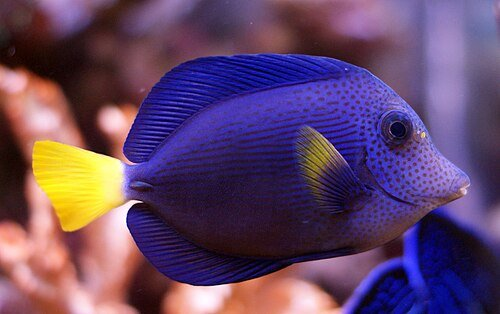

# Cirujano púrpura — *Zebrasoma xanthurum* (Blyth, 1852)

> Archivo generado desde `especies/datos/catalogo_inicial.json` con `especies/herramientas/generar_fichas.py`. No editar a mano.

*Imagen ilustrativa generada con IA por Brayan (2026-11-16). No es una fotografía de un ejemplar real; puede contener errores anatómicos.*

**Grupo:** pez  
**Otros nombres:** Purple tang, Yellowtail tang  
**Fecha de consulta:** 2026-11-16  
**Confianza global:** media  
**Estado:** verificada; pendiente de revisión del equipo

## Ficha AIRI

| Campo | Valor |
|---|---|
| Nombre común | Cirujano púrpura |
| Nombre científico | *Zebrasoma xanthurum* |
| Temperamento | Semiagresivo *LiveAquaria lo clasifica como semiagresivo, pero advierte que puede ser muy agresivo.* |
| Comportamiento | Territorial. Puede ser muy agresivo con peces de forma parecida, sobre todo otros cirujanos Zebrasoma. Necesita espacio libre para nadar y escondites. |
| Adecuado para arrecife | Sí. LiveAquaria lo considera compatible con arrecife; no hay verificación independiente. |
| Tipo de alimentación | Herbívoro: algas filamentosas, alga marina seca, algas al menos 3 veces por semana. |
| Temperatura | 22.2–25.6 °C *Discrepancia: el límite inferior de acuario (22.2 °C) está por debajo del mínimo natural indicado por FishBase (24 °C).* |
| Litraje recomendado | 492.1 L (130 gal EE. UU.). *Es el mínimo recomendado por una sola fuente comercial; ninguna fuente científica consultada establece un litraje.* |
| Tamaño adulto | 36.7 cm (longitud total). Al venderse mide 2.5–17.8 cm (juvenil o subadulto). *Diferencia importante entre fuentes: FishBase registra 36.7 cm de longitud total (longitud habitual 10 cm); LiveAquaria indica que los adultos llegan a 10 in (≈ 25.4 cm).* |

## Detalle verificado

| Campo | Dato | Confianza | Fuentes |
|---|---|---|---|
| Clasificación taxonómica | Clase Teleostei; orden Acanthuriformes; familia Acanthuridae; subfamilia Acanthurinae. WoRMS AphiaID 219681 (aceptado). Sinónimos: Acanthurus xanthurus Blyth, 1852 (combinación original). | alta | [worms_zebrasoma_xanthurum](https://www.marinespecies.org/aphia.php?p=taxdetails&id=219681), [fishbase_zebrasoma_xanthurum](https://www.fishbase.se/summary/Zebrasoma-xanthurum.html) |
| Hábitat natural | A menudo en grupos en zonas ricas en coral o sobre fondos rocosos (FishBase). LiveAquaria indica que suele vivir solo, aunque a veces forma cardúmenes en el sur del Mar Rojo. Profundidad: 0–20 m (habitual 2–20 m). Distribución: Océano Índico occidental: del Mar Rojo al golfo Pérsico; registrado en Maldivas. | media | [fishbase_zebrasoma_xanthurum](https://www.fishbase.se/summary/Zebrasoma-xanthurum.html) |
| Tamaño adulto | Máx. 36.7 cm (longitud total). Diferencia importante entre fuentes: FishBase registra 36.7 cm de longitud total (longitud habitual 10 cm); LiveAquaria indica que los adultos llegan a 10 in (≈ 25.4 cm). | baja | [fishbase_zebrasoma_xanthurum](https://www.fishbase.se/summary/Zebrasoma-xanthurum.html), [liveaquaria_zebrasoma_xanthurum](https://www.liveaquaria.com/products/purple-tang) |
| Alimentación | Herbívoro: por sus dientes faríngeos, FishBase deduce que come sobre todo algas filamentosas. En acuario necesita abundantes algas marinas, al menos tres veces por semana. | alta | [fishbase_zebrasoma_xanthurum](https://www.fishbase.se/summary/Zebrasoma-xanthurum.html), [liveaquaria_zebrasoma_xanthurum](https://www.liveaquaria.com/products/purple-tang) |
| Temperatura del agua | Acuario: 22.2–25.6 °C (72–78 °F). Medio natural: 24–28 °C. Discrepancia: el límite inferior de acuario (22.2 °C) está por debajo del mínimo natural indicado por FishBase (24 °C). | baja | [liveaquaria_zebrasoma_xanthurum](https://www.liveaquaria.com/products/purple-tang), [fishbase_zebrasoma_xanthurum](https://www.fishbase.se/summary/Zebrasoma-xanthurum.html) |
| Rango de pH | Fuente de acuario: 8.1–8.4. Rango prudente AIRI: 8.1–8.3. Criterio: Intersección con la tabla MSD para agua salada (7.8–8.3). | media | [liveaquaria_zebrasoma_xanthurum](https://www.liveaquaria.com/products/purple-tang), [msd_tabla_referencia](https://www.msdvetmanual.com/multimedia/table/normal-reference-ranges-for-routine-water-quality-analysis), [msd_capitulo](https://www.msdvetmanual.com/exotic-and-laboratory-animals/aquatic-systems/environmental-diseases-of-aquatic-animals-in-aquatic-systems) |
| Salinidad | 1.020–1.025 de gravedad específica (adimensional). Agua de mar media: 35 ppt (UF/IFAS). No se convierte a ppt porque la equivalencia depende de la temperatura. | media | [liveaquaria_zebrasoma_xanthurum](https://www.liveaquaria.com/products/purple-tang), [ufifas_ph_sal_temp](https://waterwatch.ifas.ufl.edu/media/waterwatchifasufledu/FactSheet_pH_Sal_Temp.pdf) |
| Volumen mínimo | 492.1 L (130 gal EE. UU.). Justificación: Cifra de LiveAquaria (130 gal). Necesita mucho espacio libre para nadar, buena iluminación y escondites. | baja | [liveaquaria_zebrasoma_xanthurum](https://www.liveaquaria.com/products/purple-tang), [fishbase_zebrasoma_xanthurum](https://www.fishbase.se/summary/Zebrasoma-xanthurum.html) |
| Comportamiento | Puede ser muy agresivo y no tolera compañeros de forma corporal parecida, sobre todo otros cirujanos del género Zebrasoma (LiveAquaria). | media | [fishbase_zebrasoma_xanthurum](https://www.fishbase.se/summary/Zebrasoma-xanthurum.html), [liveaquaria_zebrasoma_xanthurum](https://www.liveaquaria.com/products/purple-tang) |
| Territorialidad y refugio | Muy territorial con peces de forma corporal parecida, en especial otros Zebrasoma. | media | [liveaquaria_zebrasoma_xanthurum](https://www.liveaquaria.com/products/purple-tang), [fishbase_zebrasoma_xanthurum](https://www.fishbase.se/summary/Zebrasoma-xanthurum.html) |
| Compatibilidad con arrecife | sí (según la fuente; sin verificación independiente) | baja | [liveaquaria_zebrasoma_xanthurum](https://www.liveaquaria.com/products/purple-tang) |
| Convivencia: condiciones | Sin otros cirujanos Zebrasoma ni peces de forma parecida. · Dieta rica en algas. | baja | [liveaquaria_zebrasoma_xanthurum](https://www.liveaquaria.com/products/purple-tang), [fishbase_zebrasoma_xanthurum](https://www.fishbase.se/summary/Zebrasoma-xanthurum.html) |
| Convivencia: riesgos | Agresión fuerte hacia otros cirujanos, en especial Zebrasoma (por ejemplo, el cirujano amarillo del catálogo). | baja | [liveaquaria_zebrasoma_xanthurum](https://www.liveaquaria.com/products/purple-tang), [fishbase_zebrasoma_xanthurum](https://www.fishbase.se/summary/Zebrasoma-xanthurum.html) |
| Conservación | Preocupación menor (LC), evaluada el 07/05/2010, según FishBase. | media | [fishbase_zebrasoma_xanthurum](https://www.fishbase.se/summary/Zebrasoma-xanthurum.html) |

**Regla AIRI:** compartir rangos de agua no implica compatibilidad entre especies. Los rangos de acuario provienen de una fuente comercial y no son límites veterinarios.

## Fuentes

- **worms_zebrasoma_xanthurum** (taxonomía): WoRMS — Zebrasoma xanthurum (Blyth, 1852) (AphiaID 219681). <https://www.marinespecies.org/aphia.php?p=taxdetails&id=219681>. Consultada el 2026-11-16.
- **fishbase_zebrasoma_xanthurum** (biología): FishBase — Zebrasoma xanthurum (Blyth, 1852). <https://www.fishbase.se/summary/Zebrasoma-xanthurum.html>. Consultada el 2026-11-16.
- **liveaquaria_zebrasoma_xanthurum** (comercial): LiveAquaria — Purple Tang. <https://www.liveaquaria.com/products/purple-tang>. Consultada el 2026-11-16.
- **msd_tabla_referencia** (veterinaria): MSD Veterinary Manual — “Normal” Reference Ranges for Routine Water Quality Analysis. <https://www.msdvetmanual.com/multimedia/table/normal-reference-ranges-for-routine-water-quality-analysis>. Consultada el 2026-11-12. Reutilizada del registro del motor (motor/airi_motor/datos/fuentes.json); no se volvió a consultar para estas fichas.
- **ufifas_ph_sal_temp** (institucional): UF/IFAS — pH, Salinity and Temperature (hoja informativa). <https://waterwatch.ifas.ufl.edu/media/waterwatchifasufledu/FactSheet_pH_Sal_Temp.pdf>. Consultada el 2026-11-12. Reutilizada del registro del motor (motor/airi_motor/datos/fuentes.json); no se volvió a consultar para estas fichas.
- **msd_capitulo** (veterinaria): MSD Veterinary Manual — Environmental Diseases of Aquatic Animals in Aquatic Systems. <https://www.msdvetmanual.com/exotic-and-laboratory-animals/aquatic-systems/environmental-diseases-of-aquatic-animals-in-aquatic-systems>. Consultada el 2026-11-12. Reutilizada del registro del motor (motor/airi_motor/datos/fuentes.json); no se volvió a consultar para estas fichas.
