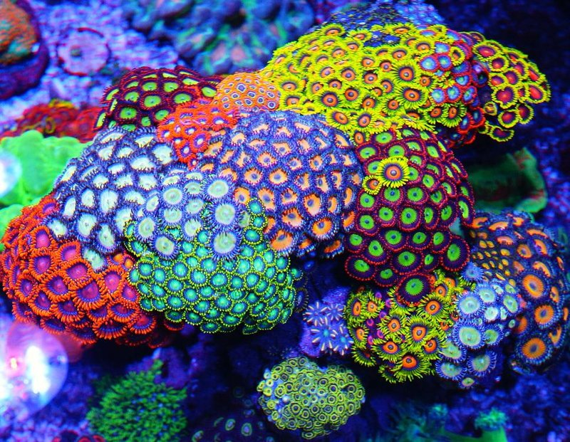

# Zoántidos — *Zoanthus sp.* Lamarck, 1801 (género)

> Archivo generado desde `especies/datos/catalogo_inicial.json` con `especies/herramientas/generar_fichas.py`. No editar a mano.

*Imagen ilustrativa generada con IA por Brayan (2026-11-16). No es una fotografía de un ejemplar real; puede contener errores anatómicos.*

**Grupo:** coral  
**Otros nombres:** Zoanthids, Zoas, Colony polyps, Button polyps  
**Fecha de consulta:** 2026-11-16  
**Confianza global:** baja  
**Estado:** verificada; pendiente de revisión del equipo

## Ficha AIRI

| Campo | Valor |
|---|---|
| Nombre común | Zoántidos |
| Nombre científico | *Zoanthus sp.* |
| Temperamento | Semiagresivo *LiveAquaria los clasifica como semiagresivos; Saltwaterfish, como pacíficos.* |
| Comportamiento | Sociable. Fáciles y aptos para principiantes. Se extienden rápido formando alfombras de colores; hay que dejarles espacio. |
| Adecuado para arrecife | Sí. Quality Marine, LiveAquaria y Saltwaterfish los consideran aptos para arrecife. |
| Tipo de alimentación | Fotosintético: luz (fotosíntesis), alimento planctónico ocasional, calcio, estroncio, yodo y magnesio. |
| Temperatura | 22.2–25.6 °C *Rango de Quality Marine (LiveAquaria no lo publica).* |
| Litraje recomendado | 189.2 L (50 gal EE. UU.). *Es el mínimo de una sola fuente comercial.* |
| Tamaño adulto | null (no verificado). *Ninguna fuente indica un tamaño máximo: forman colonias que se extienden por la roca.* |

## Detalle verificado

| Campo | Dato | Confianza | Fuentes |
|---|---|---|---|
| Clasificación taxonómica | Clase Anthozoa (Hexacorallia); orden Zoantharia; familia Zoanthidae. WoRMS AphiaID 206284 (aceptado). Ficha a nivel de género: los zoántidos se venden por variedades de color (Zoanthus sp.), no por especie. WoRMS reconoce numerosas especies en el género. | alta | [worms_zoanthus_sp](https://www.marinespecies.org/aphia.php?p=taxdetails&id=206284) |
| Hábitat natural | Zonas de cascajo rocoso, generalmente en bahías o lagunas cerca de la superficie (Quality Marine). Profundidad: no indicada. Distribución: No indicada para el género en las fuentes consultadas. | baja | [qualitymarine_zoanthus_sp](https://www.qualitymarine.com/quality-marine/coral/polyps-button-zoanthid/zoanthid/zoa-purple-mouth-green-ring-skirt-mean-green-55616/) |
| Tamaño adulto | null (no verificado). Ninguna fuente indica un tamaño máximo: forman colonias que se extienden por la roca. | baja | [qualitymarine_zoanthus_sp](https://www.qualitymarine.com/quality-marine/coral/polyps-button-zoanthid/zoanthid/zoa-purple-mouth-green-ring-skirt-mean-green-55616/) |
| Alimentación | Fotosintéticos: obtienen la mayor parte de sus nutrientes por fotosíntesis, y las tomas ocasionales de alimento planctónico les benefician. Se recomiendan calcio, estroncio, yodo, magnesio y oligoelementos (Quality Marine). | media | [qualitymarine_zoanthus_sp](https://www.qualitymarine.com/quality-marine/coral/polyps-button-zoanthid/zoanthid/zoa-purple-mouth-green-ring-skirt-mean-green-55616/) |
| Temperatura del agua | Acuario: 22.2–25.6 °C (72–78 °F). Ninguna fuente científica consultada indica rango de temperatura para este taxón. | baja | [qualitymarine_zoanthus_sp](https://www.qualitymarine.com/quality-marine/coral/polyps-button-zoanthid/zoanthid/zoa-purple-mouth-green-ring-skirt-mean-green-55616/) |
| Rango de pH | Fuente de acuario: 8.1–8.4. Rango prudente AIRI: 8.1–8.3. Criterio: Intersección con la tabla MSD para agua salada (7.8–8.3). | media | [qualitymarine_zoanthus_sp](https://www.qualitymarine.com/quality-marine/coral/polyps-button-zoanthid/zoanthid/zoa-purple-mouth-green-ring-skirt-mean-green-55616/), [msd_tabla_referencia](https://www.msdvetmanual.com/multimedia/table/normal-reference-ranges-for-routine-water-quality-analysis), [msd_capitulo](https://www.msdvetmanual.com/exotic-and-laboratory-animals/aquatic-systems/environmental-diseases-of-aquatic-animals-in-aquatic-systems) |
| Salinidad | 1.023–1.025 de gravedad específica (adimensional). Agua de mar media: 35 ppt (UF/IFAS). No se convierte a ppt porque la equivalencia depende de la temperatura. | media | [qualitymarine_zoanthus_sp](https://www.qualitymarine.com/quality-marine/coral/polyps-button-zoanthid/zoanthid/zoa-purple-mouth-green-ring-skirt-mean-green-55616/), [ufifas_ph_sal_temp](https://waterwatch.ifas.ufl.edu/media/waterwatchifasufledu/FactSheet_pH_Sal_Temp.pdf) |
| Volumen mínimo | 189.2 L (50 gal EE. UU.). Justificación: Cifra de Saltwaterfish («Minimum Tank Size: 50 Gallons»). | baja | [saltwaterfish_zoanthus_sp](https://www.saltwaterfish.com/product-blue-green-zoanthid) |
| Comportamiento | Fáciles de mantener y de propagar; buenos para principiantes. Se extienden y reproducen con facilidad (Quality Marine). LiveAquaria los clasifica como semiagresivos. | media | [qualitymarine_zoanthus_sp](https://www.qualitymarine.com/quality-marine/coral/polyps-button-zoanthid/zoanthid/zoa-purple-mouth-green-ring-skirt-mean-green-55616/) |
| Territorialidad y refugio | Se extienden por la roca; necesitan espacio respecto a otros corales. | media | [qualitymarine_zoanthus_sp](https://www.qualitymarine.com/quality-marine/coral/polyps-button-zoanthid/zoanthid/zoa-purple-mouth-green-ring-skirt-mean-green-55616/) |
| Compatibilidad con arrecife | sí (según la fuente; sin verificación independiente) | baja | [qualitymarine_zoanthus_sp](https://www.qualitymarine.com/quality-marine/coral/polyps-button-zoanthid/zoanthid/zoa-purple-mouth-green-ring-skirt-mean-green-55616/) |
| Convivencia: condiciones | Acuario bien establecido. · Luz y corriente moderadas. · Espacio respecto a otros corales. | baja | [qualitymarine_zoanthus_sp](https://www.qualitymarine.com/quality-marine/coral/polyps-button-zoanthid/zoanthid/zoa-purple-mouth-green-ring-skirt-mean-green-55616/) |
| Convivencia: riesgos | No toleran medicamentos con cobre. · Pueden invadir el espacio de otros corales. | baja | [qualitymarine_zoanthus_sp](https://www.qualitymarine.com/quality-marine/coral/polyps-button-zoanthid/zoanthid/zoa-purple-mouth-green-ring-skirt-mean-green-55616/) |
| Conservación | No aplica (ficha de género). | media | [worms_zoanthus_sp](https://www.marinespecies.org/aphia.php?p=taxdetails&id=206284) |

**Regla AIRI:** compartir rangos de agua no implica compatibilidad entre especies. Los rangos de acuario provienen de una fuente comercial y no son límites veterinarios.

## Fuentes

- **worms_zoanthus_sp** (taxonomía): WoRMS — Zoanthus Lamarck, 1801 (género) (AphiaID 206284). <https://www.marinespecies.org/aphia.php?p=taxdetails&id=206284>. Consultada el 2026-11-16.
- **qualitymarine_zoanthus_sp** (comercial): Quality Marine — Mean Green Colony Polyp (Zoanthus). <https://www.qualitymarine.com/quality-marine/coral/polyps-button-zoanthid/zoanthid/zoa-purple-mouth-green-ring-skirt-mean-green-55616/>. Consultada el 2026-11-16.
- **saltwaterfish_zoanthus_sp** (comercial): Saltwaterfish — Zoanthid: Blue/Green. <https://www.saltwaterfish.com/product-blue-green-zoanthid>. Consultada el 2026-11-16.
- **msd_tabla_referencia** (veterinaria): MSD Veterinary Manual — “Normal” Reference Ranges for Routine Water Quality Analysis. <https://www.msdvetmanual.com/multimedia/table/normal-reference-ranges-for-routine-water-quality-analysis>. Consultada el 2026-11-12. Reutilizada del registro del motor (motor/airi_motor/datos/fuentes.json); no se volvió a consultar para estas fichas.
- **ufifas_ph_sal_temp** (institucional): UF/IFAS — pH, Salinity and Temperature (hoja informativa). <https://waterwatch.ifas.ufl.edu/media/waterwatchifasufledu/FactSheet_pH_Sal_Temp.pdf>. Consultada el 2026-11-12. Reutilizada del registro del motor (motor/airi_motor/datos/fuentes.json); no se volvió a consultar para estas fichas.
- **liveaquaria_zoanthus_sp** (comercial): LiveAquaria — Colony Polyp, Zoanthus Corals (Zoanthus sp.). <https://www.liveaquaria.com/products/colony-polyp-zoanthus-corals>. Consultada el 2026-11-16.
- **msd_capitulo** (veterinaria): MSD Veterinary Manual — Environmental Diseases of Aquatic Animals in Aquatic Systems. <https://www.msdvetmanual.com/exotic-and-laboratory-animals/aquatic-systems/environmental-diseases-of-aquatic-animals-in-aquatic-systems>. Consultada el 2026-11-12. Reutilizada del registro del motor (motor/airi_motor/datos/fuentes.json); no se volvió a consultar para estas fichas.
