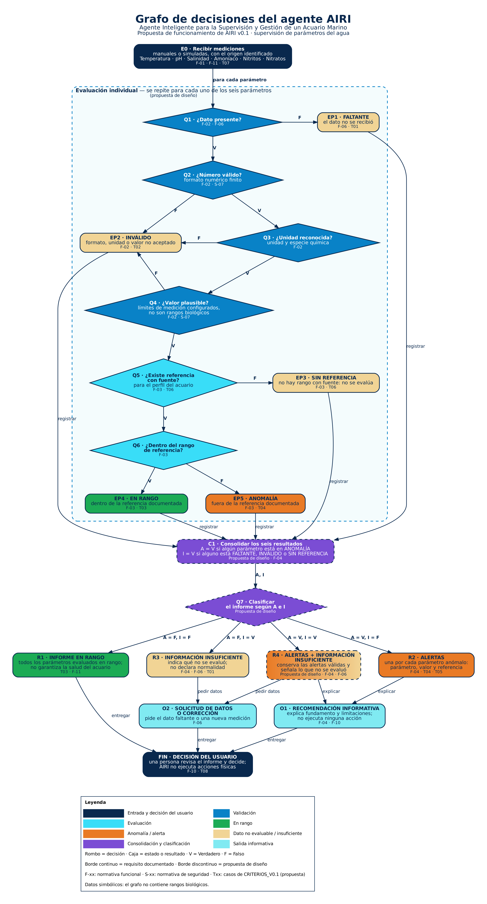

# Grafo de decisiones del agente AIRI

**Actividad:** Fundamentos de la IA — grafo relacionado con el proyecto AIRI.
**Estado:** representación académica del funcionamiento de AIRI, elaborada en v0.1 como propuesta. **Desde v0.4 está implementado**: el motor de análisis ([`motor/`](../motor/README.md) en Python y [`interfaz/motor/`](../interfaz/motor/README.md) en JavaScript) sigue este grafo nodo por nodo, y sus pruebas comprueban que cada paso del recorrido existe en `grafo_decisiones_airi.dot`. El notebook de Colab sigue usando valores **simulados** para demostrar el recorrido; las referencias reales del motor están en [`motor/REFERENCIAS.md`](../motor/REFERENCIAS.md).

## Entregable principal: simulación interactiva en Google Colab

[](https://colab.research.google.com/github/Antoniii28/Airi/blob/feature/grafo-interactivo-airi/grafo/AIRI_Grafo_Interactivo.ipynb)

[`AIRI_Grafo_Interactivo.ipynb`](AIRI_Grafo_Interactivo.ipynb) construye el grafo desde cero en Python (Matplotlib + ipywidgets, ya incluidos en Colab) y permite:

- elegir uno de siete escenarios simulados o editar las mediciones de los seis parámetros;
- **reproducir automáticamente** el recorrido, como un video, desde el estado inicial (E0) hasta el estado final (FIN), con **Pausar**, **Continuar**, **Reiniciar** y velocidad Lenta (1.5 s), Normal (0.8 s) o Rápida (0.3 s) por paso; *Siguiente paso* queda como avance manual opcional;
- ver el **recorrido resaltado** (`×n` = número de parámetros que pasaron por cada transición) y seguir un solo parámetro;
- leer el **panel de resultados**: estado de cada parámetro, valores de A e I, alertas, recomendaciones informativas y datos solicitados;
- **reiniciar** y probar otro caso.

Uso: abrir en Colab → *Entorno de ejecución → Ejecutar todo*. No requiere instalar paquetes ni cambiar rutas. Si el repositorio es privado, Colab pedirá autorizar el acceso a GitHub.

| Escenario simulado | Resultado |
|---|---|
| 1 · Parámetros dentro de las referencias simuladas | R1 · informe en rango |
| 2 · Una anomalía | R2 · 1 alerta |
| 3 · Varias anomalías | R2 · 3 alertas |
| 4 · Información incompleta | R3 · 2 datos faltantes |
| 5 · Datos inválidos | R3 · formato, unidad y valor no plausible |
| 6 · Anomalías + información insuficiente | R4 · 2 alertas y 2 datos no evaluables |
| 7 · Referencia no disponible | R3 · nitratos sin referencia |

⚠ Las mediciones, los límites de captura y las referencias del notebook son **simulados, sin fuente biológica**: sirven solo para demostrar el recorrido del grafo.

## Versión estática (complemento)



| Archivo | Uso |
|---|---|
| [`AIRI_Grafo_Interactivo.ipynb`](AIRI_Grafo_Interactivo.ipynb) | Notebook interactivo para Google Colab (entregable principal) |
| [`grafo_decisiones_airi.png`](grafo_decisiones_airi.png) | Imagen para presentar (200 dpi) |
| [`grafo_decisiones_airi.pdf`](grafo_decisiones_airi.pdf) | Versión vectorial para imprimir |
| [`grafo_decisiones_airi.svg`](grafo_decisiones_airi.svg) | Versión vectorial para web |
| [`grafo_decisiones_airi.dot`](grafo_decisiones_airi.dot) | Código fuente Graphviz que genera las tres anteriores |

## 1. Tipo de grafo

Es un **grafo dirigido acíclico de decisiones y estados del agente**. Cada nodo es un paso, una decisión o un resultado; cada arista es una transición con su condición. Al no tener ciclos, todo recorrido termina en un único nodo final.

Se relaciona con el modelo de agente de Russell y Norvig (cap. 2): **percepción** (recibir mediciones) → **razonamiento** (validar, evaluar, clasificar) → **acción**, que en AIRI es únicamente informativa.

Los valores del agua **no son nodos**. Esto lo diferencia del grafo de estados del prototipo anterior `Acuario-IA`, que representaba combinaciones de temperatura, salinidad y pH para algoritmos de búsqueda.

## 2. Cómo leerlo

- **Rombo:** decisión con salidas **V** (Verdadero) y **F** (Falso).
- **Caja:** estado de un parámetro o resultado del informe.
- **Borde continuo:** requisito documentado. **Borde discontinuo:** decisión de diseño propuesta.
- Las decisiones se identifican con **Q** (y no con V) para no confundirlas con el valor lógico V.
- Los colores siguen la **paleta V2** de [identidad visual](../identidad-visual/README.md).

## 3. Nodos (21)

| ID | Nodo | Tipo | Fundamento |
|---|---|---|---|
| E0 | Recibir mediciones manuales o simuladas con el origen identificado | Entrada | F-01, F-11, T07 |
| Q1 | ¿Dato presente? | Validación | F-02, F-06 |
| Q2 | ¿Número válido? (formato numérico finito) | Validación | F-02, S-07 |
| Q3 | ¿Unidad reconocida? (unidad y especie química) | Validación | F-02 |
| Q4 | ¿Valor plausible? (límites de medición configurados) | Validación | F-02, S-07 |
| Q5 | ¿Existe referencia con fuente para el perfil del acuario? | Evaluación | F-03, T06 |
| Q6 | ¿Dentro del rango de referencia? | Evaluación | F-03 |
| EP1 | FALTANTE | Estado del parámetro | F-06, T01 |
| EP2 | INVÁLIDO | Estado del parámetro | F-02, T02 |
| EP3 | SIN REFERENCIA | Estado del parámetro | F-03, T06 |
| EP4 | EN RANGO | Estado del parámetro | F-03, T03 |
| EP5 | ANOMALÍA | Estado del parámetro | F-03, T04 |
| C1 | Consolidar los seis resultados y calcular A e I | Consolidación | Propuesta de diseño, F-04 |
| Q7 | Clasificar el informe según A e I | Decisión | Propuesta de diseño |
| R1 | Informe en rango (no garantiza la salud del acuario) | Resultado | T03, F-11 |
| R2 | Alertas: una por parámetro anómalo | Resultado | F-04, T04, T05 |
| R3 | Información insuficiente (no declara normalidad) | Resultado | F-04, F-06, T01 |
| R4 | Alertas + información insuficiente | Resultado | Propuesta de diseño, F-04, F-06 |
| O1 | Recomendación informativa | Salida | F-04, F-10 |
| O2 | Solicitud de datos o corrección | Salida | F-06 |
| FIN | Decisión del usuario; AIRI no ejecuta acciones físicas | Fin | F-10, T08 |

Q1–Q6 y EP1–EP5 forman el bloque de **evaluación individual**, que se aplica a cada uno de los seis parámetros documentados: temperatura, pH, salinidad, amoníaco, nitritos y nitratos.

## 4. Transiciones (30)

| Origen | Condición | Destino |
|---|---|---|
| E0 | para cada parámetro | Q1 |
| Q1 | F / V | EP1 / Q2 |
| Q2 | F / V | EP2 / Q3 |
| Q3 | F / V | EP2 / Q4 |
| Q4 | F / V | EP2 / Q5 |
| Q5 | F / V | EP3 / Q6 |
| Q6 | V / F | EP4 / EP5 |
| EP1…EP5 | registrar | C1 |
| C1 | A, I | Q7 |
| Q7 | A = F, I = F | R1 |
| Q7 | A = V, I = F | R2 |
| Q7 | A = F, I = V | R3 |
| Q7 | A = V, I = V | R4 |
| R2, R4 | explicar | O1 |
| R3, R4 | pedir datos | O2 |
| R1, O1, O2 | entregar | FIN |

## 5. Lógica de clasificación (propuesta de diseño)

- **A** = V si al menos un parámetro está en ANOMALÍA.
- **I** = V si al menos un parámetro está FALTANTE, INVÁLIDO o SIN REFERENCIA.

| A | I | Resultado |
|---|---|---|
| F | F | R1 · Informe en rango |
| V | F | R2 · Alertas |
| F | V | R3 · Información insuficiente |
| V | V | R4 · Alertas + información insuficiente |

Garantías:
1. AIRI solo informa "en rango" cuando A = F e I = F. **Nunca declara normalidad si faltan datos.**
2. Un dato faltante **no oculta** las anomalías de otros parámetros válidos (R4).
3. Lo desconocido no se convierte en F: un parámetro sin dato o sin referencia queda como **no evaluado**.

Esta lógica amplía la propuesta global de [`CRITERIOS_V0.1.md`](https://github.com/Antoniii28/Airi/blob/docs/planificacion-airi-v0.1-20261111/docs/CRITERIOS_V0.1.md) (`A = D ∧ ¬R`, `N = D ∧ R`, `I = ¬D`) aplicándola por parámetro. La evaluación por parámetro y la clasificación por A e I son **propuestas de diseño aprobadas para este grafo**, no reglas que ya estuvieran documentadas.

## 6. Requisitos documentados y propuestas

**Documentados en este repositorio:**
- Normativa funcional F-01 a F-11: [`02_normativa_basica.md`](../documentacion/02_normativa_basica.md).
- Medidas de seguridad S-01 a S-12: [`03_normativa_seguridad.md`](../documentacion/03_normativa_seguridad.md).
- Casos T01–T08 y lógica mínima: `docs/CRITERIOS_V0.1.md` en la rama `docs/planificacion-airi-v0.1-20261111` (propuesta pendiente de aprobación).

**Propuestas de diseño (borde discontinuo):** el bloque de evaluación individual, C1, Q7 y R4.

**Fuera del alcance de este grafo:** compatibilidad de especies (F-05, prevista para v0.2) y reconocimiento visual (F-07 a F-09, previsto para v0.5).

## 7. Limitaciones

- Los datos son **simbólicos**: el grafo no contiene rangos biológicos. Los rangos deberán fundamentarse con fuentes especializadas antes de implementarse.
- Q4 usa "límites de medición configurados" para detectar errores de captura; **no son rangos biológicos** ni límites físicos universales.
- Las recomendaciones son informativas: ninguna transición representa una acción física automática.

## 8. Regenerar los archivos

Requiere [Graphviz](https://graphviz.org/). No necesita Python ni otras dependencias.

```bash
cd grafo
dot -Tsvg grafo_decisiones_airi.dot -o grafo_decisiones_airi.svg
dot -Tpng -Gdpi=200 grafo_decisiones_airi.dot -o grafo_decisiones_airi.png
dot -Tpdf grafo_decisiones_airi.dot -o grafo_decisiones_airi.pdf
```

## 9. Verificación realizada (11 de noviembre de 2026)

Con Graphviz 2.43.0, a partir del DOT exportado a JSON:

- 21 nodos lógicos, 30 transiciones, sin aristas duplicadas y todas con etiqueta.
- Q1–Q6 tienen exactamente una salida V y una F; Q7 cubre las cuatro combinaciones de A e I.
- Grafo acíclico; todos los nodos son alcanzables desde E0 y FIN es el único nodo terminal.
- Casos simulados: datos completos y en rango → R1; datos incompletos → R3; una anomalía → R2; tres anomalías → R2 con tres alertas; formato inválido, unidad no reconocida, valor no plausible y sin referencia → R3; anomalía con dato faltante → R4 (con O1 y O2).
- Comprobación exhaustiva de las 117 649 combinaciones posibles de estados para los seis parámetros: nunca se informa "en rango" con anomalías o datos no evaluados, las alertas nunca se pierden y todos los recorridos terminan en FIN.
- SVG válido; PDF de una página con fuentes incrustadas; PNG de 3046 × 5646 px.
- Contraste de texto (WCAG): entre 4.18:1 y 14.76:1. El valor más bajo corresponde al texto blanco sobre azul océano, y supera 3:1, el mínimo para texto grande o en negrita.

## 10. Verificación del notebook (11 de noviembre de 2026)

Realizada **fuera de Colab**, con Python 3.13 y Matplotlib 3.11, ejecutando el código de las celdas del `.ipynb`. Como en ese entorno no estaba instalado `ipywidgets`, los controles se reemplazaron por sustitutos que simulan sus eventos:

- Notebook JSON válido (nbformat 4): 16 celdas, 7 de código, todas compilan y no usan rutas de archivos locales.
- La celda de verificación del propio notebook pasa: estructura del grafo, los siete escenarios con su resultado esperado y las 117 649 combinaciones de estados de los seis parámetros.
- Controles: cambiar de escenario carga las mediciones y reinicia; *Ejecutar simulación* produce el resultado esperado en los siete escenarios; *Siguiente paso* avanza de uno en uno y se detiene en el último paso (muestra entonces el informe); *Recorrido a resaltar* redibuja; *Reiniciar* limpia; editar un valor reinicia la simulación; se acepta coma decimal y se rechazan `nan`, `inf` y `1e999`.
- Se revisaron visualmente las imágenes del grafo inicial, el recorrido completo, el modo paso a paso y el recorrido de un solo parámetro: sin texto encimado.

## 11. Verificación de la reproducción automática (11 de noviembre de 2026)

Igual que la verificación anterior, se hizo **fuera de Colab** (Python 3.13, Matplotlib 3.11). Se ejecutó el código del `.ipynb` dentro de un bucle de eventos `asyncio` real, con sustitutos de los widgets:

- Un clic en *Reproducir* muestra el estado inicial E0 y avanza solo, sin saltar ni repetir pasos, hasta FIN. Ahí se detiene y muestra el informe.
- Velocidad medida: 0.30 s por paso en Rápida, 0.80 s en Normal y 1.55 s en Lenta. Un cambio de velocidad durante la reproducción se aplica desde el paso siguiente.
- *Pausar* conserva el paso y no deja tareas activas; *Continuar* reanuda desde ese paso. Pulsar *Continuar* o *Reproducir* varias veces nunca crea reproducciones simultáneas.
- *Reiniciar*, cambiar de escenario o editar una medición durante la reproducción la detienen; después no queda ninguna tarea dibujando.
- *Siguiente paso* pausa la reproducción y avanza exactamente un paso.
- Los siete escenarios, reproducidos de principio a fin, dan el resultado esperado. Sus resultados, estados y trazas son idénticos a los de la versión anterior (`e8f8f72`).
- La imagen del grafo mide siempre 1280 × 992 px, así que no cambia de tamaño ni de posición. Cada cuadro tarda unos 0.16 s en dibujarse.

Cambios técnicos de esta versión:
- Los cuadros se muestran en un widget de imagen de tamaño fijo, y el informe en un widget HTML.
- Los extremos de las flechas se calculan una sola vez, en lugar de en cada cuadro.
- La lógica, los rangos simulados, los escenarios y el diseño del grafo no cambiaron.

